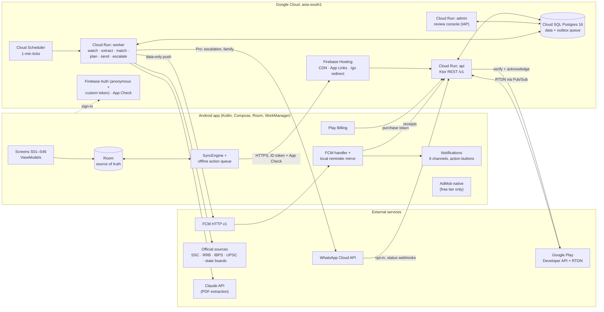

# Sarkari Match — documentation

Sarkari Match is a Hindi-first Android app that alerts government-job aspirants **only** about jobs they are eligible
for, and keeps reminding them until they tap *Applied* or *Not interested*. The free tier carries one light native ad;
Pro (₹199/year or ₹49/season) adds lifecycle alerts after applying, WhatsApp backup and, from P1, family, clash and
certificate alerts.

Everything here is design-level and implementation-ready as of **2026-11-19**. The PRD is the source of truth for
scope. Design, API, backend and frontend were written separately and then reconciled; every contradiction found and
how it was resolved is in [contract-alignment.md](contract-alignment.md).

## What is in this folder

| Path | What it is | Owner / reader |
| --- | --- | --- |
| [PRD.md](PRD.md) | Product requirements: problem, personas, features with P0/P1/P2, reminder table, pricing, ads rule, risks, validation gates | everyone (scope) |
| [contract-alignment.md](contract-alignment.md) | Every cross-doc mismatch → decision → files changed | everyone |
| **design/** | | |
| [design/README.md](design/README.md) | Design package index, key UX decisions, assumptions | design, Android |
| [design/01-screen-inventory.md](design/01-screen-inventory.md) | All 43 screens, 15 sheets, 9 dialogs, 10 overlays with IDs (S/B/D/O), routes, priority; navigation map; deep links | everyone (the IDs are used in every other doc) |
| [design/02-design-system.md](design/02-design-system.md) + [tokens.json](design/tokens.json) | Colours (light/dark, verified contrast), Mukta type scale, spacing, shape, icons, motion, voice | Android |
| [design/03-scenarios.md](design/03-scenarios.md) | 43 user flows; user-job state machine; reminder scheduler (slots, ranks, cap, quiet hours, snooze) | Android, backend |
| [design/04-screens.md](design/04-screens.md) | Per-screen layout, states, exact Hindi/English copy, TalkBack, analytics | Android |
| [design/05-notifications.md](design/05-notifications.md) | Android channels, push templates N-xx, WhatsApp templates W-xx/F-xx, SMS, digest | Android, backend |
| [design/06-components.md](design/06-components.md) | Compose component library (props, variants, states), ad slot | Android |
| [design/prototype/](design/prototype/) | Static HTML prototype (49 frames) and screenshots A–H | everyone |
| **api/** | | |
| [api/openapi.yaml](api/openapi.yaml) | The mobile contract (OpenAPI 3.1, 50 paths), incl. the FCM data payload (`PushData`) | Android, backend |
| [api/README.md](api/README.md) | Conventions: ids and links, headers, auth, errors, idempotency, offline sync, push contract, payments, ads gating, deferred items | Android, backend |
| **backend/** | | |
| [backend/README.md](backend/README.md) | Stack, component diagram, ADRs, cost table, open questions | backend |
| [backend/data-model.md](backend/data-model.md) + [schema.sql](backend/schema.sql) | ERD, PostgreSQL 16 DDL, PII handling, retention, deletion/export | backend |
| [backend/matching-engine.md](backend/matching-engine.md) + [rule.schema.json](backend/rule.schema.json) + [examples/](backend/examples/) | Rule schema, tri-state evaluation, signature-bucket matching, worked examples | backend, curation |
| [backend/ingestion-pipeline.md](backend/ingestion-pipeline.md) | Source watchers, PDF/OCR, LLM extraction, human review console, versioning | backend, curation |
| [backend/reminders-and-delivery.md](backend/reminders-and-delivery.md) | Match state machine, scheduler, outbox, FCM/WhatsApp/SMS, caps, receipts, escalation | backend |
| [backend/payments-and-entitlements.md](backend/payments-and-entitlements.md) | Play Billing, RTDN, trial, UPI links, entitlement truth | backend |
| [backend/security-privacy.md](backend/security-privacy.md) | App Check, auth, rate limits, admin, DPDP Act, ads privacy | backend |
| [backend/operations.md](backend/operations.md) | Observability, CI/CD, runbooks, scaling, week-by-week build plan | backend |
| **frontend/** | | |
| [frontend/README.md](frontend/README.md) | Android architecture, modules, key decisions, contract status | Android |
| [frontend/navigation.md](frontend/navigation.md) | Every screen → route → ViewModel → UiState; deep links; back stack | Android |
| [frontend/data-layer.md](frontend/data-layer.md) | Repositories, Room, sync, offline action queue, auth; repository → operationId table | Android |
| [frontend/state-management.md](frontend/state-management.md) | UDF pattern; Home, Job detail and Paywall examples | Android |
| [frontend/notifications.md](frontend/notifications.md) | FCM handling, channels, actions without opening the app, local reminder mirror, OEM reliability | Android |
| [frontend/billing.md](frontend/billing.md), [ads.md](frontend/ads.md) | Play Billing flow and paywall triggers; free-tier native ad slot and gating | Android |
| [frontend/i18n-and-design-system.md](frontend/i18n-and-design-system.md), [performance-accessibility.md](frontend/performance-accessibility.md), [testing-ci.md](frontend/testing-ci.md), [project-skeleton.md](frontend/project-skeleton.md) | Hindi/IST/₹ handling and theme; budgets and a11y; test pyramid and CI; versions, modules and phased tickets | Android |

## Reading order for a new developer

1. **[PRD.md](PRD.md)** (15 min): what is in scope and what is P0.
2. **[contract-alignment.md](contract-alignment.md)**, first table (5 min): the canonical ids, channels, trial and snooze rules.
3. **[design/01-screen-inventory.md](design/01-screen-inventory.md)** and skim **[design/03-scenarios.md](design/03-scenarios.md)** §0 and §2–§4: the screen IDs and the core loop.
4. **[api/README.md](api/README.md)**, then the parts of **[api/openapi.yaml](api/openapi.yaml)** you will touch.
5. Then by role:
   - **Android:** [frontend/README.md](frontend/README.md) → navigation → data-layer → notifications → state-management → billing/ads → [design/04](design/04-screens.md), [05](design/05-notifications.md), [06](design/06-components.md), [02](design/02-design-system.md) as you build screens → [project-skeleton.md](frontend/project-skeleton.md) for the ticket order.
   - **Backend:** [backend/README.md](backend/README.md) → data-model + schema.sql → matching-engine → reminders-and-delivery → ingestion-pipeline → payments → security-privacy → operations (build plan).
6. Open the [prototype](design/prototype/index.html) whenever copy or layout is in doubt; [design/04](design/04-screens.md) is authoritative for copy.

## Architecture on one page

**How a notice becomes an alert.** A watcher finds a new PDF on an official site → the LLM fills a rule document
(`rule.schema.json`) → a person checks it in the admin console and publishes → the matching job evaluates every
profile signature against the rule and writes `match` rows (eligible / check yourself; "not eligible" is never
pushed) → the planner turns due reminders into `alert` + `delivery` outbox rows (3 pushes/day cap, quiet hours
22:00–07:00, ranks) → the sender pushes data-only FCM → the app renders it in the user's language, posts receipts,
and handles *भर दिया / बाद में / रुचि नहीं* without opening → for Pro, an unopened critical alert escalates to WhatsApp.
Target: first push < 30 min after publish (PRD NFR < 6 h).

**What the server owns:** eligibility, reminder schedule, entitlement (incl. `ads_enabled`), templates.
**What the device owns:** rendering, language, the local reminder mirror (same reminder ids), quiet-hours/cap mirror,
optimistic actions queued for `POST /v1/me/actions:batch`.

## Canonical decisions

| Topic | Decision | Where it is specified |
| --- | --- | --- |
| Android stack | Kotlin 2.4, Jetpack Compose (Material 3), Navigation Compose (type-safe), Hilt, Room, DataStore, WorkManager, Retrofit 3 + OkHttp 5 + kotlinx.serialization, Firebase (Auth, FCM, App Check, Crashlytics, Analytics), Play Billing 9.1; minSdk 26, target 36; 16 modules; download ≤ 10 MB with ads | [frontend/README.md](frontend/README.md), [project-skeleton.md](frontend/project-skeleton.md) |
| Backend stack | Kotlin + Ktor, one image with `api` / `worker` / `admin` roles on Cloud Run (asia-south1); Cloud SQL PostgreSQL 16 as data store **and** job queue (`FOR UPDATE SKIP LOCKED` outbox); Cloud Scheduler 1-minute ticks; no broker, no Redis; Firebase Hosting as CDN front door. Answers the PRD's "Firebase vs own server": own server, Firebase only for Auth/FCM/App Check/Hosting | [backend/README.md](backend/README.md) ADR-01/04/09 |
| Extraction | Claude API with native PDF input and structured output against `rule.schema.json`; a person reviews and publishes every rule; second reviewer for risk-flagged posts | [ingestion-pipeline.md](backend/ingestion-pipeline.md), ADR-07 |
| Auth | Login optional for free alerts: Firebase anonymous sign-in on first launch; phone via **our own OTP** (WhatsApp auth template, DLT SMS fallback) → Firebase custom token, needed only for restore, WhatsApp, family, export, multi-device. App Check (Play Integrity) on every call | [api/README.md](api/README.md) §3, ADR-02 |
| IDs | `notice_id` `n_` · `post_id` `p_` ("the job", shared) · `match_id` `m_` (user × post) · `application_id` `a_` · `event_id` `e_`. Design `jobId` = `match_id` | [api/README.md](api/README.md) §1a |
| Links | `https://sarkarimatch.in/j/{match_id}`, `/p/{post_id}` (shared), `/a/{application_id}`, `/f/{token}`, `/pro`, `/go/{match_id}` (web redirect); `sarkarimatch://job/{match_id}` etc. for pushes. Domain is a placeholder | [api/README.md](api/README.md) §1a, [design/01](design/01-screen-inventory.md) |
| Notification channels | `critical`, `new_match`, `reminders`, `job_updates`, `digest`, `account` — immutable after release; the server sends these IDs | [design/05](design/05-notifications.md) §1, `PushData` |
| Push | Data-only FCM; high priority only when a notification is always shown; payload `PushData` (incl. `reminder_id`, `kind`, `rank`, `apply_url`); receipts drive WhatsApp escalation; one primary alert device | [api/README.md](api/README.md) §10 |
| Reminders | R0 at publish; Rp every 3 days; R3 and R1 at the user's reminder time (default 19:00); R-last 08:00 on the last day; max 3 pushes/day (ranks 1–3 exempt); quiet hours 22:00–07:00 except near-deadline; snooze: tomorrow 09:00 / 2 days before / today 19:00 (2–3 days left) | [design/03](design/03-scenarios.md) §0.2, [reminders-and-delivery.md](backend/reminders-and-delivery.md) §2 |
| Trial | 14 days, server-granted, no payment method. **Offered** on B02 right after the first Applied, **started** only by the user's tap (`POST /v1/me/trial`) | [payments-and-entitlements.md](backend/payments-and-entitlements.md) §5 |
| Billing | Play Billing: product `pro`, base plans `yearly-autorenew` (₹199) and `season-4m-prepaid` (₹49); server verifies and acknowledges; entitlement only from the server. UPI links only in the test flavour unless Play user-choice billing is adopted | [billing.md](frontend/billing.md), ADR-06 |
| Ads | Free tier only; one native ad as the last item of Home (S20) and the digest (S44); never in pushes/WhatsApp, S21, what-you-need, why-you-match, sheets, tracker, onboarding, paywall; non-personalised, `AD_ID` permission removed; hidden for Pro and trial; remote kill switch `config.ads.enabled` | [frontend/ads.md](frontend/ads.md), ADR-10 |
| WhatsApp | Meta Cloud API direct; utility templates only (design `sm_*` names); 30 messages per Pro season; no marketing template (W-90 not sent) | [reminders-and-delivery.md](backend/reminders-and-delivery.md) §3.5/§5 |
| Launch states | Working assumption **Uttar Pradesh + Bihar** (UP in P0; Bihar before launch if curation ≤ 30 min/notice, else P1) + SSC, RRB, IBPS, UPSC; S08 pins `ReferenceBundle.pinned_states` | [ingestion-pipeline.md](backend/ingestion-pipeline.md) §1 |
| Privacy | DPDP Act: no names, Aadhaar or documents; phone optional and encrypted; export and deletion in-app; every alert shows the official source and "not a government app" | [security-privacy.md](backend/security-privacy.md), [data-model.md](backend/data-model.md) |

## Open questions for the founder

1. **Launch states.** Confirm UP + Bihar (drives watchers, curation load, Hindi legacy-font OCR, QA devices). PRD also asks about an existing audience or partners for launch.
2. **Domain.** Buy `sarkarimatch.in` (or choose another) and the SMS short domain (`smch.in` placeholder); App Links and WhatsApp templates depend on it.
3. **UPI in the Play build.** Enrol in Play user-choice billing for India, or keep UPI only in the WhatsApp-test flavour? Needed before P0.
4. **Plans.** Is a 4-month prepaid base plan allowed in Play Console (fallback 3 or 6 months)? Yearly auto-renew or one-time? Season → year upgrade: full ₹199 or prorated?
5. **Ads from day 1?** Or only after the validation test / 30-day retention is known (`config.ads.enabled`)? Who reviews ad quality and the category blocklist?
6. **Meta business verification** needs a registered business (GST/Udyam); this gates WhatsApp in production.
7. **Under-18 users** (17-year-old 10th-pass aspirants): proposal is 18+ accounts with a no-account preview below 18; needs a legal check.
8. **Firebase Auth billing** for anonymous and custom-token users on the legacy tier: confirm it stays free (else switch to own JWT, about 2 days).
9. **Last-day evening reminder.** Add an 18:00 reminder on the last day in addition to 08:00? (PRD has only the morning one.)
10. **Pro-ended WhatsApp (W-90).** Currently not sent (marketing category, no upselling). Keep it that way?
11. **Family alerts by SMS** for members without WhatsApp (P1 cost), and whether S24 alert history should move from P1 to P0.
12. **Copy check.** Gender chip now reads "ट्रांसजेंडर" (the legal term in notices) instead of "अन्य"; confirm with a Hindi copy reviewer.
