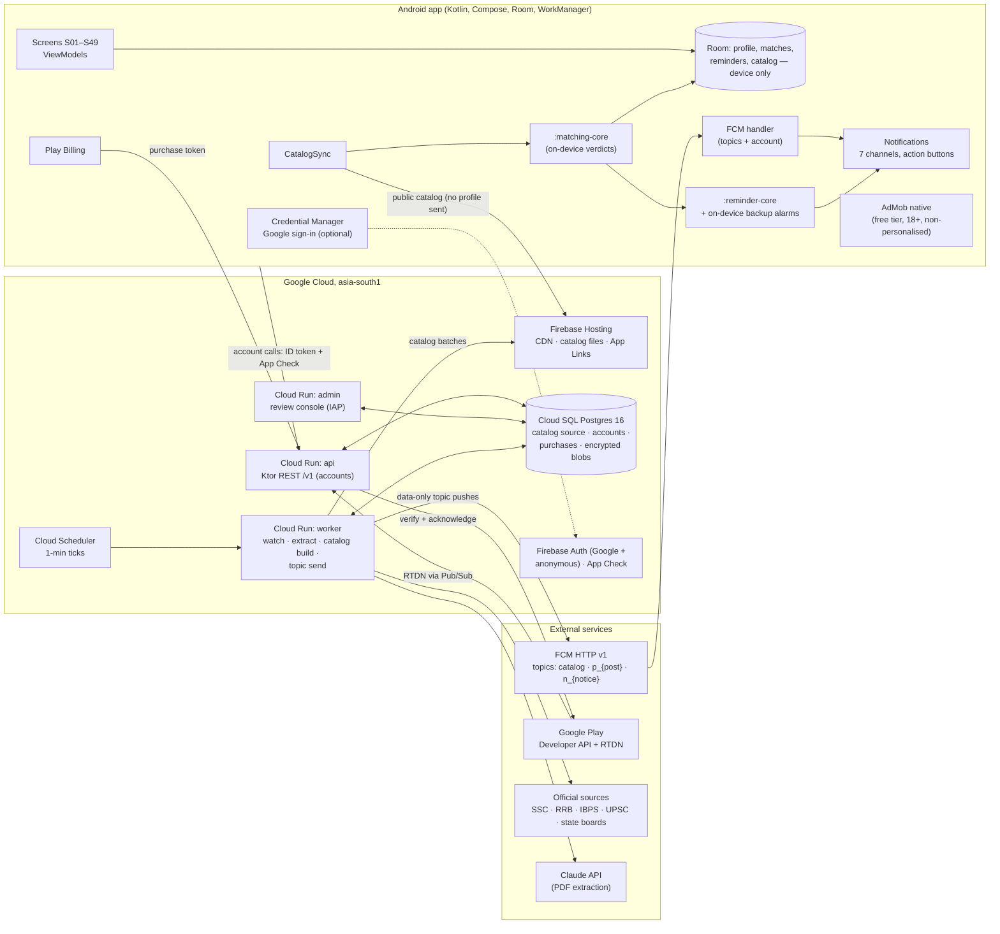

# Sarkari Match — documentation

Sarkari Match is a Hindi-first Android app that alerts government-job aspirants **only** about jobs they are eligible
for, and keeps reminding them until they tap *Applied* or *Not interested*. The free tier carries one light native ad;
Pro (₹199/year or ₹49/season, Google Play Billing only) adds lifecycle alerts after applying, no ads and, from P1,
family, clash and certificate alerts.

**Founder decisions of 2026-11-19** ([PRD.md](PRD.md), top section) are applied across design, API, backend and
frontend: all major Indian languages (hi + en at launch); Google Sign-In or guest, no phone/OTP; Play Billing only;
**the eligibility profile and matching stay on the phone**; light non-personalised ads; **no WhatsApp or SMS** —
FCM push + on-device backup reminders; family alerts to the member's own app; validation as a Play closed test.

Everything here is design-level and implementation-ready as of **2026-11-19**. The PRD is the source of truth for
scope. Design, API, backend and frontend were written separately and then reconciled; every contradiction found and
how it was resolved is in [contract-alignment.md](contract-alignment.md).

## What is in this folder

| Path | What it is | Owner / reader |
| --- | --- | --- |
| [PRD.md](PRD.md) | Product requirements: problem, personas, features with P0/P1/P2, reminder table, pricing, ads rule, risks, validation gates | everyone (scope) |
| [contract-alignment.md](contract-alignment.md) | Every cross-doc mismatch → decision → files changed | everyone |
| **design/** | | |
| [design/README.md](design/README.md) | Design package index, key UX decisions, assumptions | design, Android |
| [design/01-screen-inventory.md](design/01-screen-inventory.md) | All screens, sheets, dialogs and overlays with IDs (S/B/D/O; v1.1: S01–S49 minus retired S11, S12, S33), routes, priority; navigation map; deep links | everyone (the IDs are used in every other doc) |
| [design/02-design-system.md](design/02-design-system.md) + [tokens.json](design/tokens.json) | Colours (light/dark, verified contrast), Mukta type scale + per-script fonts (`font.script.*`), spacing, shape, icons, motion, voice | Android |
| [design/03-scenarios.md](design/03-scenarios.md) | 43 user flows; user-job state machine; reminder scheduler (slots, ranks, cap, quiet hours, snooze) | Android, backend |
| [design/04-screens.md](design/04-screens.md) | Per-screen layout, states, exact Hindi/English copy, TalkBack, analytics | Android |
| [design/05-notifications.md](design/05-notifications.md) | Android channels (7 incl. `family`), push templates N-xx, on-device backup reminders, family alerts, digest (WhatsApp/SMS retired) | Android, backend |
| [design/07-localization.md](design/07-localization.md) | 13 languages, fonts per script, expansion budgets, RTL (Urdu), numerals | Android, content |
| [design/CHANGES-2026-11-19.md](design/CHANGES-2026-11-19.md) | Screen/component/token IDs added and retired by the founder decisions | everyone |
| [design/06-components.md](design/06-components.md) | Compose component library (props, variants, states), ad slot | Android |
| [design/prototype/](design/prototype/) | Static HTML prototype (v1.1: 61 frames incl. Tamil and Urdu RTL previews) and screenshots | everyone |
| **api/** | | |
| [api/openapi.yaml](api/openapi.yaml) | The mobile contract (OpenAPI 3.1, 36 paths): public catalog, accounts, Play purchases, backup, family, reports; FCM data payload (`PushData`) | Android, backend |
| [api/README.md](api/README.md) | Conventions: derived ids and links, headers, Google/guest auth, errors, catalog sync, topics/push contract, payments, ads gating, removed endpoints | Android, backend |
| **backend/** | | |
| [backend/README.md](backend/README.md) | Stack, component diagram, ADRs, cost table, open questions | backend |
| [backend/data-model.md](backend/data-model.md) + [schema.sql](backend/schema.sql) | ERD, PostgreSQL 16 DDL (catalog, locales, minimal accounts), personal-data inventory, retention, deletion | backend |
| [backend/matching-engine.md](backend/matching-engine.md) + [rule.schema.json](backend/rule.schema.json) + [examples/](backend/examples/) | On-device vs server matching decision, rule schema, tri-state evaluation, catalog, worked examples | backend, Android, curation |
| [backend/ingestion-pipeline.md](backend/ingestion-pipeline.md) | Source watchers, PDF/OCR, LLM extraction, human review console, versioning | backend, curation |
| [backend/reminders-and-delivery.md](backend/reminders-and-delivery.md) | Device-side state machine and schedule, FCM topic pushes + on-device backup, family relay, self-test | backend, Android |
| [backend/payments-and-entitlements.md](backend/payments-and-entitlements.md) | Play Billing only, season as prepaid plan, RTDN, trial, entitlement truth, closed-test validation | backend |
| [backend/security-privacy.md](backend/security-privacy.md) | App Check, accounts, rate limits, admin, DPDP Act (minor mode), Play Data safety, ads privacy | backend |
| [backend/operations.md](backend/operations.md) | Observability, CI/CD, runbooks, scaling, week-by-week build plan | backend |
| **frontend/** | | |
| [frontend/README.md](frontend/README.md) | Android architecture, modules, key decisions, contract status | Android |
| [frontend/navigation.md](frontend/navigation.md) | Every screen → route → ViewModel → UiState; deep links; back stack | Android |
| [frontend/data-layer.md](frontend/data-layer.md) | Repositories, Room, catalog sync + on-device matching, local actions, Google sign-in/backup; repository → operationId table | Android |
| [frontend/state-management.md](frontend/state-management.md) | UDF pattern; Home, Job detail and Paywall examples | Android |
| [frontend/notifications.md](frontend/notifications.md) | FCM topic handling, 7 channels, local actions, device schedule + on-device backup reminders, OEM reliability, family | Android |
| [frontend/billing.md](frontend/billing.md), [ads.md](frontend/ads.md) | Play Billing flow and paywall triggers; free-tier native ad slot and gating | Android |
| [frontend/i18n-and-design-system.md](frontend/i18n-and-design-system.md), [performance-accessibility.md](frontend/performance-accessibility.md), [testing-ci.md](frontend/testing-ci.md), [project-skeleton.md](frontend/project-skeleton.md) | 13 languages (resources, fonts per script, RTL, pseudo-locales), IST/₹ and theme; budgets, a11y and minimal metrics; test pyramid and CI; versions, modules and phased tickets | Android |

## Reading order for a new developer

1. **[PRD.md](PRD.md)** (15 min): what is in scope and what is P0.
2. **[contract-alignment.md](contract-alignment.md)**, first table (5 min): the canonical ids, channels, trial and snooze rules.
3. **[design/01-screen-inventory.md](design/01-screen-inventory.md)** and skim **[design/03-scenarios.md](design/03-scenarios.md)** §0 and §2–§4: the screen IDs and the core loop.
4. **[api/README.md](api/README.md)**, then the parts of **[api/openapi.yaml](api/openapi.yaml)** you will touch.
5. Then by role:
   - **Android:** [frontend/README.md](frontend/README.md) → navigation → data-layer → notifications → state-management → billing/ads → [design/04](design/04-screens.md), [05](design/05-notifications.md), [06](design/06-components.md), [02](design/02-design-system.md) as you build screens → [project-skeleton.md](frontend/project-skeleton.md) for the ticket order.
   - **Backend:** [backend/README.md](backend/README.md) → data-model + schema.sql → matching-engine → reminders-and-delivery → ingestion-pipeline → payments → security-privacy → operations (build plan).
6. Open the [prototype](design/prototype/index.html) whenever copy or layout is in doubt; [design/04](design/04-screens.md) is authoritative for copy.

## Architecture on one page

**How a notice becomes an alert.** A watcher finds a new PDF on an official site → the LLM fills a rule document
(`rule.schema.json`) → a person checks it in the admin console and publishes → the worker writes an immutable
**catalog batch** to the CDN and pushes `type=sync` to the FCM topic `catalog` → every phone downloads the batch,
evaluates it against its **own, local** profile with `:matching-core`, stores eligible / check-yourself matches and
composes the "new match" notification in the app language → reminders are planned on the phone (3/day cap, quiet
hours 22:00–07:00, ranks); the server adds topic pushes on `p_{post_id}` for R3/R1/R-last and `n_{notice_id}` for
lifecycle events, and the phone's **on-device backup** fires for R1/R-last if a push is missing → *भर दिया / बाद में /
रुचि नहीं* work from the notification, offline, and never leave the phone. Target: catalog batch out < 5 min after
publish (PRD NFR < 6 h).

**What the server owns:** the public catalog (rules, dates, fees, lifecycle), topic pushes, entitlement (incl.
`ads_enabled`, signed token), minimal accounts, family relay of encrypted watch-lists, encrypted backups it cannot read.
**What the device owns:** the profile, every verdict, matches, the reminder schedule, actions, applications, inbox,
preferences, rendering in 13 languages.

## Canonical decisions

| Topic | Decision | Where it is specified |
| --- | --- | --- |
| Founder decisions 2026-11-19 | Override everything below where they conflict; change set recorded in [contract-alignment.md](contract-alignment.md) #42–#63 | [PRD.md](PRD.md) |
| Android stack | Kotlin 2.4, Jetpack Compose (Material 3), Navigation Compose (type-safe), Hilt, Room, DataStore, WorkManager, Retrofit 3 + OkHttp 5 + kotlinx.serialization, KMP `:matching-core`/`:reminder-core`, Firebase (Auth, FCM, App Check, Crashlytics opt-in — **no Analytics**), Credential Manager, Block Store, Play Billing 9.1, GMA Next-Gen + UMP; minSdk 26, target 36; 18 modules; download ≤ 10 MB with ads | [frontend/README.md](frontend/README.md), [project-skeleton.md](frontend/project-skeleton.md) |
| Backend stack | Kotlin + Ktor, one image with `api` / `worker` / `admin` roles on Cloud Run (asia-south1); Cloud SQL PostgreSQL 16 (catalog source, accounts, purchases, job queue); Cloud Scheduler 1-minute ticks; Firebase Hosting as CDN for the catalog | [backend/README.md](backend/README.md) ADR-01/04/09 |
| **Data & matching** | **Privacy-first (ADR-11):** profile and matching **on the device** against a public CDN catalog (snapshot + immutable batches, `evaluator_min_version`); server stores no DOB/category/PwD/phone; minimal consent log for account features only; **minor mode** (< 18: no account, ads, telemetry) instead of parental consent | [matching-engine.md](backend/matching-engine.md) §0/§4, [data-model.md](backend/data-model.md), [security-privacy.md](backend/security-privacy.md) §6 |
| Extraction | Claude API with native PDF input and structured output against `rule.schema.json`; a person reviews and publishes every rule; second reviewer for risk-flagged posts | [ingestion-pipeline.md](backend/ingestion-pipeline.md), ADR-07 |
| Auth | **Google Sign-In** (Credential Manager → Firebase Auth Google provider) or **guest**. Guests have no server account until trial/purchase/family; then Firebase anonymous, linkable to Google (same uid). No phone, no OTP. Cost $0 without the Identity Platform upgrade; worst case 50K MAU free then ~$0.0055/MAU | [api/README.md](api/README.md) §3, ADR-02 |
| Languages | 13 languages modelled (`LocalizedText` maps, `locale` table with fallback chains, `?locales=` catalog files, per-app locales, per-script downloadable fonts, Urdu RTL, pseudo-locale tests); **hi + en enabled at launch** | ADR-12, [i18n-and-design-system.md](frontend/i18n-and-design-system.md), [design/07](design/07-localization.md) |
| IDs | `notice_id` `n_` · `post_id` `p_` ("the job") · `match_id` `m_` and `application_id` `a_` **derived on the device** from the post id · `event_id` `e_` · `link_id` `f_`. Design `jobId` = `match_id` | [api/README.md](api/README.md) §1a |
| Links | `https://sarkarimatch.in/j/{match_id}`, `/p/{post_id}` (shared), `/a/{application_id}`, `/f/{token}#k={key}` (family; key never reaches the server), `/pro`; `sarkarimatch://job/{match_id}` etc. `/go/` and `sarkarimatch://whatsapp` retired. Domain is a placeholder | [api/README.md](api/README.md) §1a, [design/01](design/01-screen-inventory.md) |
| Notification channels | `critical`, `new_match`, `reminders`, `job_updates`, `digest`, `account`, **`family`** — immutable after release | [design/05](design/05-notifications.md) §1, `PushData` |
| Push | Data-only, **no text**; FCM **topics** `catalog` (sync), `p_{post_id}` (R3/R1/R-last), `n_{notice_id}` (lifecycle) + account pushes; everything else composed on the device; no receipts, no escalation; one primary alert install per account (B15/N-47) | [api/README.md](api/README.md) §10, [reminders-and-delivery.md](backend/reminders-and-delivery.md) |
| Reminders | Computed on the device: R0 at evaluation; Rp every 3 days; R3 and R1 at the user's reminder time (default 19:00); R-last 08:00; **on-device backup** R1 + 30 min, R-last 08:15 (S14/S28, P0, default on); max 3/day (ranks 1–3 exempt); quiet hours 22:00–07:00 except near-deadline; snooze as before | [design/03](design/03-scenarios.md) §0.2, [design/05](design/05-notifications.md) §3.6, [reminders-and-delivery.md](backend/reminders-and-delivery.md) §2–3 |
| Trial | 14 days, server-granted, no payment method. **Offered** on B02 right after the first Applied, **started** only by the user's tap (`POST /v1/me/trial`); guests get an account first (B16) | [payments-and-entitlements.md](backend/payments-and-entitlements.md) §5 |
| Billing | **Play Billing only**: subscription `pro`, base plans `season-4m-prepaid` (₹49, **prepaid**, no auto-renew, top-up; recommended over a one-time product; fallback `P3M`) and `yearly-autorenew` (₹199); server verifies and acknowledges; entitlement + signed token only from the server. No UPI links/gateways | [billing.md](frontend/billing.md), [payments](backend/payments-and-entitlements.md) §1.1, ADR-06 |
| Ads | Free tier only, adults only; one native ad as the last item of Home (S20) and the digest (S44); never in notifications, S21, what-you-need, why-you-match, sheets, tracker, onboarding, paywall; GMA Next-Gen, **UMP** before the first request, **non-personalised** (`npa=1`), `AD_ID` removed; B17 explains; hidden for Pro, trial and minor mode; kill switch `config.ads.enabled` | [frontend/ads.md](frontend/ads.md), ADR-10 |
| WhatsApp / SMS | **None.** No WhatsApp alerts, OTP, templates or opt-in; SMS dropped (would need a phone number) | ADR-05, [reminders-and-delivery.md](backend/reminders-and-delivery.md) §8 |
| Family | Pro (P1): invite link/QR (S48) via the sharesheet → member's own app (S35/S49); end-to-end-encrypted watch-list relayed by the server; N-50…N-54 on channel `family`; no phone numbers | [reminders-and-delivery.md](backend/reminders-and-delivery.md) §5 |
| Validation | Play **closed-testing** build with real Play Billing (≥ 12 testers × 14 days also unlocks production access for new personal accounts); roadmap: weeks 1–5 build → 6–7 test → go/stop → rest of P0 | [operations.md](backend/operations.md) §9, [payments](backend/payments-and-entitlements.md) §6 |
| Launch states | Working assumption **Uttar Pradesh + Bihar** + SSC, RRB, IBPS, UPSC; S08 pins `ReferenceBundle.pinned_states` | [ingestion-pipeline.md](backend/ingestion-pipeline.md) §1 |
| Privacy | DPDP Act: profile never leaves the phone (except the user's own E2E-encrypted backup); no names, phone, Aadhaar, documents; S47 privacy notice + S13 notification explanation; local export and deletion; every alert shows the official source and "not a government app" | [security-privacy.md](backend/security-privacy.md), [data-model.md](backend/data-model.md) |

## Open questions for the founder

1. **Launch states.** Confirm UP + Bihar (drives watchers, curation load, Hindi legacy-font OCR, QA devices). PRD also asks about an existing audience or partners for launch.
2. **Domain.** Buy `sarkarimatch.in` (or choose another); App Links, the catalog CDN host and the `/f/` family page depend on it.
3. **Season length.** Confirm Play Console offers a 4-month (`P4M`) prepaid base plan; else ship 3 months at ₹49 or change the price. Season → year upgrade: full ₹199 or prorated?
4. **Minor mode** (17-year-old Agniveer/NDA/10th-pass aspirants): legal check that an install sending us nothing needs no verifiable parental consent; should minors be able to buy Pro?
5. **Firebase Auth tier.** Confirm on Google's official pricing pages that the project can stay without the Identity Platform upgrade (Google + anonymous free); else budget up to ~$300/month at 1M installs.
6. **Validation metrics.** On-device data means the closed test relies on opt-in identifier-free counters + Play Console. Is that enough for the ≥ 300 profiles / ≥ 100 Applied gates, or do we add an explicit opt-in "test participant" id for the closed test only?
7. **Ads and DPDP.** S47 + B17 + non-personalised ads with no consent toggle — confirm with the legal review; and who reviews ad quality and the category blocklist?
8. **Encrypted backup** in the Play Data safety form (declared conservatively) — confirm with Play policy support.
9. **Last-day evening reminder.** Add an 18:00 reminder on the last day in addition to 08:00? (PRD has only the morning one.)
10. **First non-launch language** for the P1 pilot (Marathi and Bengali are the cheapest: Devanagari / large Hindi-belt-adjacent audiences) and who reviews translations.
11. **Copy check.** Gender chip "ट्रांसजेंडर"; S47 must say profile data is *stored on your phone*; confirm with a Hindi copy reviewer.
