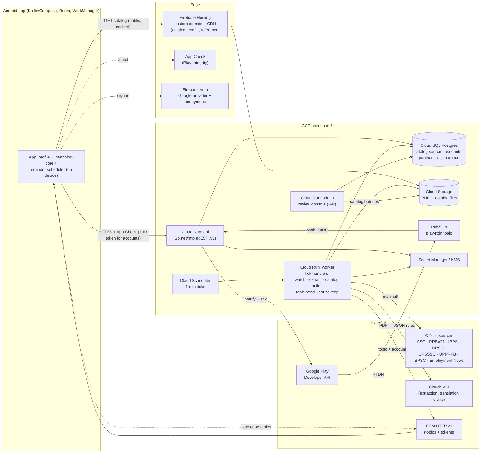

# Sarkari Match: backend architecture

Status: design + first Go implementation, 2026-11-19 ([`backend/`](../../backend/)). Author: backend architecture pass. Inputs: [PRD](../PRD.md),
[screen inventory](../design/01-screen-inventory.md), [frontend notifications](../frontend/notifications.md),
`memory/ideas/sarkari-match-pro/*`.

The mobile contract is in [`../api/openapi.yaml`](../api/openapi.yaml), with conventions in [`../api/README.md`](../api/README.md).

| Doc | What it covers |
|---|---|
| [data-model.md](./data-model.md) + [schema.sql](./schema.sql) | ERD, DDL, PII handling, retention |
| [matching-engine.md](./matching-engine.md) + [rule.schema.json](./rule.schema.json) | Rule schema, tri-state evaluation, bucketed matching, worked examples |
| [ingestion-pipeline.md](./ingestion-pipeline.md) | Source watchers, PDF/OCR, LLM extraction, review console, versioning |
| [reminders-and-delivery.md](./reminders-and-delivery.md) | On-device reminder state machine and schedule, FCM topic backups, family relay, self-test |
| [payments-and-entitlements.md](./payments-and-entitlements.md) | Play Billing (Android) + StoreKit 2 / App Store (iOS), RTDN, App Store Server Notifications V2, season pass (Play prepaid plan / App Store non-renewing), trial, one cross-store entitlement |
| [security-privacy.md](./security-privacy.md) | App Check, auth, rate limits, admin auth, DPDP Act, encryption, retention |
| [operations.md](./operations.md) | Observability, CI/CD, environments, runbooks, scaling, solo-dev build plan |

---

## 1. Constraints that drive every decision

1. **LTV is tiny.** Base-case LTV is about ₹1.6 per install, paid conversion is about 1.2%, and Pro nets about ₹42–169
   ([cac.json](../../memory/ideas/sarkari-match-pro/cac.json)). Infrastructure therefore has to cost **paise per user
   per month**. It also has to be close to free during the 14-day Play closed test and the first 10K users.
2. **One developer runs everything**: product, curation and on-call. That means managed services, a single
   codebase and deployable, a single database, no Kubernetes and no message broker to operate.
3. **Correctness beats latency.** A wrong "eligible" verdict kills trust (the target is under 1% wrong). Eligibility
   is relational and rule-heavy, which favours SQL plus a deterministic, unit-tested rule evaluator over ad-hoc
   document queries.
4. **The load is bursty and fan-out shaped.** About 20–40 notices a month each hit 5–40% of users at once, for
   example 200K pushes in minutes at 1M users. Between bursts there is almost nothing. Reminders follow
   predictable daily peaks in IST.
5. **India first.** Everything runs in `asia-south1` (Mumbai), with DR copies in `asia-south2` (Delhi). Clients are on
   slow networks with 2 GB RAM phones. Delivery has to survive Xiaomi/Vivo/Oppo background-killing.
6. **Minimal PII under the DPDP Act 2023 (founder decisions 2026-11-19).** No names, phone numbers, Aadhaar or
   documents. The eligibility profile and matching stay **on the device** (ADR-11); the server holds the public catalog
   and minimal accounts. Everything is deletable.
7. **No paid messaging.** No WhatsApp, no SMS, no OTP. Delivery = FCM push (APNs via FCM on iOS) + on-device
   reminders. Payments = Google Play Billing on Android, App Store in-app purchase on iOS. Login = free Google
   Sign-In, Sign in with Apple (iOS) or guest.
9. **Android and iOS from one Kotlin Multiplatform codebase** (founder decision 9). The backend is platform-neutral
   except where a store or OS forces a difference: purchases, Apple sign-in token revocation and the APNs block of
   pushes; devices and entitlements carry `platform`.
8. **All major Indian languages.** Hindi, English, Bengali, Marathi, Telugu, Tamil, Gujarati, Kannada, Odia,
   Malayalam, Punjabi, Assamese, Urdu (RTL) are supported by the content model; Hindi + English ship at launch.

## 2. Chosen stack (summary)

| Concern | Choice |
|---|---|
| Language/runtime | **Go 1.24** (founder decision 2026-11-19, ADR-13): one module in [`backend/`](../../backend/), one static binary and one distroless image whose `ROLE` env selects `api`, `worker` or `admin` |
| Compute | **Cloud Run** (`asia-south1`): `api` (min 1), `admin` (min 0, behind IAP), `worker` (tick-driven; always-on above about 300K users) |
| Database | **Cloud SQL for PostgreSQL 16** (`asia-south1`): db-f1-micro during the test, then db-g1-small → custom 2 vCPU + HA at ~1M installs. Holds the catalog source, accounts, purchases; also the job queue (`FOR UPDATE SKIP LOCKED`) |
| Matching | **On the device** with the shared KMP module `:matching-core` against the public **catalog** (CDN files); the server never sees profiles ([matching-engine.md](./matching-engine.md)) |
| Scheduling | **Cloud Scheduler** → authenticated `POST /internal/tick/*` every minute (no broker) |
| Auth | **Firebase Auth**: **Google** provider (Android Credential Manager / Google Sign-In on iOS), **Apple** provider on iOS (Sign in with Apple; refresh token kept sealed only to revoke it at deletion), or **guest** via anonymous auth created only when a server feature needs an account; `linkWithCredential` upgrades a guest with the same uid. Other providers refused. No phone auth, no OTP, no custom tokens. App Check with Play Integrity / App Attest |
| Push | **FCM HTTP v1**, data-only on Android, alert pushes with loc-keys + `mutable-content` (background for sync) via the `apns` block on iOS; **topic** messages (`catalog`, `p_{post_id}`, `n_{notice_id}`) for everything match-related, token messages only for account pushes |
| Payments | **Google Play Billing** (Android): subscription `pro` with a prepaid ₹49 season base plan and a ₹199 yearly auto-renew plan; subscriptionsv2 verification, server acknowledgement, RTDN via **Pub/Sub** push. **App Store / StoreKit 2** (iOS): ₹49 non-renewing season + ₹199 yearly auto-renewable with a 14-day intro free trial; JWS verified offline against Apple Root CA G3, App Store Server Notifications V2, optional App Store Server API. One entitlement per account across both |
| Files | **Cloud Storage**: raw notice PDFs (content-addressed), catalog files (public, via the CDN) |
| Front door | **Firebase Hosting** custom domain with rewrites to Cloud Run and GCS. Free TLS and CDN caching for `Cache-Control: public` GETs (`/v1/catalog/*`, `/v1/reference`, `/v1/config`, `/v1/health`) |
| LLM extraction | **Claude API** (`claude-opus-5-5`, structured outputs, native PDF input) + a cheap classifier pass; human review always |
| OCR fallback | Native PDF/vision input to the LLM; Cloud Vision OCR only for re-checks of scans or legacy-font Hindi PDFs |
| Admin console | Server-rendered Go `html/template` pages + a JSON API (htmx + pdf.js to come), behind **Identity-Aware Proxy** (Google accounts allowlist; the IAP JWT is verified again in-app) |
| Observability | Cloud Logging (structured JSON), Cloud Monitoring and OpenTelemetry metrics, Sentry free tier, uptime checks, alerts to the founder's phone |
| CI/CD | GitHub Actions (gofmt, vet, staticcheck, `go test -race` with a Postgres 16 service, distroless Docker build) → Artifact Registry → Cloud Run (gradual traffic), **goose** SQL migrations (`sarkari migrate up`), Workload Identity Federation |

## 3. Component diagram

**Data flow for one notice:** watcher finds a new PDF → stores it in GCS (sha256) → classifier → extractor
(LLM → `rule.schema.json`) → validators → **human review in admin** → publish (creates `notice_version` and `post_rule`
versions) → **catalog batch** written to GCS + `topic_send(sync)` → FCM topic `catalog` → every app fetches the
batch, evaluates it against the **local** profile, and composes its own "new match" notification; R1/R-last topic
backups are scheduled on `p_{post_id}` (R3/R1/R-last), with on-device backup alarms for R1/R-last. Target: catalog batch out **< 5 min after publish**; notifications follow as
soon as each phone runs (NFR < 6 h).

## 4. Decisions (ADR summaries)

Costs in this section are for **compute + DB only**. The full cost table is in §5. 10K / 100K / 1M = registered users
(about 30% monthly active).

### ADR-01: Platform: Cloud Run + Cloud SQL Postgres

_Platform unchanged; the language changed from Kotlin/Ktor to **Go** on 2026-11-19 (ADR-13). Unchanged choice; with ADR-11 the database no longer holds profiles or matches, so the load numbers below are
upper bounds from the earlier server-matching design._

| Option | 10K | 100K | 1M | Matching fit | Ops for 1 dev | Notes |
|---|---|---|---|---|---|---|
| A. Firebase (Auth + Firestore + Functions) | ~$5 | ~$150–300 | ~$1.5–3K | Weak: no joins or range+equality on many fields; matching means scanning all users per post (1M reads ≈ $0.6 per post per pass) and fanning out writes. Reminder state updates are about 5 writes per match | Very low at first, then painful (indexes, cost surprises, Functions cold starts) | Reads scale with app opens × documents; offline sync is great, but we already use Room |
| B. Supabase Pro (Postgres in ap-south-1 Mumbai, Edge Functions) | ~$35 | ~$135–235 | ~$450–700 | Good (Postgres) | Low; but a Deno/TS backend, and FCM/Pub/Sub/Play stay on GCP → two clouds | $25/org + compute add-ons; strong option if you prefer TS |
| **C. Cloud Run (Go) + Cloud SQL (chosen)** | **~$25–45** | **~$200** | **~$900–1.1K** | **Good: SQL + the catalog publisher (matching runs on the device, ADR-11)** | Low: all managed, one IAM/billing, Pub/Sub for RTDN and FCM in the same project | Go starts in milliseconds with ~20 MB RSS, so min-instances can stay 0 for `admin`/`worker` and 1 only for `api` |
| D. Monolith + self-hosted Postgres on one VM (e.g. e2-small/DO BLR) | ~$15 | ~$80 | ~$400 (bigger VM) | Good | Highest: you own backups, patching, failover, disk alarms | Cheapest floor; a single point of failure during the last-date rush |
| (Neon serverless Postgres) | n/a | | | | | No ap-south-1 region found, so latency/locality rules it out ([Neon regions](https://neon.com/docs/introduction/regions)) |

**Why C.** It has relational matching, it is managed end to end, and it stays in one Google project with FCM, Firebase
Auth, Play RTDN (which requires Pub/Sub anyway), Cloud Scheduler and IAP. It is near-free at test scale on
db-f1-micro (~$8–10/mo) and request-billed Cloud Run (free tier: 180K vCPU-s, 360K GiB-s and 2M requests a month,
[Cloud Run pricing](https://cloud.google.com/run/pricing)). The rule evaluator is the Android app's KMP module
(ADR-11); the server only publishes rules, so it no longer needs to share a runtime with the app (ADR-13). **Exit ramps:** plain Postgres plus a
container means a move to Supabase, a VM or AWS is a weekend, not a rewrite.

### ADR-02: Auth: Google Sign-In (Credential Manager + Firebase Auth) or guest; no phone, no OTP

Founder decision 2 (2026-11-19): login is free only. **Kept:** Google via Android Credential Manager
(`GetGoogleIdOption`/`GetSignInWithGoogleOption` → Google ID token → `GoogleAuthProvider.getCredential` → Firebase
`signInWithCredential`, or `linkWithCredential` for a guest), and **guest**. A guest needs no account for free
matching and reminders (on-device, ADR-11); a Firebase **anonymous** account is created only when a server feature
first needs one (trial, purchase, family link) and can be linked to Google later with the same uid.
**Removed:** our own WhatsApp/SMS OTP, MSG91/DLT, custom tokens, phone numbers, `otp_session`.
**iOS (decision 9):** Google Sign-In for iOS plus **Sign in with Apple** (Firebase `apple.com` provider; App Store
guideline 4.8 requires it next to Google). The server accepts only ID tokens whose `sign_in_provider` is
`anonymous`, `google.com` or `apple.com`. Apple accounts get `auth_kind = apple`; account deletion revokes the Apple
refresh token (guideline 5.1.1(v), security-privacy.md §2.1). Apple is a Firebase Auth provider like Google, so the
cost analysis below is unchanged.

**Cost.** Firebase Authentication without the Identity Platform upgrade charges only for phone/SMS verification;
Google and anonymous sign-ins carry no per-MAU charge. If the project is (or must be) upgraded to Identity Platform,
Google and anonymous are Tier 1 providers with **50,000 MAU free per month**, then about **$0.0055/MAU** (50K–100K)
with lower rates above; anonymous accounts stop counting once Identity Platform's anonymous auto-cleanup is on; an
upgraded project on the no-cost Spark plan is capped at 3,000 DAU. (Third-party summaries of Google's pricing pages,
2026: [Logto](https://blog.logto.io/firebase-authentication-pricing),
[SuperTokens](https://supertokens.com/blog/firebase-pricing),
[RapidNative](https://www.rapidnative.com/blogs/firebase-authentication-pricing); the official
[Firebase pricing](https://firebase.google.com/pricing) and
[Identity Platform pricing](https://cloud.google.com/identity-platform/pricing) pages could not be fetched from the
build environment — **confirm before launch**.) Only signed-in or paying users have accounts (~15–30% of installs),
so the worst case at 1M installs is ≈ 60–150K account MAU → **$0–300/month**, and $0 below ~170K installs. We stay
on Blaze without the upgrade unless a needed feature forces it, and do **not** enable anonymous auto-cleanup (guests
with Pro are anonymous); our own housekeeping deletes idle anonymous accounts (data-model.md §5).

### ADR-03: Matching: superseded by ADR-11 (on-device)

The earlier choice (server-side signature buckets + DOB range join in Postgres) is kept in git history only.

### ADR-04: Queue and scheduler: Postgres `job` + `topic_send` with `SKIP LOCKED`, driven by Cloud Scheduler ticks

Per-user reminder scheduling moved to the device, so the server queue is small: extraction/catalog/translation jobs
and topic sends (one per catalog batch, two per open post for R1/R-last backups, one per lifecycle event — a few
thousand rows a month at any user count). Cloud Scheduler ticks every minute (3 jobs free, then $0.10/job/month). No
Cloud Tasks, Pub/Sub queues or Redis.

### ADR-05: WhatsApp and SMS: removed

Founder decision 7 (2026-11-19): no WhatsApp alerts, OTP or templates. Meta Cloud API, BSPs, templates, opt-in
endpoints, quotas and costs are removed. Family alerts go to the family member's own app
([reminders-and-delivery.md §5](./reminders-and-delivery.md#5-family-alerts-pro-p1--push-to-the-family-members-own-app)).
SMS is dropped too (it would need a phone number); see reminders-and-delivery.md §8.

### ADR-06: Payments: platform stores only (Play Billing + App Store), server-side truth

Google Play Billing **only** (founder decision 4). One subscription product `pro` with base plans
`season-4m-prepaid` (₹49, **prepaid**, non-renewing, top-up allowed — recommended over a one-time product, see
payments §1.1) and `yearly-autorenew` (₹199). The 14-day trial is **server-granted and opt-in**: offered right after
the first Applied (B02), started when the user taps "14 दिन मुफ़्त शुरू करें" (`POST /v1/me/trial`). There is no Play
free-trial offer (prepaid plans cannot carry offers, and it would need a payment method). Entitlement is computed only
on the server from `entitlement_grant` rows (trial, Play, referral, promo) and handed to the app as a signed token.
UPI links, Razorpay/Cashfree and user-choice billing are removed. **iOS (decision 9):** StoreKit 2 with the same two
plans — the season as a **non-renewing subscription** (the App Store has no prepaid plan and no 4-month auto-renew
period) and the year as an auto-renewable subscription with a 14-day introductory free trial; transactions are
Apple-signed JWS verified offline, lifecycle from App Store Server Notifications V2. Grants from both stores feed one
entitlement per account, so a user switching platforms keeps Pro. See
[payments-and-entitlements.md](./payments-and-entitlements.md).

### ADR-07: Extraction: LLM-assisted, human-verified, versioned

Claude (`claude-opus-5-5`) with native PDF input and structured outputs against `rule.schema.json`, plus
deterministic validators and DOB-window cross-checks against dates printed in the notice. A human publishes every
rule; a second reviewer is required for risk-flagged posts. Estimated cost ~$0.5–1.5 per notice, about $20–60/month
at 40 notices. See [ingestion-pipeline.md](./ingestion-pipeline.md).

### ADR-08: Push semantics: data-only, topics, composed on the device

Data-only FCM so the app controls language, buttons, quiet-hour dedupe and caps. Match-related pushes go to
**topics** (the server does not know recipients); the device composes the text from its string resources and the
catalog. High priority only for R1/R-last backups, critical lifecycle and the self-test. No delivery receipts, no
escalation channel. **iOS:** data-only (background) pushes are throttled and not delivered to a force-quit app, so the
FCM message also carries an `apns` block: alert pushes with localisation keys (`loc-key`, resolved from the app
bundle in the device language — still no server text), `mutable-content` for the Notification Service Extension,
categories with the Applied/Later actions and `time-sensitive` interruption level for last-day reminders; sync and
entitlement refreshes stay background pushes. A signed-in account has one primary alert install (B15): when another install becomes primary,
the others get N-47 and stop their local reminders and deadline/lifecycle topics. Guests have a single install.

### ADR-10: Ads: client-side AdMob native, server only decides *whether*

Light ads were added to the free tier by a PRD change on 2026-11-19. The backend does not serve, select or proxy ads
and stores no ad identifiers. It exposes two flags: `Entitlement.ads_enabled` (false for any Pro source, trial
included) and `AppConfig.ads` (global kill switch, allowed placements, minimum app version, no ads in the first N
sessions). This costs nothing at any scale. The kill switch covers a bad SDK release, a policy incident, or an ad
that looks like an official notice. Ad content policy: block the education/test-prep look-alike, gambling, loans and
dating categories in the AdMob console, plus a manual blocklist of advertiser URLs that mimic govt portals. For
privacy, the app removes the `AD_ID` permission, integrates **UMP** (form only where Google requires one) and
requests only **non-personalised** ads (`npa=1` extras on the Next-Gen SDK), never for users whose on-device DOB says
< 18; the SDK still collects app-instance identifiers and diagnostics, which are disclosed in S47, B17 and the Play
Data safety form ([frontend ads.md](../frontend/ads.md), [security-privacy.md §7](./security-privacy.md#7-ads)). An
ads-free build flavour stays possible.

### ADR-09: Single deployable, three roles

`api`, `worker` and `admin` are the same image (one Go binary, `sarkari serve`) with a different `ROLE` env. This
means one build and shared code (rule validators, catalog builder, templates); `ROLE=all` runs everything in one
process for local development. One-off tasks are subcommands of the same binary (`sarkari migrate up`,
`sarkari tick housekeep`, `sarkari catalog rebuild`, `sarkari admin add`). They are separate Cloud Run services, so admin can be IAP-protected and the worker can
scale and time out differently.

### ADR-11: Privacy-first: profile and matching on the device

Founder decision 5: collect only what matching needs and minimise what leaves the device. The profile (DOB,
category, PwD, ESM, qualifications, domicile, interests) stays on the phone; the app evaluates the public rule catalog
with `:matching-core` and schedules reminders locally; the server keeps the catalog, minimal accounts, purchases and
end-to-end-encrypted blobs (backup, family watch-list). Chosen over server-side signature matching for DPDP scope (no
caste/disability data held), the children's-data problem (minor mode instead of parental consent), a short Data
safety form, breach impact and cost; the price is coarser analytics, evaluator versioning and a catalog format. Full
comparison: [matching-engine.md §0](./matching-engine.md#0-decision-on-device-matching-vs-server-side-signature-matching).

### ADR-12: Localization: LocalizedText maps + locale registry

All 13 major Indian languages are modelled; Hindi + English launch. Every user-visible server string is a
`LocalizedText` map (`en` mandatory, all `launch` locales required at publish), resolved with per-locale fallback
chains from the `locale` table (e.g. mr → hi → en, ta → en → hi; ur is RTL). Non-launch locales are filled by an LLM
draft + human review queue (`translation_task`) and shipped as `translation` catalog batches; the catalog is
requested per locale set (`?locales=ta,en`). Device and account carry `locale`; `Accept-Language` selects the
`Problem.message` language and the default catalog locales. Notification text is composed on the device from
per-app-locale string resources; the server holds per-locale text only for account pushes (`notification_text`).

### ADR-13: Backend language: Go + PostgreSQL (founder decision 2026-11-19)

Supersedes the Kotlin/Ktor part of ADR-01. Platform (Cloud Run + Cloud SQL Postgres 16, Firebase, FCM, Play, Pub/Sub,
Cloud Scheduler, GCS + Firebase Hosting CDN) is unchanged.

| Concern | Library / approach | Why |
|---|---|---|
| HTTP | stdlib `net/http` with Go 1.22+ method/wildcard patterns; AIP `{id}:verb` paths routed by splitting the last segment | No framework to upgrade; the API is ~40 routes |
| Errors | RFC 9457 `application/problem+json`, stable `code`s from openapi `Problem`, `message` as LocalizedText (hi/en) | Contract |
| Logging | `log/slog` JSON with Cloud Logging keys (`severity`, `message`); request ids; no bodies, tokens or client IPs | security-privacy §4 |
| DB | `jackc/pgx/v5` pool with hand-written typed queries per package (no ORM); sqlc can be added later without schema changes | Small schema, explicit SQL, `FOR UPDATE SKIP LOCKED` queues |
| Migrations | `pressly/goose/v3`, SQL files embedded in the binary; `00001_baseline.sql` is `schema.sql` verbatim (a test fails on drift), `00002` holds the Go-backend deltas | Plain SQL, reversible |
| Rule validation | `santhosh-tekuri/jsonschema/v6` (draft 2020-12) on the embedded `rule.schema.json` + Go semantic validators incl. the blocking printed-DOB-window check (matching-engine §3.1) | The schema is the contract between extractor, console and app |
| Tokens | `golang-jwt/jwt/v5`; Firebase ID tokens (securetoken x509 certs), App Check (JWKS), Google OIDC (RTDN, Scheduler), IAP (ES256) verified locally with cached key sets; ES256 entitlement token signer | No Admin SDK needed for verification |
| Google APIs | `golang.org/x/oauth2/google` (ADC) + small REST clients for FCM HTTP v1, Android Publisher (subscriptionsv2 + acknowledge) and GCS JSON upload | Avoids the large generated SDKs; each behind an interface with a fake |
| IDs | `oklog/ulid/v2` with the schema's prefixes (`u_`, `n_`, `p_`, `f_`, ...) | data-model conventions |
| Tests | `go test` unit tests; integration tests against a real Postgres (`TEST_DATABASE_URL`, one throwaway database per test; skipped when unset); contract tests validate live responses against `openapi.yaml` component schemas and assert every documented operation is routed | No Testcontainers dependency |

**Consequence: the evaluator is no longer shared with the server.** The design had the server run the KMP
`:matching-core` for review tooling (boundary-test tables, the synthetic-population impact preview, re-checking a
wrong-match report). Options: (a) a Go port of the evaluator kept honest by **shared golden fixtures** (rule +
profile → verdict + reason codes) that both the KMP and the Go test suites execute in CI; (b) run the KMP module as a
small JVM CLI/sidecar for the console only. Recommendation: (a), because the console needs only verdicts and the
fixture set doubles as the app's regression suite; until then the console shows validator findings and the printed
DOB window check, not verdict tables. Status of the implementation and the stub list:
[`backend/README.md`](../../backend/README.md).

## 5. Cost table (monthly, USD, **estimates**)

Assumptions: 10K / 100K / 1M = installs; 30% monthly active; matching, reminders and notification text on the device
(no per-user server work); ~40 catalog batches a month (80 at 1M with more states); a new install downloads one
snapshot (~1 MB) and an active install ~0.3 MB of batches a month; ~15–30% of installs have a server account (Google
sign-in, Pro, family); Pro = 3% of MAU; INR ≈ 88/USD. **Removed lines:** OTP (WhatsApp auth/SMS) and WhatsApp alerts;
no feature has a per-message cost any more.

| Line item | 10K installs | 100K installs | 1M installs | Source / note |
|---|---|---|---|---|
| Cloud SQL Postgres | $10 (db-f1-micro) | $33 (db-g1-small) | $70–140 (2 vCPU; HA from ~500K) | accounts + catalog only, < 3 GB ([Cloud SQL pricing](https://cloud.google.com/sql/pricing), [Bytebase table](https://www.bytebase.com/dbcost/cloudsql-pricing/)) |
| Cloud Run (api + worker + admin) | $8–15 (min-instance idle; rest in free tier) | $20 | $60–80 | API traffic is accounts, reports, self-tests; the catalog is served by the CDN |
| Firebase Hosting CDN + egress | $0 | $10 | $45–90 | ~150K snapshots + ~300K MAU × 0.3 MB ≈ 250–300 GB/month at 1M |
| Cloud Storage, Scheduler, Pub/Sub, Secret Manager, KMS | $2 | $4 | $10 | |
| Logging/monitoring (50 GB free), Sentry free | $0 | $5 | $20 | |
| FCM (topics + tokens, incl. APNs delivery on iOS) | $0 | $0 | $0 | free; APNs is free (auth key uploaded to Firebase) |
| Apple Developer Program (iOS) | $8 | $8 | $8 | $99/year ([Apple](https://developer.apple.com/programs/)); App Store commission is taken from revenue (15% with the Small Business Program), not infra |
| Firebase Auth (Google + anonymous) | $0 | $0 | $0–300 | $0 without the Identity Platform upgrade; worst case Tier 1 after 50K MAU (ADR-02) |
| LLM extraction (Claude Opus 5.5) | $30 | $40 | $80 | ~$0.5–1.5/notice incl. re-extracts; translation drafts add ~$10–40 once non-launch locales are enabled |
| Domain, misc | $2 | $2 | $5 | |
| Ads SDK (Google Mobile Ads / AdMob) | $0 | $0 | $0 | revenue share is taken out of eCPM, so no infra cost; backend only serves the flags |
| **Total** | **≈ $60–70** (≈ ₹5–6K) | **≈ $125** (≈ ₹11K) | **≈ $300–735** (≈ ₹0.26–0.65 L) | incl. the Apple Developer Program; iOS adds no per-user server cost (same API, App Store JWS verified locally, notifications are a few per subscriber per year) |
| Per install | ~₹0.5 | ~₹0.1 | ~₹0.03–0.06 | |
| Subscription revenue, base case (1.2% pay, ~₹170/yr net) | ~₹1.7K | ~₹17K | ~₹1.7 L | cac.json base case |
| **Ad revenue, free tier (ESTIMATE, unchanged)** | ~₹0.9–3.5K ($10–40) | ~₹9–35K ($100–400) | ~₹0.9–3.5 L ($1–4K) | ~97% of MAU free × ~22 native impressions/MAU/month (feed bottom about 12 + digest about 10) × India native eCPM **$0.15–0.60** = ₹0.3–1.2 per free MAU/month. eCPM sources are weak: a single dev report of native at $0.14 ([Kodular forum](https://community.kodular.io/t/admob-ecpm-getting-low-by-low-everyday-india-0-22/189851)); blended India AdMob $0.5–2.0 ([adpumb](https://adpumb.com/?p=10317), [cas.ai](https://cas.ai/?p=11066)). Minor-mode users (no ads) lower it slightly. Replace with AdMob actuals after 2 weeks |
| Revenue vs infra | revenue ≈ 0.5–1.2× infra | revenue ≈ 2.5–5× infra | revenue ≈ 4–20× infra | Infra is now mostly fixed cost (LLM, DB floor). **The business case, not infra, is the risk.** |

During the Play closed test and below about 2K installs, run **db-f1-micro + request-billed worker**: about
$20–35/month, dominated by the LLM. Cost guardrails are in [operations.md §6](./operations.md#6-cost-guardrails).

## 6. What is *not* built

No microservices, Kubernetes, Redis, Kafka, separate search engine, GraphQL, realtime sockets, or document storage.
No server-side profiles, matching, per-user reminder planner, WhatsApp, SMS, OTP or payment gateway.
There is no server-side PDF rendering for users (we link the official PDF). The admin console is a few server-rendered
pages, not an SPA.

## 7. Open questions

1. **Launch states.** Working assumption (shared with design): **UP + Bihar**, UP watchers in P0 week 5 and Bihar
   (BPSC, BSSC, CSBC) before launch only if curation stays ≤ 30 min/notice, else in P1. Founder to confirm.
2. **Minor mode (under 18)** replaces the 18+ gate: confirm with a lawyer that an install that sends us nothing
   (only Google-processed FCM topic subscriptions) needs no verifiable parental consent; and whether Pro purchase
   should stay hidden for minors.
3. **Firebase Auth tier:** confirm on the official pricing pages that the project can stay without the Identity
   Platform upgrade (Google + anonymous free); else budget ADR-02's worst case.
4. **Play prepaid plan of 4 months**: confirm `P4M` is offered in Play Console; fallback `P3M` at ₹49.
5. **Encrypted backup in the Data safety form:** does Play treat end-to-end-encrypted data we cannot decrypt as
   "collected"? Declared conservatively until confirmed.
6. **Analytics depth:** opt-in identifier-free counters + Play Console may be too coarse for the validation gates
   (≥ 300 profiles, ≥ 100 Applied). Accept, or add an explicit opt-in "test participant" id for the closed test only?
7. **iOS trial stacking (decision 9):** the yearly App Store product has a 14-day intro free trial; the server trial
   is marked used after an App Store trial, but Apple may still grant its intro offer after a server trial (worst case
   28 days). Accept, or drop the server trial on iOS / drop the App Store intro offer? (payments §5)
8. **iOS notifications without filtering:** Android drops a server backup push the device already showed or no longer
   needs (Applied, dedupe, quiet hours); an iOS Notification Service Extension cannot drop a notification without
   Apple's `com.apple.developer.usernotifications.filtering` entitlement. Request it, or accept occasional duplicate
   backups on iOS (they are unsubscribed from `p_` topics after Applied, which limits it)?
9. **App Store season price point and GST:** confirm ₹49 is an available India price point and the GST/commission
   treatment with the CA; enrol in the App Store Small Business Program before launch.
10. **Ads under DPDP:** S47 notice + B17 + non-personalised ads with no consent toggle — confirm with the legal review
   that this suffices for adults in India.
