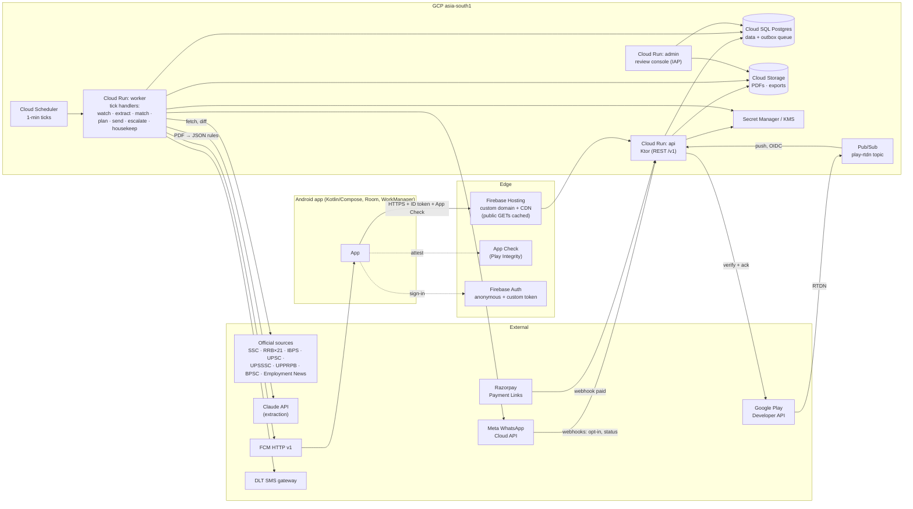

# Sarkari Match: backend architecture

Status: design, 2026-11-19. Author: backend architecture pass. Inputs: [PRD](../PRD.md),
[screen inventory](../design/01-screen-inventory.md), [frontend notifications](../frontend/notifications.md),
`memory/ideas/sarkari-match-pro/*`.

The mobile contract is in [`../api/openapi.yaml`](../api/openapi.yaml), with conventions in [`../api/README.md`](../api/README.md).

| Doc | What it covers |
|---|---|
| [data-model.md](./data-model.md) + [schema.sql](./schema.sql) | ERD, DDL, PII handling, retention |
| [matching-engine.md](./matching-engine.md) + [rule.schema.json](./rule.schema.json) | Rule schema, tri-state evaluation, bucketed matching, worked examples |
| [ingestion-pipeline.md](./ingestion-pipeline.md) | Source watchers, PDF/OCR, LLM extraction, review console, versioning |
| [reminders-and-delivery.md](./reminders-and-delivery.md) | Reminder state machine, scheduler, FCM/WhatsApp/SMS, caps, receipts |
| [payments-and-entitlements.md](./payments-and-entitlements.md) | Play Billing, RTDN, trial, UPI links, entitlement source of truth |
| [security-privacy.md](./security-privacy.md) | App Check, auth, rate limits, admin auth, DPDP Act, encryption, retention |
| [operations.md](./operations.md) | Observability, CI/CD, environments, runbooks, scaling, solo-dev build plan |

---

## 1. Constraints that drive every decision

1. **LTV is tiny.** Base-case LTV is about ₹1.6 per install, paid conversion is about 1.2%, and Pro nets about ₹42–169
   ([cac.json](../../memory/ideas/sarkari-match-pro/cac.json)). Infrastructure therefore has to cost **paise per user
   per month**. It also has to be close to free during the 14-day WhatsApp test and the first 10K users.
2. **One developer runs everything**: product, curation and on-call. That means managed services, a single
   codebase and deployable, a single database, no Kubernetes and no message broker to operate.
3. **Correctness beats latency.** A wrong "eligible" verdict kills trust (the target is under 1% wrong). Eligibility
   is relational and rule-heavy, which favours SQL plus a deterministic, unit-tested rule evaluator over ad-hoc
   document queries.
4. **The load is bursty and fan-out shaped.** About 20–40 notices a month each hit 5–40% of users at once, for
   example 200K pushes in minutes at 1M users. Between bursts there is almost nothing. Reminders follow
   predictable daily peaks in IST.
5. **India first.** Everything runs in `asia-south1` (Mumbai), with DR copies in `asia-south2` (Delhi). Clients are on
   slow networks with 2 GB RAM phones. Delivery has to survive Xiaomi/Vivo/Oppo background-killing.
6. **Minimal PII under the DPDP Act 2023.** No names, Aadhaar or documents. Phone is optional. Everything is deletable.

## 2. Chosen stack (summary)

| Concern | Choice |
|---|---|
| Language/runtime | **Kotlin + Ktor** (JVM 21), one Gradle multi-module repo, one container image with three entrypoints: `api`, `worker`, `admin` |
| Compute | **Cloud Run** (`asia-south1`): `api` (min 1), `admin` (min 0, behind IAP), `worker` (tick-driven; always-on above about 300K users) |
| Database | **Cloud SQL for PostgreSQL 16** (`asia-south1`): db-f1-micro during the test, then db-g1-small → custom 2 vCPU → 4 vCPU + HA. It is also the job queue (`FOR UPDATE SKIP LOCKED` outbox) |
| Scheduling | **Cloud Scheduler** → authenticated `POST /internal/tick/*` every minute (no broker) |
| Auth | **Firebase Auth**, legacy tier with no Identity Platform upgrade: anonymous sign-in plus **custom tokens minted after our own OTP** (WhatsApp authentication template first, DLT SMS fallback). App Check with Play Integrity |
| Push | **FCM HTTP v1**, data-only messages, app-level receipts |
| WhatsApp | **Meta WhatsApp Cloud API direct** in production. A BSP (AiSensy/Interakt) only for the 14-day test if Meta business verification isn't done in time |
| SMS (P2 and OTP fallback) | DLT-registered gateway (MSG91 or similar), about ₹0.16–0.25 + GST |
| Payments | **Google Play Billing**: subscriptionsv2 verification, server acknowledgement, RTDN via **Pub/Sub** push. **Razorpay Payment Links** for the UPI test |
| Files | **Cloud Storage**: raw notice PDFs (content-addressed), exports. Public notice JSON goes through the CDN |
| Front door | **Firebase Hosting** custom domain with rewrites to Cloud Run. This gives free TLS and CDN caching for `Cache-Control: public` GETs (`/v1/notices/*`, `/v1/reference`, `/v1/config`, `/v1/health`) |
| LLM extraction | **Claude API** (`claude-opus-5-5`, structured outputs, native PDF input) + a cheap classifier pass; human review always |
| OCR fallback | Native PDF/vision input to the LLM; Cloud Vision OCR only for re-checks of scans or legacy-font Hindi PDFs |
| Admin console | Server-rendered Ktor + htmx + pdf.js, behind **Identity-Aware Proxy** (Google accounts allowlist) |
| Observability | Cloud Logging (structured JSON), Cloud Monitoring and OpenTelemetry metrics, Sentry free tier, uptime checks, alerts to the founder's phone |
| CI/CD | GitHub Actions → Jib image → Artifact Registry → Cloud Run (gradual traffic), Flyway migrations, Workload Identity Federation |

## 3. Component diagram

**Data flow for one notice:** watcher finds a new PDF → stores it in GCS (sha256) → classifier → extractor
(LLM → `rule.schema.json`) → validators → **human review in admin** → publish (creates `notice_version` and `post_rule`
versions) → `match` job (signature buckets, see [matching-engine.md](./matching-engine.md)) → `match` rows +
`reminder_state` → planner writes `delivery` outbox rows → sender pushes FCM → receipts → escalation to WhatsApp for Pro.
Target: first push out **< 30 min after publish** (NFR is < 6 h).

## 4. Decisions (ADR summaries)

Costs in this section are for **compute + DB only**. The full cost table is in §5. 10K / 100K / 1M = registered users
(about 30% monthly active).

### ADR-01: Platform: Cloud Run + Cloud SQL Postgres (Kotlin/Ktor)

| Option | 10K | 100K | 1M | Matching fit | Ops for 1 dev | Notes |
|---|---|---|---|---|---|---|
| A. Firebase (Auth + Firestore + Functions) | ~$5 | ~$150–300 | ~$1.5–3K | Weak: no joins or range+equality on many fields; matching means scanning all users per post (1M reads ≈ $0.6 per post per pass) and fanning out writes. Reminder state updates are about 5 writes per match | Very low at first, then painful (indexes, cost surprises, Functions cold starts) | Reads scale with app opens × documents; offline sync is great, but we already use Room |
| B. Supabase Pro (Postgres in ap-south-1 Mumbai, Edge Functions) | ~$35 | ~$135–235 | ~$450–700 | Good (Postgres) | Low; but Deno/TS backend instead of Kotlin, and FCM/Pub/Sub/Play stay on GCP → two clouds | $25/org + compute add-ons; strong option if you prefer TS |
| **C. Cloud Run (Ktor) + Cloud SQL (chosen)** | **~$25–45** | **~$200** | **~$900–1.1K** | **Good: SQL range joins + Kotlin evaluator** | Low: all managed, one IAM/billing, Pub/Sub for RTDN and FCM in the same project | JVM cold start mitigated by min-instances=1 and startup CPU boost |
| D. Ktor monolith + self-hosted Postgres on one VM (e.g. e2-small/DO BLR) | ~$15 | ~$80 | ~$400 (bigger VM) | Good | Highest: you own backups, patching, failover, disk alarms | Cheapest floor; a single point of failure during the last-date rush |
| (Neon serverless Postgres) | n/a | | | | | No ap-south-1 region found, so latency/locality rules it out ([Neon regions](https://neon.com/docs/introduction/regions)) |

**Why C.** It has relational matching, it is managed end to end, and it stays in one Google project with FCM, Firebase
Auth, Play RTDN (which requires Pub/Sub anyway), Cloud Scheduler and IAP. It is near-free at test scale on
db-f1-micro (~$8–10/mo) and request-billed Cloud Run (free tier: 180K vCPU-s, 360K GiB-s and 2M requests a month,
[Cloud Run pricing](https://cloud.google.com/run/pricing)). Kotlin is shared with Android: DTOs and the
rule-evaluator module can be a KMP module reused for on-device previews. **Exit ramps:** plain Postgres plus a
container means a move to Supabase, a VM or AWS is a weekend, not a rewrite.

### ADR-02: Auth: Firebase anonymous + own OTP → Firebase custom token

| Option | Cost per verification (India) | Notes |
|---|---|---|
| Firebase phone auth | **~US$0.07 per SMS (≈₹6)**, 10/day free ([Identity Platform pricing](https://cloud.google.com/identity-platform/pricing); India rate as reported by [Authgear, Aug 2026](https://www.authgear.com/post/best-otp-service-providers/), *verify*) | Simplest, but 30–50× local rates; at 1M users × ~1.3 OTPs that's about ₹80 lakh |
| MSG91/DLT SMS OTP | **~₹0.16–0.25 + 18% GST** ([eChai summary of msg91.com](https://echai.ventures/explore/sms-marketing), [RichAutomate](https://richautomate.in/blog/sms-api-pricing-india-2026)) | Needs DLT entity, header and template registration |
| WhatsApp authentication template | **~₹0.115–0.145** (*estimate*, India utility/auth range per [AiSensy](https://m.aisensy.com/blog/whatsapp-pricing-update-october-2026/)) | No DLT; same Meta number we use for alerts; not usable if the user has no WhatsApp |
| **Chosen:** anonymous first; phone optional via WhatsApp OTP → SMS fallback; server mints a Firebase custom token | ~₹0.13 average | Free tier works with **zero** OTP spend; a phone is needed only for restore, WhatsApp or family |

Firebase Auth stays on the **legacy (non-Identity-Platform) tier**, where anonymous and custom-token users carry no
MAU charge (community-reported; **verify before launch**, since Identity Platform bills above 50K MAU). Exit ramp: the
`AuthVerifier` interface can switch to our own Ed25519-signed JWTs (we already own OTP and session creation).
Anti-abuse is in [security-privacy.md](./security-privacy.md).

### ADR-03: Matching: signature buckets + DOB range join in Postgres

Options compared: (a) a naive per-user × per-post loop in app code, about 1M evaluations streamed from the DB, around
30–60 s; (b) in-memory roaring bitsets per attribute value held in the worker, which is fast but needs a resident
cache and warm-up and is hard to keep consistent on profile edits; (c) **chosen: group profiles by an
*eligibility signature* (every eligibility-relevant attribute except DOB)**. The rule is evaluated once per distinct
signature (S ≈ 5–50K at 1M users), producing at most one DOB window, then a single `INSERT … SELECT` joins
`profile(elig_sig, dob)` against those windows. That is O(S·R) CPU plus O(M log N) index work. At 1M users that is
about 1 s of rule evaluation plus 3–10 s of SQL, with no cache to keep warm. Details are in
[matching-engine.md](./matching-engine.md).

### ADR-04: Queue and scheduler: Postgres outbox + `SKIP LOCKED`, driven by Cloud Scheduler ticks

| Option | Fit |
|---|---|
| Cloud Tasks (one task per reminder) | $0.40/M tasks, but every Applied/Snooze/corrigendum means finding and deleting tasks; millions of future tasks; hard to cap 3 pushes a day per user |
| Pub/Sub | No delayed delivery; still needs a DB for state |
| pg-boss / Redis queues | Node-only or one more service to run |
| **Postgres `reminder_state.next_due_at` index + `delivery` outbox + `FOR UPDATE SKIP LOCKED` (chosen)** | Rescheduling is one `UPDATE` in the same transaction as the user's action; caps and dedupe are SQL; no extra infra. Cloud Scheduler ticks every minute (3 jobs free, then $0.10/job/month) |

Throughput: one worker instance drains about 2–5K FCM sends a second over HTTP/2. FCM's project quota is
600K messages a minute ([FCM throttling](https://firebase.google.com/docs/cloud-messaging/throttling-and-quotas)).

### ADR-05: WhatsApp: Meta Cloud API direct

BSPs add ₹999–16,999/mo platform fees or a ₹0.05–0.15/msg markup on top of Meta's ₹~0.115 utility rate
([go4whatsup](https://go4whatsup.com/guides/whatsapp-business-api-pricing-india/), [myoperator](https://myoperator.com/blog/whatsapp-business-api-pricing-india-2026)),
which is a +40–130% markup. We need no inbox UI or broadcast tool; we need templates + webhooks, which Cloud API gives for
free. Cost: Meta business verification and a few days of integration. **For the 14-day test** (before the app
exists) use whichever is live first; a BSP with a free or low tier is acceptable for 2 weeks.

### ADR-06: Payments: Play Billing as primary, server-side truth

There is one subscription product `pro` with base plans `season-4m-prepaid` (₹49, non-renewing prepaid) and
`yearly-autorenew` (₹199). The 14-day trial is **server-granted** at first Applied (no Play free-trial offer, because
that needs a payment method). Entitlement is computed only on the server from `entitlement_grant` rows (trial, Play,
UPI, referral, promo). See [payments-and-entitlements.md](./payments-and-entitlements.md).

### ADR-07: Extraction: LLM-assisted, human-verified, versioned

Claude (`claude-opus-5-5`) with native PDF input and structured outputs against `rule.schema.json`, plus
deterministic validators and DOB-window cross-checks against dates printed in the notice. A human publishes every
rule; a second reviewer is required for risk-flagged posts. Estimated cost ~$0.5–1.5 per notice, about $20–60/month
at 40 notices. See [ingestion-pipeline.md](./ingestion-pipeline.md).

### ADR-08: Push semantics: data-only, app receipts, primary device

Data-only FCM so the app controls language, buttons, quiet-hour dedupe and receipts. High priority is used only for
visible alerts. App receipts drive WhatsApp escalation; FCM itself gives no per-message delivery callback. One
primary device per account (B15).

### ADR-10: Ads: client-side AdMob native, server only decides *whether*

Light ads were added to the free tier by a PRD change on 2026-11-19. The backend does not serve, select or proxy ads
and stores no ad identifiers. It exposes two flags: `Entitlement.ads_enabled` (false for any Pro source, trial
included) and `AppConfig.ads` (global kill switch, allowed placements, minimum app version, no ads in the first N
sessions). This costs nothing at any scale. The kill switch covers a bad SDK release, a policy incident, or an ad
that looks like an official notice. Ad content policy: block the education/test-prep look-alike, gambling, loans and
dating categories in the AdMob console, plus a manual blocklist of advertiser URLs that mimic govt portals. For
privacy, the Google Mobile Ads SDK collects the advertising ID. That has to be disclosed in the Play Data safety form
and in our DPDP notice; consent is covered in [security-privacy.md](./security-privacy.md#7-ads). An ads-free build
flavour stays possible.

### ADR-09: Single deployable, three roles

`api`, `worker` and `admin` are the same image with a different `ROLE` env. This means one build and shared code
(rule evaluator, templates). They are separate Cloud Run services, so admin can be IAP-protected and the worker can
scale and time out differently.

## 5. Cost table (monthly, USD, **estimates**)

Assumptions: 30% monthly active; 3 API calls per active user per day; about 25 pushes per active user per month;
Pro = 3% of MAU, each about 10 WhatsApp messages a month (cap 30 per season), plus 20% of Pro with one family member
at about 4 messages a month; 30% of new users verify a phone (about 1.3 OTPs each); 40 notices a month (scaling to
80 at 1M users with more states); INR ≈ 88/USD.

| Line item | 10K users | 100K users | 1M users | Source / note |
|---|---|---|---|---|
| Cloud SQL Postgres | $10 (db-f1-micro) → $33 (db-g1-small) | $140 (2 vCPU/7.5 GB + 50 GB SSD + PITR) | $650 (4 vCPU/16 GB **HA** + 300 GB + PITR) | [Bytebase Cloud SQL table](https://www.bytebase.com/dbcost/cloudsql-pricing/) shows db-g1-small asia-south1 ≈ $31; shared-core has no SLA ([Cloud SQL pricing](https://cloud.google.com/sql/pricing)) |
| Cloud Run (api + worker + admin) | $8–15 (min-instance idle; rest in free tier) | $50 | $250 (worker always-on, API peaks of about 2K rps after pushes) | $0.000024/vCPU-s, $0.0000025/GiB-s, $0.40/M req beyond free tier |
| Firebase Hosting CDN + egress | $0 | $10 | $80 | notice JSON is about 8 KB gzipped; most opens hit cache |
| Cloud Storage, Scheduler, Pub/Sub, Secret Manager, KMS | $2 | $5 | $20 | |
| Logging/monitoring (50 GB free), Sentry free | $0 | $10 | $60 | log sampling on hot paths |
| FCM | $0 | $0 | $0 | free |
| Firebase Auth (anonymous + custom token) | $0 | $0 | $0* | *if the legacy tier stays MAU-free (verify) |
| LLM extraction (Claude Opus 5.5) | $30 | $40 | $80 | ~$0.5–1.5/notice incl. re-extracts for corrigenda |
| OTP (WhatsApp auth, SMS fallback) | $2 | $15 | $150 | ~₹0.13 average × verifications |
| WhatsApp alerts (Pro + family) | $1 | $15 | $150 | ₹0.115–0.145/utility msg ([AiSensy](https://m.aisensy.com/blog/whatsapp-pricing-update-october-2026/), [baat.ai](https://baat.ai/blog/whatsapp-api-pricing-india)) |
| Domain, misc | $2 | $2 | $5 | |
| Ads SDK (Google Mobile Ads / AdMob) | $0 | $0 | $0 | revenue share is taken out of eCPM, so no infra cost; backend only serves the flags |
| **Total** | **≈ $55–90** (≈ ₹5–8K) | **≈ $290** (≈ ₹25K) | **≈ $1,450** (≈ ₹1.3 L) | |
| Per registered user | ~₹0.5–0.7 | ~₹0.25 | ~₹0.13 | |
| Subscription revenue, base case (1.2% pay, ~₹170/yr net) | ~₹1.7K | ~₹17K | ~₹1.7 L | cac.json base case |
| **Ad revenue, free tier (ESTIMATE)** | ~₹0.9–3.5K ($10–40) | ~₹9–35K ($100–400) | ~₹0.9–3.5 L ($1–4K) | ~97% of MAU free × ~22 native impressions/MAU/month (feed bottom about 12 + digest about 10) × India native eCPM **$0.15–0.60** = ₹0.3–1.2 per free MAU/month. eCPM sources are weak: a single dev report of native at $0.14 ([Kodular forum](https://community.kodular.io/t/admob-ecpm-getting-low-by-low-everyday-india-0-22/189851)); blended India AdMob $0.5–2.0 ([adpumb](https://adpumb.com/?p=10317), [cas.ai](https://cas.ai/?p=11066)). Replace with AdMob actuals after 2 weeks |
| Revenue vs infra | infra ≈ 1–3× revenue | revenue ≈ 1.0–2.1× infra | revenue ≈ 2–4× infra | Ads roughly double revenue at every scale and are the larger line in the low case. Per-user cost is already near the floor (LLM and DB are fixed costs). **The business case, not infra, is the risk.** |

During the WhatsApp test and below about 2K users, run **db-f1-micro + request-billed worker**: about $20–35/month,
dominated by the LLM. Cost guardrails are in [operations.md §6](./operations.md#6-cost-guardrails).

## 6. What is *not* built

No microservices, Kubernetes, Redis, Kafka, separate search engine, GraphQL, realtime sockets, or document storage.
There is no server-side PDF rendering for users (we link the official PDF). The admin console is a few server-rendered
pages, not an SPA.

## 7. Open questions

1. **Launch states.** UP is assumed in the examples. The state set determines the source watchers, the Hindi
   legacy-font OCR share and the curation load.
2. **Under-18 users** (10th-pass aspirants of 17). The DPDP Act requires verifiable parental consent. Proposal: the
   app is for 18+; a DOB under 18 shows a limited, no-account eligibility preview only. Needs a legal check.
3. **Firebase Auth MAU billing** for anonymous and custom-token users on the legacy tier: confirm. If it is billed,
   switch to our own JWT (about 2 days of work).
4. **Play prepaid plan duration of 4 months**: confirm Play Console allows a 4-month prepaid base plan. Fallback is
   3 months (₹49) or 6 months.
5. **UPI in the Play build.** Play payments policy: UPI links in-app only via Play's alternative billing programme for
   India, or only in the non-Play test build. Decision needed before P0.
6. **Meta business verification** needs a registered business (GST/Udyam). This gates WhatsApp in production.
7. **Single primary device** (B15) vs. pushing to all devices: the frontend has assumed primary; the API supports it.
