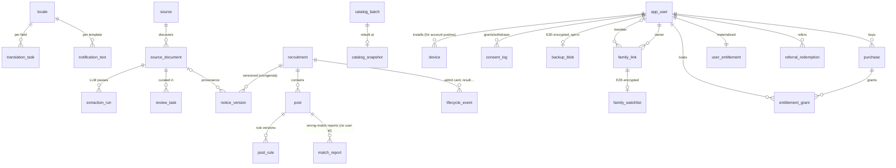

# Data model

The DDL is in [`schema.sql`](./schema.sql) (PostgreSQL 16; it loads cleanly into a fresh database, verified
2026-11-19). This document explains the shape, the personal-data inventory and the retention rules.

**Privacy model (founder decisions 2026-11-19, ADR-11).** The eligibility profile, matches, reminder schedule,
actions, applications and inbox exist **only on the user's phone** (Room, [frontend data-layer.md](../frontend/data-layer.md)).
The server database holds (a) the public catalog of notices, posts and rules, and (b) a minimal **account** for
people who use a server feature: Google sign-in, Pro or trial, a family link, or the encrypted backup. A guest who
uses only free matching and reminders has **no row** in this database.

## 1. ERD

Infrastructure tables (not drawn): `topic_send` (scheduled topic pushes), `push_test` (self-test), `usage_counter`
(opt-in aggregates), `idempotency_key`, `job`, `ref_item`, `qualification`, `product`, `admin_user`, `audit_log`.

Removed in this revision (they held per-user eligibility data or served WhatsApp/OTP/UPI): `profile`,
`elig_signature`, `notification_prefs`, `match`, `match_action`, `reminder_state`, `application`, `alert`,
`alert_dedupe`, `delivery`, `daily_counter`, `whatsapp_link`, `otp_session`, `self_test`, `sync_tombstone`,
`export_job`, and the phone columns of `app_user`/`family_member`.

## 2. Key modelling choices

| Choice | Why |
|---|---|
| `recruitment` (API: *notice*) → `post` → `post_rule(version)` | One advertisement has many posts with different rules (UP Police: civil police, PAC, jail warder). Rules are immutable per version; a device's match records the `rule_version` it was computed with. |
| `post_rule.rule` vs `public_rule` | `rule` keeps reviewer notes and verbatim quotes for the console; `public_rule` (no `review`, no `source.quote`) is what ships in the catalog. `evaluator_min_version` is computed at publish. |
| `notice_version` immutable snapshots + `change_summary` | Corrigenda show as before→after diffs (B07) and keep provenance. `recruitment.current_version` points at the latest. |
| `catalog_batch` (one per publish) + `catalog_snapshot` | The app's only input for matching. Files are immutable and served from the CDN; `catalog_seq` orders them. A device applies batches in order or jumps to a snapshot ([matching-engine.md §4](./matching-engine.md#4-on-device-evaluation-and-the-catalog)). |
| **LocalizedText as `jsonb` maps** + `locale` table + `locale_keys_ok()` CHECK | One shape for every user-visible string (titles, short titles, fee notes, documents, specs, lifecycle text, change summaries, reference names). Adding Tamil is data, not a migration. `en` is mandatory; the publish validator requires every `status=launch` locale (hi, en). |
| `locale.fallback` | Per-locale resolution order used by server and app alike: mr/gu/pa → hi → en (Devanagari/Hindi readers), as → bn → en → hi, most others → en → hi, hi → en, en → hi. |
| `translation_task` | Non-launch locales are filled by an LLM draft + human review per field; a published translation creates a `translation` catalog batch. Launch locales are authored in review. |
| `notification_text(template, locale)` | Only for the few pushes the server composes for one account (N-31 trial ending, Pro expiry, payment hold, family link changes). Match/reminder/lifecycle pushes are composed on the device from app string resources. |
| `app_user.auth_kind` (`anonymous`/`google`) | A guest gets a Firebase anonymous account only when a server feature first needs one; linking Google keeps the same uid. No email, name or phone is copied into our database. |
| `device` only for accounts | Needed for account pushes and family relay; guests receive topic pushes only, which need no registration with us. |
| `backup_blob` | One opaque ciphertext ≤ 64 KB per account, compare-and-swap by `version`. Key in Google Block Store on the device; we hold only `key_id`. |
| `family_link` + `family_watchlist` | Link ids, states and one encrypted watch-list; the key is in the invite URL fragment, so the server cannot read who or what is being followed. |
| `topic_send` with deterministic ids (`r:{post}:{kind}:{date}`, `l:{event}`, `sync:{seq}`) | Idempotent scheduling of the backup topic pushes; the same `reminder_id` the device uses for its local alarm. |
| `match_report` without user id | Reports are anonymous; profile attributes only when the user ticks the box for that report. |
| `usage_counter` | Opt-in, identifier-free daily aggregates (counter × date × app version × locale). Nothing joins them to a person. |
| `entitlement_grant` rows → `user_entitlement` materialized | Several overlapping sources (trial, Play, referral, promo); features read one row. |
| `idempotency_key (user_id, key)` | Generic `Idempotency-Key` support (24 h TTL); unauthenticated calls key on the installation id. |
| `job` table | Durable background jobs (extract, catalog build, translate, deletion) with `dedupe_key`, `FOR UPDATE SKIP LOCKED`. |

## 3. Sizing (1M installs, 12 months)

| Table | Rows | Size (with indexes, approx.) |
|---|---|---|
| app_user + device + user_entitlement | ~150–300K accounts (sign-in, Pro, family) | < 0.5 GB |
| backup_blob | ≤ accounts × ~8 KB | < 2 GB |
| family_link + family_watchlist | ~10–30K | < 0.2 GB |
| purchase + entitlement_grant | ~10–30K a year | < 0.1 GB |
| source docs/notices/rules/catalog index | thousands | < 200 MB (PDFs and catalog files in GCS) |
| topic_send, usage_counter, match_report | tens of thousands | < 0.1 GB |
| **Total** | | **≈ 2–3 GB** (was 25–40 GB with server-side matches and alerts) |

## 4. Personal data inventory (DPDP Act 2023)

What the **server** holds:

| Data | Where | Why (purpose) | Protection | Retention |
|---|---|---|---|---|
| Firebase UID; Google account identity (email, Google id) | app_user (uid only); Firebase Auth (Google identity) | sign-in, restore purchases/backup on a new phone | — | account life |
| Installation id, FCM token, app locale, app version | device | account pushes, family relay | — | until device removed; tokens invalid > 60 d purged |
| Encrypted backup | backup_blob | restore the on-device profile/state on a new phone (opt-in) | end-to-end encrypted; key never sent to us | until disabled/erasure |
| Family link (two account ids) + encrypted watch-list | family_link, family_watchlist | family alerts (P1, opt-in by both people) | watch-list end-to-end encrypted | until either side ends it/erasure |
| Consent records | consent_log | proof of consent for account features (DPDP s.6) | append-only | account life + **3 years** after erasure, pseudonymous (*legal check*) |
| Purchases | purchase | billing, tax, refunds | tokens encrypted | **8 years** (*legal check*); unlinked from the user on erasure |
| Wrong-match reports | match_report | quality | no user id; attributes only if ticked per report | 12 months, then attributes nulled |
| Usage counters | usage_counter | product metrics (opt-in) | no identifiers | 24 months |
| Self-test token | push_test | one delivery test | token nulled at test end | 1 day |
| Server logs | Cloud Logging | debugging | IDs only; request bodies not logged; **client IPs dropped** on `/v1/reports`, `/v1/telemetry`, `/v1/push-tests`, catalog | 30 days |
| Backups | Cloud SQL backups, GCS dumps | DR | encrypted | 7 days PITR + 4 weekly dumps (35 days) |

What stays **on the device only** (never sent, except inside the user's own encrypted backup): DOB, gender,
category and "not sure", OBC-NCL, domicile, PwD status/type, ex-serviceman status and service, qualifications,
extra attributes, certificates' FY, interests, job states, matches and verdicts, actions, applications and their
progress, reminder schedule, inbox, notification preferences, device consent choices.

**Never collected anywhere:** phone number, name of the aspirant, Aadhaar, addresses, documents,
photos/signatures, exact location, contacts, SMS inbox, advertising ID.

**Ads (free tier, adults only):** the server stores no ad data. The Google Mobile Ads SDK runs on the device with
non-personalised requests, `AD_ID` removed; the SDK still collects app-instance identifiers and diagnostics, which
are disclosed in the privacy notice (S47) and the Play Data safety form ([security-privacy.md §7](./security-privacy.md#7-ads)).

## 5. Deletion and export flows

**On the device ("सब कुछ हटाएँ", S38):** wipes Room and DataStore, cancels alarms and work, unsubscribes all topics,
deletes the FCM token. With no account this is the whole erasure.

**Account deletion (`DELETE /v1/me`):**

1. In one transaction: `app_user.state = pending_deletion`, `hard_delete_at = now() + 7 d`, family links `removed`
   (family members get one `family_removed` push), devices removed, an audit row.
2. The Firebase user is disabled (Admin SDK).
3. After 7 days a `job(kind=hard_delete)` deletes `app_user` (cascades device, backup_blob, family links and
   watch-lists, entitlement rows), sets `purchase.user_id = NULL`, deletes the Firebase user and writes a
   `consent_log` row with purpose `account_deleted`.
4. The user may cancel during the grace period (`POST /v1/me/deletion:cancel`).

**Export / access (DPDP s.11):** the profile and history are on the phone, so "download my data" is a local JSON
file written by the app (S38). `GET /v1/me` returns the summary of what the server holds (account, devices, consents,
entitlement and purchases without tokens, family links, backup size/date); the backup itself is the user's own
ciphertext.

**Inactive accounts:** no session for 24 months → one account push → deleted after 30 more days. Anonymous accounts
with no active entitlement, family link or backup after 30 days of inactivity → deleted (our own housekeeping; we do
not enable Identity Platform's anonymous auto-cleanup because guests with Pro are anonymous).
