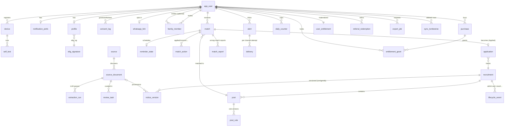

# Data model

The DDL is in [`schema.sql`](./schema.sql) (PostgreSQL 16; it loads cleanly into a fresh database, verified
2026-11-19). This document explains the shape, the PII handling and the retention rules.

## 1. ERD

Infrastructure tables (not drawn): `otp_session`, `idempotency_key`, `job`, `alert_dedupe`, `ref_item`,
`qualification`, `product`, `admin_user`, `audit_log`.

## 2. Key modelling choices

| Choice | Why |
|---|---|
| `recruitment` (API: *notice*) → `post` → `post_rule(version)` | One advertisement has many posts with different rules (UP Police: civil police, PAC, jail warder). Rules are immutable per version; a match records the `rule_version` it was computed with. |
| `notice_version` immutable snapshots + `change_summary` | Corrigenda show as before→after diffs (B07) and keep provenance. `recruitment.current_version` points at the latest. |
| `profile.elig_sig` + `elig_signature` | Enables bucketed matching ([matching-engine.md §4](./matching-engine.md#4-fast-fan-out-signature-buckets--dob-range-join)). |
| Only `eligible`/`check_yourself` stored in `match` | Not-eligible pairs would be about 80% of rows for no use; "why not" is computed on demand. |
| `reminder_state` separate from `match` | Hot, frequently updated scheduler row with a partial index on `next_due_at`; keeps `match` rows stable. |
| `alert` (logical message = inbox row) vs `delivery` (one per channel attempt) | One reminder can go to push, then WhatsApp, then family: one inbox row with per-channel status icons (S24). |
| Deterministic `alert.id` (`r:{match}:{kind}:{YYYYMMDD}`, `n:{match}`, `l:{event}:{application}`) + `alert_dedupe` | Idempotent planning: re-running a tick or a corrigendum never double-sends. The app uses the same id to dedupe its local mirror alarm (frontend gap G-08). |
| `alert`/`delivery` partitioned monthly | Biggest tables (about 25 rows per active user per month); retention = drop partition. |
| `entitlement_grant` rows → `user_entitlement` materialized | Several overlapping sources (trial, Play, UPI, referral, promo); features read one row. |
| Global `sync_seq` → `change_seq` on syncable rows + `sync_tombstone` | Cheap delta sync: `WHERE user_id=$1 AND change_seq > $since` per table, using `(user_id, change_seq)` indexes. The token encodes the max seq. |
| `match_action.action_id` PK | Offline queue replays are idempotent; ordering by `occurred_at`. |
| `idempotency_key (user_id, key)` | Generic `Idempotency-Key` support for all mutations (24 h TTL). |
| `job` table | Durable background jobs (extract, match, rematch, export, deletion) with `dedupe_key`, `FOR UPDATE SKIP LOCKED`. |

## 3. Sizing (1M registered users, 12 months)

| Table | Rows | Size (with indexes, approx.) |
|---|---|---|
| app_user + profile + prefs + device | 1M each | ~3 GB |
| elig_signature | 5–50K | < 20 MB |
| match | ~300 posts × ~100K = 30M/yr | ~8 GB |
| reminder_state | open matches only (~3M at any time) | ~0.5 GB |
| alert (90 d) | ~300K MAU × 25/mo × 3 = 22M | ~6 GB |
| delivery (90 d) | ~1.2 × alerts | ~5 GB |
| source docs/notices/rules | thousands | < 100 MB (PDFs in GCS) |
| **Total** | | **≈ 25–40 GB** → 100 GB disk with headroom |

## 4. Personal data inventory (DPDP Act 2023)

| Data | Where | Why (purpose) | Protection | Retention |
|---|---|---|---|---|
| Firebase UID, installation id | app_user, device | account, delivery | — | account life |
| DOB, gender, category, domicile, qualifications | profile | eligibility matching (core purpose) | Cloud SQL encryption at rest (Google-managed); column-level access only via the API service account | account life; deleted on erasure |
| PwD status/type | profile | eligibility (some posts exclude or relax) | as above; **treated as sensitive**: excluded from logs, analytics and exports to third parties; optional field with explicit explanation | account life |
| Ex-serviceman status/service length | profile | age relaxation | as above | account life |
| Phone number (own) | app_user.phone_enc/phone_hmac | restore account, OTP, WhatsApp | **AES-256-GCM envelope encryption** (DEK wrapped by Cloud KMS key `pii-v1`), HMAC-SHA256 with secret pepper for lookup; only last 2 digits in clear for display | until removed/erasure |
| WhatsApp number (may differ) | whatsapp_link | backup alerts | same | until opt-out (+30 d for audit of opt-out), then erased |
| Family member display name + phone | family_member | family alerts | same; name is user-chosen label (e.g. "Papa") | until removed/declined/erasure |
| FCM token, device model, OEM, permission state | device | delivery, OEM guidance | — | until device removed; tokens invalid >60 d purged |
| Actions (applied/not interested) | match_action, match | reminders, metrics | — | account life; anonymized aggregates after erasure |
| Alerts sent + delivery status | alert, delivery | inbox, escalation, cost control | — | **90 days** (partition drop) |
| Consent records | consent_log | proof of consent (DPDP s.6) | append-only | account life + **3 years** after erasure in pseudonymous form (user id only, no profile) — *legal check* |
| Purchases | purchase | billing, tax, refunds | tokens encrypted | **8 years** (Indian tax record-keeping; *legal check*); unlinked from the user on erasure |
| Wrong-match reports | match_report | quality | minimal profile snapshot, no phone | 12 months, then snapshot nulled |
| Server logs | Cloud Logging | debugging | no PII in logs (IDs only; phone/DOB scrubbed by logger filter) | 30 days |
| Backups | Cloud SQL backups, GCS dumps | DR | encrypted | 7 days PITR + 4 weekly dumps (35 days); erasure propagates as backups age out (documented in the privacy notice) |

**Never collected:** name of the aspirant, Aadhaar, addresses, documents, photos/signatures, exact location, contacts,
SMS inbox (OTP autofill uses the SMS Retriever/User Consent API, not READ_SMS).

**Ads (free tier, PRD change 2026-11-19):** the server stores no advertising ID or ad events. The Google Mobile Ads
SDK on the device processes the advertising ID; that is disclosed in the privacy notice and the Play Data safety form
(see [security-privacy.md](./security-privacy.md#7-ads)).

## 5. Deletion and export flows

**Delete (`DELETE /v1/me`):**

1. In one transaction: `app_user.state = pending_deletion`, `hard_delete_at = now() + 7 d`, `reminder_state.next_due_at = NULL`
   for all matches, `whatsapp_link.state = opted_out`, family members `opted_out`, devices removed, and an audit row.
   Alerts stop immediately.
2. The Firebase user is disabled (Admin SDK).
3. After 7 days a `job(kind=hard_delete)` runs. It deletes `app_user` (cascades profile, prefs, devices, matches,
   applications, reminder_state, whatsapp_link, family_member, entitlement rows, export jobs), sets
   `purchase.user_id = NULL`, nulls `match_report.user_id` and its snapshot, deletes alert/delivery rows by `user_id`,
   adjusts `elig_signature.user_count`, deletes the Firebase user, and writes a `consent_log` row with
   purpose `account_deleted`.
4. The user may cancel during the grace period (`POST /v1/me/deletion:cancel`).

**Export (`POST /v1/me/exports`):** a job writes JSON (profile, prefs, matches with statuses, applications and
timelines, alerts of the last 90 days, consents, entitlement and purchases without tokens, devices without tokens) to
`gs://…-exports/{user}/{id}.json` (CMEK, 7-day lifecycle). It returns a signed URL valid for 15 minutes.

**Inactive accounts:** no app session for 24 months → warning push/WhatsApp → deleted after 30 more days. Anonymous
accounts with no profile after 30 days → deleted.
