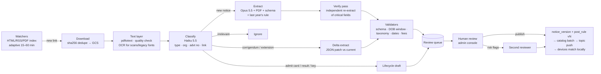

# Ingestion and extraction pipeline

From "a PDF appeared on an official site" to "published, human-verified rules", within the PRD's
≤ 30 min curation budget per notification, with full provenance and versioned corrigenda.

## 1. Sources (launch set)

| Org | Source pages watched (examples) | Kind | Notes |
|---|---|---|---|
| SSC | ssc.gov.in notices / "Latest News" | html_list / JSON endpoint behind the SPA | Exam calendar also feeds P2 "early alerts" |
| RRB (21 boards) | Each RRB site's "Notices / CEN" list; CEN PDFs are mirrored on all boards → dedupe by sha256 | html_list × 21 | Region-specific lifecycle events (city slips, DV lists) |
| IBPS | ibps.in "CRP" notifications | html_list | |
| UPSC | upsc.gov.in examinations (active) + recruitment (advertisements) | html_list | |
| UP: UPSSSC, UPPRPB/UPPBPB, UPPSC | Notice boards | html_list | Hindi PDFs, often legacy fonts or scans |
| Bihar (working assumption, founder to confirm): BPSC, BSSC, CSBC | Notice boards | html_list | Built before launch if curation time allows, else P1 |
| Employment News | weekly e-paper index | pdf_index | Cross-check for coverage |

Each source is a row in `source` with a declarative extractor (`{selector: "table#notices a[href$='.pdf']", date_regex: …}`).
Adding a source is config, not code. A **coverage monitor** (daily) compares our recruitments against the listings of
one or two large aggregator sites. These are used **only as tip-offs** to detect a missed or broken watcher, never as
data. A miss opens a review task pointing at the official site.

## 2. Watchers

- Triggered by the `watch` tick: each source has `interval_minutes`, which is adaptive. It is 15 min from 09:00 to
  21:00 IST on weekdays and 60 min otherwise. After a new document appears on a source, that source runs at 10 min
  for the next 2 hours, because corrigenda and links often follow.
- Conditional GET (`If-None-Match`/`If-Modified-Since`). If the server ignores these, use a normalized content hash
  of the link list (dates and visitor counters stripped).
- Requests come from asia-south1 egress. Some govt sites geo-block foreign IPs; if a site needs a stable IP, use
  Cloud NAT with a static IP (+~$1/mo + NAT data).
- A small number of sites need JavaScript or WAF handling → per-source `render: true` runs a headless Chromium
  (Playwright) Cloud Run **job**. Used only where needed, because it is slow and memory-hungry.
- Politeness: a generic, contactless user agent, ≤ 1 request/2 s per host, and robots.txt honoured.
- Failure handling: exponential backoff; `consecutive_failures` ≥ 6 (or no success for 6 h in business hours)
  → alert. Source health is shown on the console dashboard.
- Output: new `source_document` rows. The PDF is stored at `gs://sm-docs/{sha256}.pdf`, content-addressed, so the same
  CEN on 21 RRB sites is stored once.

## 3. Text layer and OCR

| Detected `text_quality` | How detected | Handling |
|---|---|---|
| `unicode_ok` | pdftotext output has sane Latin/Devanagari ratios and dictionary hits | text used for classification, diffing, search |
| `legacy_font` | Hindi notice whose extracted text is mostly Latin with Kruti Dev/DevLys signatures (`vkosnu`, `fu;qfDr`, …) | Convert with a Kruti Dev→Unicode mapping table (deterministic, cheap). Mark low confidence; the LLM reads the rendered pages anyway |
| `scanned` | < 50 chars/page of text | **Cloud Vision `DOCUMENT_TEXT_DETECTION`** (supports Hindi; about $1.50/1000 pages, *verify*) for the text layer; the LLM gets the PDF pages as images |
| `mixed` | per page | per page |

The LLM always receives the **original PDF** (native document input renders pages as images plus text), so extraction
quality does not depend on our text layer. The text layer is for cheap steps and for the reviewer's search box.

## 4. Classification (cheap, every document)

Model: `claude-haiku-5-5` ($0.10/$0.50 per MTok). Input: the first 2 pages of text (or images for scans) plus the
link text and the source. Output (structured): `doc_class ∈ {new_notice, corrigendum, extension, cancellation,
admit_card, city_slip, exam_date, answer_key, result, cutoff, dv_schedule, medical, other_relevant, irrelevant}`,
`org`, `advt_no`, `exam_name`, `year`, `recruitment_candidates` (fuzzy matches against open recruitments by
advt no / exam name). Cost is about $0.001/doc. Anything not `irrelevant` with confidence < 0.8 goes to the console
"triage" list.

## 5. Extraction

Model: `claude-opus-5-5` (the default). This is the step where accuracy matters most; at about 40 notices a month the
cost difference against a cheaper model is a few dollars. Effort `high`. Structured outputs
(`output_config.format` = JSON schema derived from [`rule.schema.json`](./rule.schema.json) plus the notice-level
fields: dates, fees, documents, photo/signature specs, links, posts). Native PDF input (limit 600 pages / 32 MB per
request).

Prompt structure (stable prefix first, so prompt caching applies across notices):

1. System: extraction rules. Never infer; use `null` and `other_conditions{severity: check_yourself}` when unsure;
   copy relaxation tables row by row including combination rows; every field needs `source.page` and a short quote;
   dates as ISO; money in paise; use only taxonomy codes from the list; how to express "not attained".
2. Taxonomy code list (qualifications, categories, states, extras), about 6K tokens, cached.
3. **Last published rule for the same exam** (e.g. SSC GD 2025) as a reference example, with the instruction: "the
   structure is similar; values change every year; report differences in `review.notes`".
4. The PDF document.

Because citations cannot be combined with structured outputs, provenance comes from schema fields (`source.page`,
`source.quote`). The validator checks that each `quote` actually occurs in the page's text layer (fuzzy match) and
flags it if not.

**Verify pass:** a second, independent call (different prompt wording, no reference example) re-extracts only the
critical fields: age block, relaxations, qualification, gender/domicile/PwD, dates, fees. A field-level diff against
pass 1 shows any disagreement as a red flag in the console and adds a `risk_flag`. It adds about 40% to cost and is
worth it against a trust-killing wrong verdict.

**Cost per notice (estimate):** a 40-page bilingual PDF is about 60–120K input tokens (pages as image+text) plus
about 8K output tokens. Extract: ~$0.25–0.50 + $0.16; verify: ~$0.20–0.40; classify: ~$0.001. **≈ $0.6–1.1/notice**,
or about $25–45/month at 40 notices, more for 150-page RRB CENs (~$2). Batch API (50% off) is *not* used for
extraction, because latency matters (< 6 h NFR). It is used for nightly re-verification of all open rules after a
prompt or model upgrade (regression run).

Pricing used: Opus 5.5 $4/$20 per MTok, Haiku 5.5 $0.10/$0.50 (Anthropic model table cached 2026-11-03).

## 6. Validators (deterministic, before review)

| Check | Blocking? |
|---|---|
| JSON schema (rule + notice) | yes |
| `printed_dob_window` reproduced from `cutoff_date`, `limits`, `max_convention` | yes |
| `apply_start ≤ apply_end ≤ fee_end`; dates within -60/+365 days of today | yes |
| Every qualification/attribute/state code exists | yes |
| Every relaxation row and limit has `source.page` | yes |
| Relaxation years ≤ 20; ages 14–70 | yes |
| Fee table has a default row; amounts are multiples of ₹1 and ≤ ₹5,000 | warn |
| Quote text found on the cited page | warn |
| Pass 1 vs verify-pass disagreement | warn + `risk_flag` |
| Differences from last year's rule for the same exam (e.g. max age changed) | info (highlighted) |
| Post count / vacancy totals add up | warn |

## 7. Review console (admin)

A server-rendered Go app (`html/template` + a JSON API under `/admin/api/`; htmx and pdf.js to come) at `admin.sarkarimatch.in` behind IAP. The first implementation (`backend/internal/admin`) covers create draft → attach rule JSON per post (validators) → approve (second reviewer for risk flags) → publish. The full design:

1. **Queue:** sorted by urgency (`apply_end` soonest, then org priority), showing source, class, risk flags, age of
   the task, and validator status.
2. **Review screen** (the main tool, designed for ≤ 30 min):
   - Left: pdf.js viewer. Clicking any field jumps to its cited page with the quote highlighted.
   - Right: tabs for Dates · Fees · Documents & specs · Posts → per-post rule form. Each field shows the extracted
     value, the verify-pass value (when different), last year's value, and accept/edit controls.
   - **Boundary-test table** (auto-generated profiles at window edges per category/gender/ESM/qualification
     status) with computed verdicts. The reviewer ticks "matches the PDF".
   - **Impact preview:** share of a **synthetic population** (we hold no user profiles) that would be eligible /
     check-yourself, by state; for corrigenda, the share that gains or loses eligibility (matching-engine.md §7).
   - **Translations:** every user-visible field shows its `hi` and `en` values (launch locales, both required to
     publish) and the status of any other enabled locale (LLM draft → review in `translation_task`).
   - **Publish** is enabled only when blocking validators are green and the reviewer ticks "I checked every rule
     against the PDF". If `needs_second_review`, the task moves to the second-review queue instead.
3. **Corrigendum fast path:** a side-by-side diff of the current published JSON and the proposed JSON patch.
   Date-only extensions publish in about 2 minutes.
4. **Lifecycle quick-entry:** pick a recruitment (or accept the classifier's suggestion), type, stage,
   dates/windows, regions, link, and critical flag, with `title`/`body` in the launch locales. Publishing adds the
   event to a catalog batch and schedules one topic push to `n_{notice_id}`. Target ≤ 3 min per event.
5. **Reports inbox:** anonymous wrong-match reports grouped by post, with the attributes the user chose to send (if
   any) and a re-evaluation of the current rule against them, plus "fix rule → new version".
6. **Dashboard:** source health, queue age, curation minutes per notice (from `review_task.active_seconds`, the PRD
   metric), LLM spend month to date, publish→CDN latency, topic send lag, self-test pass rate, translation queue.

Admin auth and audit are in [security-privacy.md §5](./security-privacy.md#5-admin-console).

## 8. Versioning and provenance

- `source_document` is immutable and content-addressed.
- Publishing a new notice creates `recruitment` (v1) + `notice_version` v1 + `post_rule` v1 per post.
- A corrigendum or extension creates `notice_version` vN with `kind`, `source_document_id` and a `change_summary`
  (field, before, after, bilingual text, used by B07), plus a new `post_rule` version only for posts whose rules
  changed. The `recruitment.etag` changes, so the app refetches the notice (CDN cache keyed by etag).
- Every published fact has `source {doc, page, para, quote}`. The app shows "Official PDF, page 7" links on
  why-you-match lines and the what-you-need card.
- Nothing is edited in place. Retracting a publish means publishing a new version (with an optional retraction of
  matches). The audit log records who published what and when.

## 9. Lifecycle tracking (after applying)

Lifecycle events are attached to a `recruitment` (optionally to specific posts, regions or stages):
`city_slip, admit_card, exam_date, exam_rescheduled, answer_key, objection_window, response_sheet, result, cutoff,
scorecard, next_stage, pet_pst, skill_test, dv_schedule, medical_schedule, final_result`.

- Sources: the same watchers. Admit cards, results and keys usually appear on the same boards; the classifier labels
  them `admit_card`/`result`/… and proposes the recruitment link.
- **Expected events:** when a notice is published, the reviewer can add "expected" events from the notice's
  tentative schedule (e.g. "CBT: Feb 2027 (tentative)"). These show on the timeline but never alert.
- **Reschedules:** a new event with `supersedes` = the old one; the old one becomes `cancelled`. The alert says
  "Exam date changed: 12 Mar → 26 Mar".
- **Who is alerted:** every install subscribed to `n_{notice_id}` (Applied + Pro/trial, and family members
  following it). Each device filters by its own application (post, region, progress — skip if `not_cleared` for an
  earlier stage). Pro users get a push for every event, high priority for `critical` ones (admit card, reschedule,
  DV/medical, objection window last day); free users see the timeline from the catalog but get no lifecycle
  notifications (`alerts_locked`), except one local teaser per application ("Admit card is out: Pro alerts you for
  every stage"), at most once per 30 days.
- Region-specific events (RRB city slips per RRB) need the user's RRB choice, stored on the device (P1); until then
  such events are shown to all trackers of that recruitment with the region in the text.

## 10. Failure modes

| Failure | Detection | Response |
|---|---|---|
| Source site down or changed layout | failures counter; "0 links parsed" anomaly; coverage monitor miss | alert; fix the selector (config); manual review task from the official link |
| PDF is a scan / legacy font | text_quality | OCR text layer; LLM uses images; flag low confidence |
| LLM wrong (hallucinated relaxation, off-by-one window) | validators, verify-pass diff, last-year diff, human review, boundary tests | human corrects; prompt and reference example updated; nightly batch regression on all open rules |
| LLM API outage or rate limit | errors | retries with backoff; manual-entry form (same console, empty draft); alerts may be late but never wrong |
| Duplicate notice (21 RRB mirrors) | sha256 | single document |
| Corrigendum not linked correctly | classifier candidates + reviewer confirms link | — |
| Wrong publish discovered later | reports / reviewer | new version; withdraw + correction alerts; audit |
| Curation backlog (founder unavailable) | queue age > 12 h | "alerts may be delayed" banner via `/v1/health` `degraded`; prioritise by apply_end |
