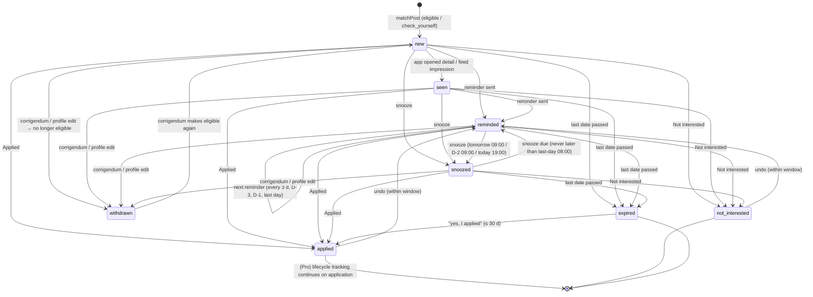

# Reminders and delivery

This doc implements the PRD reminder table: persistent reminders until the user acts, quiet hours, at most 3
pushes a day plus a digest, Pro escalation to WhatsApp and family, a weekly delivery self-check, and cost caps. It
uses only Postgres + Cloud Scheduler + FCM/WhatsApp/SMS providers.

## 1. Match state machine



- **Applied** stops deadline reminders. It creates an `application` (lifecycle timeline), returns a `paywall` hint
  (`trial_offer` while the trial is unused; the trial itself starts only on `POST /v1/me/trial`, see
  [payments-and-entitlements.md §5](./payments-and-entitlements.md#5-14-day-trial)), and is never withdrawn by a later corrigendum (the user gets a corrigendum alert
  instead).
- **Cancelled notice:** open and applied matches → `status_reason = notice_cancelled` (open ones become
  `withdrawn`, applied ones stay applied with a banner). One `cancelled` push goes out; slots are cleared.
- **Expired, then "yes, I applied" (SC-17):** `applied` is accepted on `expired` matches for 30 days. It creates the
  application with lifecycle backfill. There is no push for expiry itself.
- **Extension:** if `apply_end` moves later, `expired` matches revert to `reminded` (when the new date is in the
  future) and an `extension` alert is sent once to open, snoozed and expired-by-old-date matches.
- `seen` is set by a `seen` action (a feed impression ≥ 1 s or a detail open). It only affects badges; it does not
  stop reminders.

## 2. Reminder schedule (per open match)

All times IST. `D` = `apply_end` (the date the user can last apply; if `fee_end` is later, reminders still target
`apply_end`).

Aligned with the design scenario catalogue (`docs/design/03-scenarios.md` §0.2: slots R0/Rp/R3/R1/R-last, cap ranks).
`T` = the user's `reminder_time` (default 19:00).

| Kind (design slot) | When | Free channels | Pro adds | Cap rank |
|---|---|---|---|---|
| `last_day` (R-last) | D, 08:00 (**ignores quiet hours**; if matched late on day D, sent immediately) | push, high priority | WhatsApp + family | 1 (never deferred) |
| `d_minus_1` (R1) | D−1 at T | push, high priority | WhatsApp + family | 2 (never deferred) |
| lifecycle critical | at publish | push (Pro only) | WhatsApp (+ family for DV/medical/admit card) | 3 (never deferred) |
| `new_match` (R0) | at publish + matching (shifted out of quiet hours) | push | WhatsApp | 4 |
| `extension` / `corrigendum` / `cancelled` | on publish, once | push (date moved earlier, eligibility changed, or cancelled; otherwise a quiet update) | WhatsApp if it changes the user's deadline or verdict | 4 |
| `d_minus_3` (R3) | D−3 at T | push | WhatsApp | 5 |
| `periodic` (Rp) | every 3 days after R0 at T while ≥ 4 days are left; for windows > 30 days, every 5 days after the 3rd unopened periodic (`rp_backoff`) | push | — | 6 |
| `snooze_due` | snooze target (tomorrow 09:00, D−2 09:00, or today 19:00) | push | — | 5 |

**WhatsApp rule (Pro):** WhatsApp goes out for R0, R3, R1, R-last and lifecycle critical **unless the matching push
was opened** before the escalation check (R0/R3: 60 min, R1: 30 min, R-last: 15 min, lifecycle critical: 30 min).
This matches the design's "skip if opened in the last 2 h" intent and stays inside the 30/season cap. If the device is
`failing` (two missed weekly pings or a failed self-test), WhatsApp is sent for R1/R-last regardless of push.

`nextReminder(match, state, now)` is a **pure function** of `(D, matched_at, status, snoozed_until, last_sent_kind,
quiet hours)`. It returns `(kind, due_at)` or null. Rules:

1. Candidates are the kinds above, minus kinds already sent (each fixed kind is sent at most once; `periodic`
   repeats). **Collapse:** a match never gets two pushes on the same IST day; if R3 and Rp coincide, R3 wins.
2. A snooze suppresses every candidate before `snoozed_until` **except `last_day`**. The snooze target itself is
   capped at the last-day reminder.
3. Quiet hours (`quiet_start`–`quiet_end`, default 22:00–07:00) push `due_at` to `quiet_end`, except `last_day`.
4. If `D` has passed → null and status `expired`.

Because the function is pure and deterministic, the API exposes `next_reminder_at/_id/_kind` and `reminder_plan[]`,
and the app's **local mirror alarms** (frontend notifications doc) use the same ids (`r:{match}:{kind}:{YYYYMMDD}`).
If FCM fails, the on-device alarm still fires and the app dedupes against FCM by id.

## 3. Planner, sender and escalation (Postgres outbox)

Cloud Scheduler calls `POST /internal/tick/{name}` on the worker every minute (OIDC-authenticated). Each tick runs
until its work is drained or 50 s have passed, whichever comes first. Ticks are safe to overlap: each claims rows with
`FOR UPDATE SKIP LOCKED` and a lease.

```mermaid
sequenceDiagram
  participant S as Cloud Scheduler
  participant P as plan tick
  participant DB as Postgres
  participant X as send tick
  participant F as FCM
  participant A as App
  participant E as escalate tick
  participant W as WhatsApp Cloud API
  S->>P: every minute
  P->>DB: claim reminder_state due ≤ now (SKIP LOCKED, ≤5000)
  P->>DB: per user: caps, quiet hours, bundle, insert alert (deterministic id, dedupe) + delivery(push) ; set next_due_at
  S->>X: every minute (and a self-chained continuation while the backlog > 0)
  X->>DB: claim delivery queued & run_after ≤ now
  X->>F: HTTP v1 send (HTTP/2, ~200 concurrent)
  F-->>A: data message (high priority if visible)
  A->>DB: POST /v1/me/delivery-receipts (received, displayed, opened)
  S->>E: every minute
  E->>DB: alerts with escalate_at ≤ now and no receipt / not opened
  E->>DB: Pro + WA active + quota → insert delivery(whatsapp)
  X->>W: template message
  W-->>DB: status webhooks (sent, delivered, read, failed)
```

### 3.1 Plan step (per user, in one transaction per batch)

1. Load prefs, `user_entitlement`, today's `daily_counter`, the primary device, and the `whatsapp_link`.
2. Sort the due items by cap rank (table above; the same `rank` goes into the push payload): 1 `last_day` >
   2 `d_minus_1` > 3 lifecycle critical > 4 `new_match` / `extension` / `corrigendum` / `cancelled` > 5 `d_minus_3` /
   `snooze_due` > 6 `periodic`; ties by earlier `D`.
3. **Bundle:** items due in the same tick become one notification ("2 jobs: last date tomorrow"), which counts as one
   push.
4. **Cap:** at most **3 pushes per user per IST day**. Ranks 1–3 (R-last, R1, lifecycle critical) are never deferred
   and may exceed the cap (design: observed max about 5). Beyond the cap, P0 items are deferred to the next day's
   first slot; once the digest ships (P1), lower ranks fold into the daily digest instead.
5. **Quiet hours:** `alert.not_before = quiet_end`, except ranks 1–3 whose slot is within the next 24 h, which go out
   at quiet-hours end at the latest, and R-last, which is always 08:00.
6. Insert `alert` with its deterministic id (`INSERT INTO alert_dedupe … ON CONFLICT DO NOTHING`; skip if it already
   exists), then `delivery(channel=push, target=primary device)`. Set `escalate_at` for Pro-eligible kinds.
7. Update `reminder_state` (`last_sent_at`, `sent_count`, `next_due_at = nextReminder(...)`) and `match.status =
   reminded` (with `change_seq` bumped for sync).

**Digest** (P1): at the user's `digest_time` (default 19:00) a `digest` tick sends one push summarising
`digest_pending` plus low-priority updates (it opens S44). There is at most one per day and it does not count toward
the cap. Users with nothing pending get nothing.

### 3.2 New-notice fan-out

`matchPost` returns the new match rows. It inserts `reminder_state(next_due_at = now, next_kind = new_match)` for each,
and the planner then treats them like any other due item, so the caps, quiet hours and bundling apply automatically.
A **fan-out rate limit** (default 20K alerts/min, configurable) spreads the burst. This keeps API and CDN load smooth
when users open the app, and stays well under FCM's 600K messages/min project quota
([FCM throttling](https://firebase.google.com/docs/cloud-messaging/throttling-and-quotas)). 200K users are notified in
about 10 minutes.

**Latency budget** (NFR: alert < 6 h after review): publish → match job (≤ 1 min queue + 3–15 s) → plan (next minute)
→ send (about 10 min for 200K) → **first pushes within ~2 min, the last within ~15 min**. Quiet hours can defer to
07:00; that deferral is by design and is shown in the console.

### 3.3 Sender

- FCM HTTP v1 via the Admin SDK (one HTTP/2 connection pool, about 200 concurrent requests). Each request is a single
  message (FCM has no multicast in v1; `sendEach` parallelizes).
- Message: `data` only; `android.priority = HIGH` only for kinds that always show a notification; `android.ttl` =
  until the end of `D` for deadline kinds, 24 h for new matches, 4 weeks for lifecycle. No `notification` block.
  Payload contract: [api/README.md §10](../api/README.md#10-push-fcm-payload-contract) and `PushData` in the spec.
  The planner fills `reminder_id` (= `alert.id`), `kind`, `rank`, `template`, `channel` (design channel IDs:
  `critical`, `new_match`, `reminders`, `job_updates`, `digest`, `account`), `link`, and for match pushes
  `post_id`, `apply_url` and `pdf_url` from the notice's current version.
- Results: success → `sent`. `UNREGISTERED`/`INVALID_ARGUMENT` on the token → `device.token_invalid_at`, delivery
  `failed`, and immediate escalation eligibility for Pro. `QUOTA_EXCEEDED`/`UNAVAILABLE`/`INTERNAL` → retry with
  exponential backoff plus jitter, honouring `Retry-After`, up to 6 attempts over about 2 h, then `failed`.
- At-least-once: a crash after FCM accepted but before commit can resend. The app dedupes on `msg_id`
  (notification tag + ledger).
- Only the **primary device** gets alert pushes; other devices get `type=sync` (normal priority) so their caches
  stay fresh.

### 3.4 Receipts and escalation

The app posts `received`/`displayed` from `onMessageReceived` (expedited WorkManager) and `opened`/`action_tapped` on
interaction. FCM gives no per-message delivery callback to servers (aggregate delivery data via the BigQuery export can
be enabled for dashboards only).

| Kind | Escalate to WhatsApp (Pro, opted in, quota left) when |
|---|---|
| `new_match`, `d_minus_3` | push not opened within 60 min |
| `d_minus_1` | no `opened` within 30 min **and** match still open |
| `last_day` | no `opened` within 15 min **and** match still open |
| lifecycle `critical` (admit card, reschedule, DV/medical slot, objection window closing) | always (this is the Pro promise), deduped per event |
| device `delivery_health = failing` (≥ 3 consecutive alerts without receipt, or a failed self-test) | escalate immediately for the kinds above |

**Family:** Pro + `family_alerts` + an active family member with that `alert_kind` → one WhatsApp per member for
`d_minus_1`, `last_day`, `admit_card` and `dv_schedule`, only while the match/application is open. Content is minimal:
the aspirant's chosen display name, the exam name, the date and a link. No profile data.

### 3.5 WhatsApp cost cap

- Per Pro user, **30 business-initiated messages per entitlement season** (120 days; yearly = 3 seasons), stored as
  `whatsapp_link.season_quota_used`. Family messages count against the same quota.
- From 24 used: only `last_day` and lifecycle `critical`. At 30: none, and an in-app note ("WhatsApp limit reached
  this season; push continues").
- Global guard: daily WhatsApp spend ceiling (config, default ₹500/day at launch) with alerts at 80%. Above the
  ceiling, only `last_day` goes out.
- Expected use: 6–12 messages per Pro user per season. Cost about ₹1–2 per season per Pro user vs ₹42 net revenue.

### 3.6 Retries and idempotency summary

| Layer | Mechanism |
|---|---|
| API mutations | `Idempotency-Key` table (24 h) |
| Match actions | `action_id` PK; ordered by `occurred_at` |
| Planning | deterministic `alert.id` + `alert_dedupe` |
| Deliveries | one row per (alert, channel, target), checked before insert; provider retries reuse the row (`attempts++`) |
| Webhooks (WA, Razorpay, RTDN) | dedupe on provider event/message id; handlers are upserts |
| Jobs | `job.dedupe_key` (`match:post:version`, `export:user`, …) |

## 4. Delivery self-test (onboarding + weekly)

`POST /v1/me/devices/{id}/self-tests` → `self_test(sent)` → FCM high-priority data message `type=self_test`
(visible N-41 on the `critical` channel) → app posts the `received`/`displayed` receipt with `message_id=test_id` →
status `received`. With no receipt in 120 s → `timeout` with `advice[]` derived from device state (notifications off
→ `enable_notifications`; known aggressive OEM (xiaomi, redmi, poco, vivo, oppo, realme, oneplus) and battery
optimisation not ignored → `enable_autostart` + `disable_battery_optimization`; Pro without WhatsApp →
`link_whatsapp`). The rolling 14-day receipt rate updates `device.delivery_health`, which drives the S29 traffic
light and server-side escalation.

**Weekly silent ping (SC-35):** a `ping` tick sends each primary device one silent high-priority data message
about every 7 days around 12:00 IST (spread by user hash). The app acks with a `received` receipt. Two consecutive
missed pings → `delivery_health = failing` → O02 banner on next open; for Pro, WhatsApp becomes the default for R1 and
R-last. The killed-app self-test step uses `POST …/self-tests {kind: killed_app, delay_seconds: 60}`.

## 5. WhatsApp Business (Meta Cloud API)

- **Setup:** Meta Business verification (needs a registered business, GST/Udyam), a dedicated number, display name
  "Sarkari Match", and a WhatsApp Business Account owned by us. Webhook at `/hooks/whatsapp`, verified with the
  `X-Hub-Signature-256` HMAC.
- **Messaging limits:** new numbers start with a low daily cap of unique business-initiated recipients (historically
  250 per 24 h, rising with volume and quality; *verify the current tiers*). The 14-day test (about 300 users) fits.
  Plan a warm-up before launch.
- **Templates** (utility category, Hindi + English; names and copy are the design's, [05 §4](../design/05-notifications.md#4-whatsapp-business-templates-pro-via-bsp)):
  `sm_welcome` (W-00, opt-in confirmation), `sm_new_match` (W-01), `sm_deadline_soon` (W-02, R3 and R1),
  `sm_last_day` (W-03), `sm_notice_change` (W-04), `sm_stage_update` (W-10..W-15 lifecycle), `sm_dv_slot`,
  `sm_family_invite` (W-20), `sm_family_alert` (F-01..F-03), `sm_family_removed` (F-09), plus `sm_otp`
  (authentication category). App-opening URL buttons use `https://sarkarimatch.in/j/{match_id}?src=wa` (lifecycle:
  `/a/{application_id}`); "फ़ॉर्म की साइट खोलें" uses the tracked redirect `https://sarkarimatch.in/go/{match_id}`
  → 302 to the official apply URL (Meta URL buttons need a fixed base URL). Each type gets a second approved
  variant (`_v2`) plus a generic fallback `sm_alert_generic` ("आपके लिए नई सूचना: {{1}}. देखें: {{2}}").
  W-90 `sm_pro_ended` (marketing category) is **not sent**: Pro/trial end is told in-app and by push only.
- **No promotional content** in any utility template (no upsell, no "buy Pro"). Otherwise Meta may recategorise it as
  marketing (₹~0.86/msg) or reject it.
- **Opt-in:** (a) in-app consent with the verified phone, or (b) user-initiated `START <code>` message, which proves
  the number. Both write `consent_log(purpose=whatsapp_alerts)`. The first message is an `optin_confirm` with
  "Reply STOP to stop".
- **Opt-out:** inbound `STOP`, `रोकें` or `बंद` (case- and space-insensitive; same list in design 05 §4), the app toggle, or `DELETE /v1/me/whatsapp`
  → `opted_out` immediately plus a confirmation reply (a free service reply inside the 24 h window). Sustained
  failures that indicate the user blocked us → `blocked`; stop sending.
- **Quality:** monitor the phone number quality rating and template status webhooks. On a "paused/flagged" template,
  switch to its variant and alert the founder.
- **Pricing:** per delivered message. Utility ~₹0.115–0.145 in India (2026 BSP reports; [AiSensy](https://m.aisensy.com/blog/whatsapp-pricing-update-october-2026/),
  [baat.ai](https://baat.ai/blog/whatsapp-api-pricing-india)); from 1 Oct 2026 utility templates are charged even
  inside the 24 h window (as reported). `delivery.cost_paise` is recorded from the pricing webhook field for cost
  dashboards.

## 6. SMS (OTP fallback now, SMS backup P2)

India requires **DLT registration** under TRAI's TCCCPR 2018: register as a Principal Entity on an operator DLT
portal (Jio/Airtel/Vi/BSNL, one-time fee), register the 6-character header (e.g. `SRKMCH`) and every **content
template** with `{#var#}` placeholders (OTP: "service implicit"; alerts: "service implicit/explicit" with consent
template). **URLs and call-back numbers in SMS must be whitelisted** (TRAI direction effective Oct 2024; *verify the
current rules*). Gateway: MSG91 or similar at about ₹0.16–0.25 + GST per SMS
([RichAutomate](https://richautomate.in/blog/sms-api-pricing-india-2026)). SMS backup (P2) reuses the escalation
rule for users who chose SMS instead of WhatsApp, with the same quota.

## 7. Lifecycle alerts (Pro)

When a lifecycle event is published, a job selects active applications of that recruitment (filtered by post,
region and stage progress) and creates `lifecycle` alerts:

- `admit_card`, `city_slip`: immediately; plus "exam in 3 days, carry the admit card" at D−3 of `exam_date` (push).
- `objection_window`: at open, plus at close−1 day (push + WhatsApp if critical).
- `exam_rescheduled`: immediately, critical.
- `result`, `cutoff`, `scorecard`: immediately; the app asks "Did you clear?" → `PATCH application.progress`.
- `dv_schedule`, `medical_schedule`: immediately, critical, family-eligible.
- Free users: no lifecycle pushes; at most one teaser per application per 30 days (`alerts_locked=true` on the
  timeline).
- Caps apply (lifecycle items rank with `d_minus_1`).

**Clash detection (P1):** after any `exam_date` event or applied action, compare the user's applications' exam dates.
The same day or within 3 days → a `clash` alert (Pro) and a row in `GET /v1/me/clashes`.

**Certificate validity (P1):** at match time, if the notice requires an OBC-NCL/EWS certificate for a financial year
(rule `other_conditions` with code `cert_fy`) and the profile's certificate FY differs → `why[]` line with
`rule=certificate, result=info` (S36 `ValidityBadge`, S21 what-you-need warning) plus a Pro `certificate` alert once
(N-29, `job_updates` channel).

## 8. Failure modes

| Failure | Effect | Mitigation |
|---|---|---|
| FCM outage / high error rate | pushes delayed | sender retries 2 h; `/v1/health.alerts_delayed=true`; Pro escalation to WhatsApp after the window; app local mirror alarms still fire for scheduled reminders |
| OEM kills app (Xiaomi/Vivo/Oppo) | data message never reaches the app | onboarding OEM guide + self-test; receipts → `delivery_health`; WhatsApp escalation (Pro); local alarms; weekly 12 h sync job catches up the inbox |
| WhatsApp template rejected/paused | WA sends fail | variant template → generic fallback → push only; founder alert |
| WhatsApp number quality drops / limit tier hit | sends throttled | prioritise `last_day` + critical lifecycle; spread across the day; reduce escalations |
| Worker crash mid-batch | — | leases expire (2 min) → rows reclaimed; deterministic ids prevent duplicates |
| Scheduler stops | no ticks | Cloud Monitoring alert on tick-age metric; a manual trigger endpoint |
| Corrigendum flood (many changes at once) | many alerts | bundling + daily cap + digest |
| Clock/timezone errors | wrong-time reminders | all scheduling in UTC instants computed from IST rules with `Asia/Kolkata`; unit tests on DST-free IST; quiet hours from prefs |
