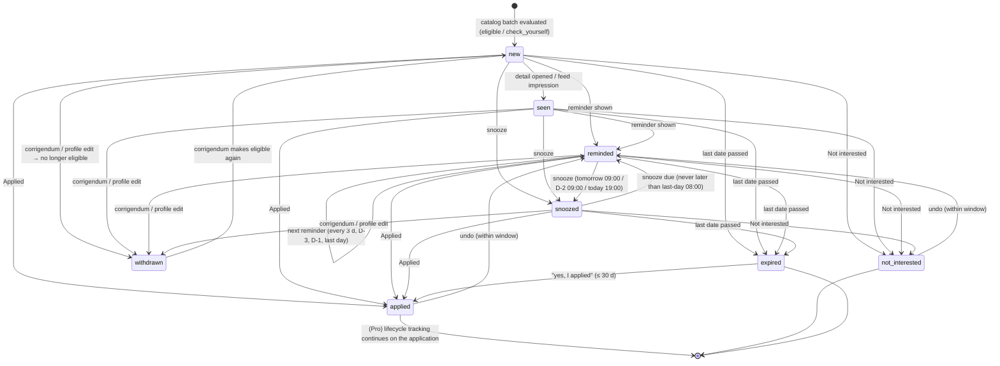

# Reminders and delivery

This doc implements the PRD reminder table: persistent reminders until the user acts, quiet hours, at most 3
pushes a day plus a digest, Pro lifecycle and family alerts, and a delivery self-check. Founder decisions of
2026-11-19 apply: **delivery = FCM push + on-device backup reminders; no WhatsApp, no SMS, no OTP**, and the
eligibility profile and matches stay on the phone (ADR-11, [matching-engine.md §0](./matching-engine.md#0-decision-on-device-matching-vs-server-side-signature-matching)).

**Split of responsibilities**

| Who | Owns |
|---|---|
| **Device** (`:core:notifications`, [frontend notifications.md](../frontend/notifications.md)) | match state machine, the reminder schedule for every open match (all slots, caps, quiet hours, snooze), composing every match/reminder/lifecycle notification in the app language, alarms and WorkManager, topic subscriptions, the family watch-list |
| **Server** (worker role) | catalog batches, **topic** pushes (`catalog` sync, `p_{post_id}` deadline backups, `n_{notice_id}` lifecycle), account pushes (trial/Pro/family link), family relay, the self-test push |

The server never knows which users matched a post. It addresses everyone who might care through FCM topics, and
each device decides locally whether to show anything.

## 1. Match state machine (on the device)



Same states and rules as before, now evaluated in Room transactions:

- **Applied** stops deadline reminders, unsubscribes `p_{post_id}`, creates the local application (timeline from
  the catalog's lifecycle events) and, with Pro/trial, subscribes `n_{notice_id}`. The first Applied shows B02 with
  the trial offer while the trial is unused; the trial starts only on `POST /v1/me/trial`
  ([payments-and-entitlements.md §5](./payments-and-entitlements.md#5-14-day-trial)). A later corrigendum never
  withdraws an applied match (the user gets a corrigendum notification instead).
- **Cancelled notice** (catalog batch): open matches → `withdrawn`, applied ones keep a banner; one `cancelled`
  notification; local slots cleared.
- **Expired, then "yes, I applied" (SC-17):** accepted for 30 days.
- **Extension:** if `apply_end` moves later, `expired` matches revert to `reminded` and one `extension` notification
  is shown to open, snoozed and expired-by-old-date matches.

## 2. Reminder schedule (per open match, computed on the device)

All times IST. `D` = `apply_end`. `T` = the user's reminder time (default 19:00, S28). Slots and ranks are those of
design `03-scenarios.md` §0.2.

| Kind (design slot) | When (shown to the user) | FCM | On-device | Pro adds | Cap rank |
|---|---|---|---|---|---|
| `last_day` (R-last) | D, 08:00 (**ignores quiet hours**; if matched late on day D, immediately) | topic `p_{post}` `deadline` at 08:00, high | **backup** alarm 08:15 (design 05 §3.6), cancelled when the push is shown | family N-51 (P1) | 1 (never deferred) |
| `d_minus_1` (R1) | D−1 at T | topic `p_{post}` `deadline` at 19:00, high; held until T if T is later | **backup** alarm at T + 30 min | family N-50 (P1) | 2 (never deferred) |
| lifecycle critical | at publish | topic `n_{notice}` `lifecycle`, high | — | Pro only; family N-52/N-53 (P1) | 3 (never deferred) |
| `new_match` (R0) | when the catalog batch is evaluated (shifted out of quiet hours) | topic `catalog` `sync` triggers it | composed locally | — | 4 |
| `extension` / `corrigendum` / `cancelled` | when the batch is evaluated, once | topic `catalog` `sync` | composed locally (date earlier, verdict changed, cancelled; else quiet update) | — | 4 |
| `d_minus_3` (R3) | D−3 at T | topic `p_{post}` `reminder` at 19:00, normal; held until T | WorkManager at T if no push arrived | — | 5 |
| `periodic` (Rp) | every 3 days after R0 at T while ≥ 4 days are left; every 5 days after the 3rd unopened one for windows > 30 days | — | WorkManager | — | 6 |
| `snooze_due` | snooze target | — | WorkManager / alarm | — | 5 |

The server cannot know each user's reminder time `T`, so topic pushes go out at the design defaults (configurable in
`AppConfig.reminder_backup`); a device whose `T` is later holds the push and shows it at `T` (data-only messages
allow this), and one whose `T` is earlier has already shown the reminder and drops the push by `reminder_id`.

`nextReminder(match, now)` stays a **pure function** of `(D, matched_at, status, snoozed_until, last_shown_kind,
quiet hours, T)`, in `:matching-core`'s sibling module `:reminder-core` (unit-tested on the JVM; shared with the
admin console's "what will users see" preview). Rules: one notification per match per IST day (R3 beats Rp); a snooze
suppresses everything before it except `last_day`; quiet hours (default 22:00–07:00) push `due_at` to their end
except `last_day`; at most **3 notifications a day**, ranks 1–3 exempt; overflow folds into the digest (P1) or the next
day's first slot. Reminder id: `r:{match_id}:{kind}:{YYYYMMDD}`; because `match_id` is derived from `post_id`, the
server's topic backup for R1/R-last carries the **same id** and the device shows whichever arrives first.

## 3. How reminders survive a killed app

Founder decision 7: **delivery = FCM push + on-device backup reminders.**

| Mechanism | Covers | Notes |
|---|---|---|
| **FCM topic push** (`p_{post_id}` R3/R1/R-last, `n_{notice_id}` lifecycle, `catalog` sync) | the primary delivery | high priority for R1/R-last/critical lifecycle wakes a background-killed app on most OEMs once autostart is allowed (S15); the device dedupes by `reminder_id` and suppresses if the user already acted |
| **On-device backup reminder** for R1 (T + 30 min) and R-last (08:15): `AlarmManager.setAndAllowWhileIdle`, exact (`setExactAndAllowWhileIdle`) when `SCHEDULE_EXACT_ALARM` is granted via S14 (P0) | FCM blocked or late | cancelled when the push with the same id is shown; body suffix "(फ़ोन से याद दिलाया)"; S28 toggle "बिना इंटरनेट भी याद", default on |
| WorkManager one-time work per due Rp/R3/snooze slot + a **daily reconcile** (24 h, flex 4 h, no network needed) | slots without a push; catch-up after force-stop once the app runs again | reconcile also syncs the catalog when online and expires matches |
| `BOOT_COMPLETED`, `MY_PACKAGE_REPLACED`, `TIME_SET`, `TIMEZONE_CHANGED` receivers | re-arm after reboot/update/clock change | alarms are cleared on reboot |

Force-stop (Settings → Force stop) disables alarms, work **and** FCM until the user opens the app; this was true of
the previous design too. The onboarding OEM guide (S13/S15), the self-test (S16) and the O02 banner remain the
mitigation.

## 4. Topic push sender (server)

Cloud Scheduler calls `POST /internal/tick/topics` every minute. The tick claims `topic_send` rows with
`due_at ≤ now` (`FOR UPDATE SKIP LOCKED`) and sends them with the FCM HTTP v1 API (`message.topic`).

| Topic | Who subscribes | Sends | Priority / TTL |
|---|---|---|---|
| `catalog` | every install (guests and minors included) | `type=sync, seq` on every catalog batch | normal / 24 h |
| `p_{post_id}` | installs with an **open** match on the post (the account's primary install, if signed in); family members following it | `type=reminder, kind=d_minus_3` (normal) and `type=deadline, kind=d_minus_1\|last_day` (high), `reminder_id, post_id, last_date` | see type / until end of D |
| `n_{notice_id}` | installs with an Applied match and Pro/trial; family members following it | `type=lifecycle, event_id, stage, critical` | high if critical, else normal / 4 weeks |

- Rows are created at publish: one `sync:{seq}` per batch, `r:{post}:{kind}:{date}` per open post for R3, R1 and
  R-last (rescheduled or cancelled by later batches: extension, cancellation, retraction), `l:{event}` per lifecycle
  event.
- **Payload** = `PushData` ([api/README.md §10](../api/README.md#10-push-fcm-payload-contract)): data-only, ids
  and dates, no text. The device renders in its language from string resources and catalog `LocalizedText`.
- FCM fans topic messages out on its side; there is no per-device result. `QUOTA_EXCEEDED`/`UNAVAILABLE` → retry
  with backoff for up to 2 h, then `failed` (alert). FCM's project quota is 600K messages/min and topic fan-out is
  free ([FCM throttling](https://firebase.google.com/docs/cloud-messaging/throttling-and-quotas)).
- High-priority topic messages always produce a notification on most receiving devices (open match, not acted). The
  ones that are suppressed (already applied but not yet unsubscribed) are a small share, so Android's
  deprioritisation of silent high-priority messages is not triggered in practice; this is watched via the self-test
  pass rate.
- **Entitlement for lifecycle** is applied on the device (it subscribes `n_{notice}` only with an active Pro/trial
  entitlement token, and unsubscribes when it lapses). A modified client could receive lifecycle pushes for free;
  accepted risk at ₹49.

**Account pushes** (`device` rows of one account; FCM `message.token`): trial ending N-31 (day 12), Pro expiring,
payment on hold, entitlement changed, N-47 alerts moved to another phone (primary device changed, B15), and `family`
events (`sync`, `accepted` → N-44, `removed` → N-54, `paused`). Text comes from `notification_text` in the device's
locale with `locale.fallback`, plus the template id so a current app can render it from its own resources.

## 5. Family alerts (Pro, P1) — push to the family member's own app

No phone numbers, no WhatsApp, no SMS. The aspirant invites from S48; the family member uses their own install.

```mermaid
sequenceDiagram
  participant A as Aspirant app
  participant S as Server
  participant M as Family member app
  A->>S: POST /v1/me/family (Pro) → {link_id, token, url}
  Note over A: key = 32 random bytes; share https://sarkarimatch.in/f/{token}#k={key} (sharesheet O08 / QR)
  M->>S: GET /v1/family-invites/{token} → {link_id, state, expires_at}
  M->>S: POST /v1/family-invites/{token}:accept (member account, consent family_link_member)
  S-->>A: account push family_accepted
  A->>A: watch-list = {label, items: open matches' post_id/notice_id, last_date, kinds, short titles}
  A->>S: PUT /v1/me/family/{link_id}/watchlist (AES-256-GCM with key, AAD link_id+version)
  S-->>M: account push family_sync
  M->>S: GET /v1/family/following/{link_id}/watchlist
  M->>M: decrypt; subscribe p_{post} / n_{notice}; schedule local R1 / R-last alarms
```

- The member's app shows only what the aspirant shared (S49): the aspirant's chosen label, exam short titles, last
  dates and critical lifecycle stages (`last_day`, `one_day_before`, `admit_card`, `dv_schedule`). It turns the
  topic pushes it receives into N-50…N-53 on its `family` channel (design 05 §3.5), with its own on-device backup
  for N-50/N-51, respecting the member's quiet hours except N-51/N-53 within 24 h. No action buttons (a parent
  cannot mark Applied). The aspirant's name never passes through the server in clear: it is inside the encrypted
  watch-list.
- The aspirant's device republishes the watch-list after every change (new match, Applied, Not interested, expiry);
  the server keeps only the latest version.
- Either side can end the link (D06/D12) → server marks it `removed`, deletes the watch-list, pushes
  `family_removed`; the member's app unsubscribes and cancels alarms.
- Gate: the owner must have an active Pro/trial entitlement to create a link or publish a watch-list; when Pro ends,
  the link pauses (member sees "paused") rather than being deleted.

## 6. Delivery self-test (onboarding + weekly)

`POST /v1/push-tests {fcm_token}` (App Check, no account needed) → the server sends one high-priority data message
`type=self_test, test_id` to that token, keeps the token only until the test ends → the app shows N-41 on the
`critical` channel and calls `POST /v1/push-tests/{id}:received` → `GET /v1/push-tests/{id}` reports `received` or
`timeout` (120 s). Advice (`enable_autostart`, `disable_battery_optimization`, `unblock_channel`,
`update_play_services`) is computed **on the device** from its own state. The weekly check is the same call from a
periodic worker; the S29 traffic light is local (self-test result + whether topic backups arrived before local alarms).
There is no server-side `delivery_health`, no silent weekly ping and no escalation channel.

## 7. Lifecycle alerts (Pro)

When a lifecycle event is published, the catalog batch carries it and a `topic_send(l:{event})` row is created:

- `admit_card`, `city_slip`: immediately; plus "exam in 3 days, carry the admit card" at D−3 of `exam_date` as a
  **local** reminder computed from the catalog.
- `objection_window`: at open, plus a local reminder at close−1 day.
- `exam_rescheduled`, `dv_schedule`, `medical_schedule`: immediately, critical; family-eligible (`admit_card`,
  `dv_schedule`).
- `result`, `cutoff`, `scorecard`: immediately; the app asks "Did you clear?" and updates the local application.
- Regions/posts: the device filters by the post it applied to and the region it chose on the timeline.
- Free users: no lifecycle notifications; the timeline still shows the events from the catalog with lock rows
  (`alerts_locked`), and at most one teaser per application per 30 days.

**Clash detection (P1)** and **certificate validity (P1)** are computed on the device from the local applications,
the catalog's exam dates and the profile's certificate FY; their notifications (N-28/N-29) are local.

## 8. SMS — dropped

SMS backup (PRD P2) is **dropped**: it needs a phone number, which decision 5 rules out. If it is ever reconsidered
(P2, optional): TRAI DLT registration (entity, header, templates, URL whitelisting) and a gateway at about
₹0.16–0.25 + GST per SMS ([RichAutomate](https://richautomate.in/blog/sms-api-pricing-india-2026)), plus an explicit
phone-number consent purpose. Not budgeted.

## 9. Failure modes

| Failure | Effect | Mitigation |
|---|---|---|
| FCM outage | catalog sync and topic backups delayed | local alarms still fire for every scheduled reminder; daily reconcile fetches the catalog over HTTPS; `/v1/health.alerts_delayed=true` |
| OEM kills the app (Xiaomi/Vivo/Oppo) | alarms may not fire | topic backups for R1/R-last; onboarding OEM guide + self-test; reconcile on next run |
| App force-stopped | nothing fires until opened | same as any Android app; S29 explains; O02 banner after a failed self-test |
| Phone clock wrong | reminders at wrong times | compare with `catalog/head.server_time`; schedule with server date; banner |
| Old app version (older evaluator) | possible wrong verdict on new rule fields | `evaluator_min_version` → `check_yourself` + "update the app"; `min_supported_version` |
| Catalog batch corrupt or wrong publish | wrong matches on devices | batches are immutable; a fix is a new batch (retract/corrigendum); devices apply in order; signature + schema check before apply |
| Worker crash mid-send | — | `topic_send` leases; deterministic ids prevent duplicates on the server; the device dedupes by `reminder_id` |
| Scheduler stops | no topic pushes | Cloud Monitoring alert on tick age; local alarms unaffected |
| Corrigendum flood | many notifications | device bundling + daily cap + digest |
