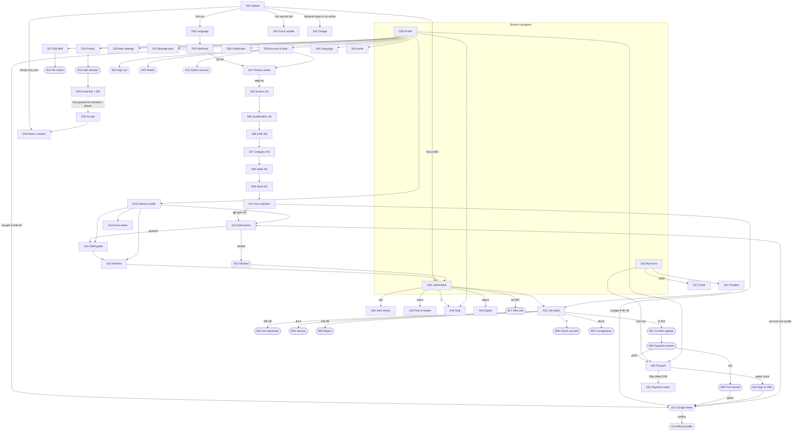

# 01 — Screen Inventory & Navigation Map

Sarkari Match · Android (Kotlin + Jetpack Compose, Material 3) · design v1.1 · 2026-11-19 (founder decisions applied: Google sign-in or guest, Play Billing only, no WhatsApp, privacy notice, multilingual)

This is the master list of every destination in the app. Every other design doc (03-scenarios, 04-screens,
05-notifications, 06-components) refers to these IDs. **Do not renumber**; add new IDs at the end of a range.
**Removed IDs are retired, never reused** (rows stay below, struck through, so frontend mappings remain stable).
Removed on 2026-11-19: S11, S12, S33, B11, D05. Added: S47–S49, B16–B17, D10–D12, O11. Full list: [CHANGES-2026-11-19.md](CHANGES-2026-11-19.md).

## Conventions

| Prefix | Kind | Compose implementation |
| --- | --- | --- |
| `S..` | Full-screen route | `NavHost` destination, typed `@Serializable` route object |
| `B..` | Modal bottom sheet | `ModalBottomSheet` hosted by the calling screen (state in that screen's ViewModel), *not* a nav destination unless marked "(route)" |
| `D..` | Dialog | M3 `AlertDialog` / `BasicAlertDialog` |
| `O..` | Overlay / inline system UI | Snackbar, banner, system notification, Play Billing sheet, OS settings |

Priority: **P0** = first release (weeks 3–10), **P1** = within 3 months, **P2** = later. A P0 screen may contain P1 sections; those are flagged in 04-screens.md.

Route naming: `snake_case` strings shown for deep-link and analytics; in code use `@Serializable data object Home`, `@Serializable data class JobDetail(val matchId: String, val src: String? = null)` etc. Ids are the API's (see `../contract-alignment.md`): `matchId` = the user's match with one post (per user), `applicationId` = the user's tracked application, `postId` = the shared post ("the job"), used only in links meant for other people.

Top-level structure: **3-tab bottom navigation** (shown only on S20, S22, S26):

| Tab | Hindi label | English label | Icon (Material Symbols Rounded) | Start route |
| --- | --- | --- | --- | --- |
| 1 | नौकरियाँ | Jobs | `work` (filled when selected) | S20 `home` |
| 2 | मेरे फ़ॉर्म | My forms | `assignment_turned_in` | S22 `applied` |
| 3 | प्रोफ़ाइल | Profile | `account_circle` | S26 `profile` |

Why only 3: low-literacy users, one job ("act on my alerts"). Notification history, settings and Pro live behind the top bar / Profile (secondary nav, `nav-hierarchy` rule). Badge on tab 1 = number of matches still needing a reply (max "9+").

---

## A. Launch, onboarding & sign-in

Sign-in is **optional** and **free**: Google Sign-In through Android Credential Manager (O11) or continue as guest (Firebase anonymous). There is no phone number, OTP or password anywhere in the app.

| ID | Route | Name (HI / EN) | Purpose | Entry points | Key components | P |
| --- | --- | --- | --- | --- | --- | --- |
| S01 | `splash` | स्प्लैश / Splash | Android 12 SplashScreen API; decide start route (onboarding vs home vs force-update vs outage) | App launch, notification tap when process dead | `installSplashScreen()`, logo, no custom delay (>0 ms only while DataStore read) | P0 |
| S02 | `onb/language` | भाषा चुनें / Choose language | Pick from the **enabled** languages (launch: हिंदी default, English), each written in its own script. Below, a collapsed "जल्द आ रही हैं / Coming soon" list of the other 11 languages (not selectable). The list comes from `ReferenceBundle.languages` so a language is enabled without an app release once its strings ship (07 §6) | First launch; S40 | `LanguageList` (06 §L1): `LanguageOptionCard` × enabled, `ComingSoonLanguageRow` × planned, primary button | P0 |
| S03 | `onb/welcome` | स्वागत / Welcome | Promise + trust: "सिर्फ़ आपकी नौकरियाँ। कोई मौका न छूटे।"; 3 icon+text bullets; "सरकारी ऐप नहीं" disclaimer; "शुरू करें" | After S02 | `IllustrationHeader` (vector), `BulletRow` ×3, `DisclaimerNote`, button, text link "पहले इस्तेमाल किया है? Google से साइन इन करें" → O11 (restores profile, SC-46) | P0 |
| S47 | `privacy` (onboarding variant `onb/privacy`) | आपकी जानकारी / Your data (privacy notice) | Plain-language notice **before** any profile question: what we store (exam interests, qualification, DOB, category, state, optional gender/PwD/ex-servicemen; device token; Google email only if you sign in), why (matching and reminders only), what we never ask (phone, Aadhaar, documents, contacts, location), ads note (non-personalised, Pro removes, B17), how to delete (Profile → अकाउंट और डेटा). One button "समझ गया, आगे बढ़ें"; no checkbox wall | After S03; S38 "प्राइवेसी नोटिस"; S39 | `PrivacyNoticeItem` ×5 (06 §K4), link to full policy, primary button | P0 |
| S04 | `onb/exams` | कौन-सी नौकरियाँ? / Exam interests | Step 1 of 6: multi-select exam groups (SSC, Railway, Bank, Police, Teacher, UPSC/State PSC, Defence, Other State jobs) + "सब" | S03 | `StepProgressHeader` (1/6), `SelectableTile` grid (2 col), sticky `BottomActionBar` | P0 |
| S05 | `onb/qualification` | पढ़ाई / Qualification | Step 2: highest qualification (10th / 12th / ITI / Diploma / Graduate + stream / PG) + status (passed / final year–result awaited) + optional extras (CCC, typing, NCC, B.Ed/D.El.Ed/TET) | S04 | `RadioListItem`, `SegmentedButton` (passed / result awaited), expandable "और योग्यता" chips | P0 |
| S06 | `onb/dob` | जन्मतिथि / Date of birth | Step 3: DOB as on 10th certificate; 3 numeric fields DD/MM/YYYY (not a calendar wheel); shows computed age | S05 | `DobInputRow` (3 `OutlinedTextField`, numeric keyboard), live helper "आपकी उम्र आज: 23 साल 4 महीने" | P0 |
| S07 | `onb/category` | वर्ग / Category | Step 4: General / EWS / OBC (non-creamy layer) / SC / ST; for EWS/OBC/SC/ST ask "certificate kis saal ka hai?" (FY, optional, P1 feeds S36) | S06 | `RadioListItem` ×5 with one-line Hindi explainers, optional `CertificateYearPicker` | P0 |
| S08 | `onb/state` | राज्य / State & domicile | Step 5: domicile state (searchable list; launch states pinned on top, from `ReferenceBundle.pinned_states`, assumed UP + Bihar), "क्या आपके पास इस राज्य का निवास प्रमाण पत्र है?" yes/no | S07 | `SearchField`, `RadioListItem` list, `YesNoToggle` | P0 |
| S09 | `onb/more` | और जानकारी / A few more | Step 6: gender (पुरुष/महिला/अन्य), PwD (नहीं/हाँ → type: locomotor/visual/hearing/other + ≥40% yes/no), ex-servicemen (नहीं/हाँ → service years), marital status *only if* a selected exam group needs it (hidden by default) | S08 | `ChipGroup` single-select, conditional `ExpandableSection`, "छोड़ें" text button per question (stored as `unknown`) | P0 |
| S10 | `onb/result` | आपका नतीजा / Your matches | Payoff: "आप अभी 7 नौकरियों के योग्य हैं" with top 3 job titles; completeness meter; CTA "मुझे सूचना भेजें" → permission flow; secondary `GoogleSignInButton` "Google से सेव करें (ज़रूरी नहीं)" → O11 (first sign-in offer, SC-44) | S09 (after server match, ≤3 s, else skeleton) | `MatchCountHero`, `MiniJobRow` ×3, `ProfileCompletenessBar`, buttons | P0 |
| ~~S11~~ | ~~`auth/phone`~~ | ~~मोबाइल नंबर / Phone~~ | **Removed 2026-11-19** (no phone number). Replaced by O11 Google sign-in, offered via B16 and inline buttons | — | — | — |
| ~~S12~~ | ~~`auth/otp`~~ | ~~OTP डालें / Verify OTP~~ | **Removed 2026-11-19** (no OTP). The profile-merge question moved to D10 | — | — | — |
| S13 | `perm/notifications` | सूचना की इजाज़त / Notification permission primer | Pre-permission explainer before the Android 13+ `POST_NOTIFICATIONS` system prompt; on Android 8–12 checks channel/app enabled instead. Explains *what* reminders we send (new match, every 3 days, 3 days / 1 day before, last-day morning), the 3-a-day cap and quiet hours, and that push is the **only** channel (no SMS/WhatsApp) | S10 primary CTA; Home banner when disabled; S28 | Sample notification, 3 bullets, button "इजाज़त दें" → system dialog; "अभी नहीं" | P0 |
| S14 | `perm/exact_alarm` | पक्का रिमाइंडर / Exact-alarm primer | On-device backup reminders (R1 + R-last, from the local reminder mirror) are now the only fallback when push fails, so this is **P0** (was P1) and the S28 toggle is on by default. Android 12+: `canScheduleExactAlarms()` false → explain → `ACTION_REQUEST_SCHEDULE_EXACT_ALARM`; denied → inexact ±15 min | S28 toggle; S29 row; S16 failure | Explainer, button "सेटिंग खोलें" | P0 |
| S15 | `perm/oem_guide` | फ़ोन की सेटिंग / Phone setup guide (OEM) | Brand-specific step list (Xiaomi/Redmi/POCO, Vivo, Oppo, Realme, OnePlus, Samsung, Motorola/stock) for autostart + battery "No restrictions" + lock in recents; deep-link buttons to the exact settings screen with fallback to app-info | After S13 (only on detected aggressive OEM or any device where `isIgnoringBatteryOptimizations` = false); S29; Home "अलर्ट नहीं आ रहे?" banner | `OemStepCard` list (step number, icon, Hindi text, "सेटिंग खोलें" button, "हो गया" checkbox), brand selector chip if detection unsure | P0 |
| S16 | `perm/self_test` | टेस्ट सूचना / Delivery self-test | Server sends a real FCM high-priority test push; after 60 s the screen shows "अभी भी इंतज़ार…" and gives the final result at the server's 120 s timeout; asks user to swipe app away for the "killed app" test. Failure offers S15 and the on-device backup (S14), never a paid channel | End of onboarding; S29 "फिर से जाँचें"; weekly auto-test result | `SelfTestStepper` (3 checks: permission, push received, push when app closed), result states | P0 |

## B. Main (bottom-nav) destinations

| ID | Route | Name | Purpose | Entry points | Key components | P |
| --- | --- | --- | --- | --- | --- | --- |
| S20 | `home` | नौकरियाँ / Jobs (Home) | Inbox of eligible jobs **that still need a reply**, grouped by urgency: "आज आखिरी दिन" → "जल्द ख़त्म" (≤3 days) → "नई" → "जवाब बाकी" ; plus "जाँच लें" (check-yourself) section; one native ad at the very bottom for free users (O10); banners (permission off, delivery problem, trial, corrigendum, offline) | Bottom nav; app open; digest push; most pushes when job list context needed | `TopAppBar` (logo wordmark, bell → S24, help), `StatusBanner` slot, `SectionHeader`, `MatchCard` list (`LazyColumn`, `key = matchId`), `EmptyState`, pull-to-refresh | P0 |
| S21 | `job/{matchId}` | नौकरी का पूरा ब्योरा / Job detail ("alert card") | The full alert: headline verdict, deadline countdown, primary actions (भर दिया / रुचि नहीं / बाद में), "आपको क्या चाहिए" card, "आप योग्य क्यों हैं" rules, official PDF + apply link, report wrong match, change log (corrigenda) | Push tap; App Link; S20/S22/S24/S25 rows | `DeadlineHero`, `ActionBar` (sticky bottom), `WhatYouNeedCard`, `WhyYouMatchList`, `OfficialLinksCard`, `ChangeLogCard`, `DisclaimerNote` | P0 |
| S22 | `applied` | मेरे फ़ॉर्म / My forms (tracker) | All jobs marked Applied. Each row shows next lifecycle stage + date. Free users: rows show "अगला चरण: एडमिट कार्ड — Pro में अलर्ट" lock row; Pro: live stage | Bottom nav; push "admit card out" | `TrackerRow` list, filter chips (चालू / पूरे), `ProUpsellInline` (free), `ClashBanner` (P1) | P0 |
| S23 | `applied/{applicationId}` | फ़ॉर्म की टाइमलाइन / Application timeline | Vertical lifecycle timeline: Applied → City slip → Admit card → Exam → Answer key (objection window) → Result → Cut-off → DV/Medical → Final. Each stage: status, date, official link, "क्या करें" | S22 row; lifecycle push; App Link | `LifecycleTimeline` (`TimelineStep` items), `StageActionCard`, `RescheduleNotice` | P0 (Pro) |
| S26 | `profile` | प्रोफ़ाइल / Profile | Account header (Google name/email, or "मेहमान / Guest" + `GoogleSignInButton` → B16 `settings`), profile summary (each field a row → edit), completeness, Pro status card, settings entry list | Bottom nav | `AccountHeader` (06 §K2), `ProStatusCard`, `SettingsRow` list grouped | P0 |

## C. Secondary screens (pushed on top, no bottom nav)

| ID | Route | Name | Purpose | Entry points | Key components | P |
| --- | --- | --- | --- | --- | --- | --- |
| S24 | `inbox` | पुरानी सूचनाएँ / Alert history | Every alert we sent (push only), newest first, with delivered/opened status; family alerts sent to linked members are marked `family_restroom`; lets user recover a dismissed push | S20 bell | `InboxRow` list, date `stickyHeader` | P1 |
| S25 | `archive` | पुरानी नौकरियाँ / Past & hidden jobs | Tabs: "रुचि नहीं" (with undo → back to S20), "तारीख निकल गई", "अब योग्य नहीं" (corrigendum/age) | S20 overflow menu; S26 | `TabRow`, `ArchiveRow` | P1 |
| S27 | `profile/edit/{field}` | प्रोफ़ाइल बदलें / Edit profile field | Reuses S04–S09 bodies in edit mode (top bar with back + "सेव करें"), then shows B15 re-match result | S26 rows; B05 ("मेरी प्रोफ़ाइल गलत है"); "check yourself" missing-info chip | Same components as onboarding step, `TopAppBar` with save | P0 |
| S28 | `settings/alerts` | अलर्ट सेटिंग / Alert settings | Quiet hours (default 22:00–07:00), reminder time, digest on/off + time (P1), max per day (fixed 3, info only), **on-device backup reminder** (P0, default on → S14 if exact alarms are blocked), notification channels shortcut | S26; S13 denied path | `SwitchRow`, `TimeRangeRow` → `TimePicker` dialog, `InfoRow` | P0 |
| S29 | `settings/delivery` | अलर्ट पक्के करें / Delivery health | Traffic-light checklist: permission, channel importance, battery optimisation, autostart (self-reported), last test result + date, on-device backup reminder (exact-alarm state). Fix buttons | S26; Home banner "अलर्ट शायद नहीं पहुँच रहे"; weekly self-test failure push | `HealthCheckRow` ×6, buttons to S13/S14/S15/S16 | P0 |
| S30 | `pro` (route) | Pro प्लान / Paywall (full) | Plans: ₹199/साल (₹17/महीना), ₹49/सीज़न (4 महीने); benefits (lifecycle alerts, no ads, clash, certificate, family — P1 ones tagged "जल्द"); trial text button; **Google Play Billing only** (UPI, cards and Play balance are inside Play's sheet O06); restore link. Guests see B16 `pro` once before the Play sheet (optional) | B02 "प्लान देखें"; S26 Pro card; S22 lock rows; trial-expiry push; ad slot; locked features | `PlanOptionCard` ×2 (radio), `BenefitRow` ×6, `PrimaryButton`, Play legal text | P0 |
| S31 | `pro/status` | भुगतान की स्थिति / Payment status | Result after purchase: success / pending (Play `PENDING`, e.g. UPI inside Play not yet confirmed) / failed / cancelled, with next step | Return from Play Billing; pending purchase resolves | `ResultIllustration`, title/body, buttons | P0 |
| S32 | `pro/manage` | मेरा प्लान / Manage plan | Current plan, expiry date, renew/upgrade season→year, "Play Store में मैनेज करें", restore purchase (Play purchase history of the phone's Play account; Google sign-in carries Pro to other devices), receipt list | S26 Pro card | `PlanSummaryCard`, `SettingsRow` list | P0 |
| ~~S33~~ | ~~`whatsapp`~~ | ~~WhatsApp अलर्ट / WhatsApp backup~~ | **Removed 2026-11-19** (no WhatsApp). Pro delivery = push + on-device backup reminders; family alerts go to the member's own app | — | — | — |
| S34 | `family` | परिवार अलर्ट / Family alerts | Pro: up to 2 linked family members (relation + optional nickname; **no phone number**); status invite sent / linked / declined; which alerts they get as push on **their own app** (1 day before, last day, admit card, DV/medical) | S26; S30 benefit; S31 success | `FamilyLinkRow` (06 §K6), add button → B12 → S48, remove → D06 | P1 |
| S35 | `family/accept/{token}` | परिवार निमंत्रण / Family invite (invitee) | For a family member who opens the invite link or scans the QR (phone camera → App Link; app not installed → Play Store with install referrer): one tap "हाँ, अलर्ट भेजें" → notification permission (S13 variant) → S49. No phone, no OTP, no profile, no sign-in needed (guest UID is enough; Google sign-in offered later to keep the link on a new phone) | Invite link / QR shared through any app via the Android sharesheet | `InviteSummaryCard`, button, decline link | P1 |
| S36 | `certificates` | सर्टिफ़िकेट / Certificates | Pro: category (OBC-NCL/EWS) certificate FY, domicile certificate date, PwD certificate; per-job validity verdict, renew reminder | S26; certificate alert push; S21 WhatYouNeed row "⚠ आपका OBC सर्टिफ़िकेट" | `CertificateRow`, `MonthYearPicker`, `ValidityBadge` | P1 |
| S37 | `clash/{clashId}` | परीक्षा टकराव / Exam clash | Pro: two applied exams on same day/week; shows both with dates, what to do (check official change-of-date rules) | Clash push; S22 banner | `ClashCompareCard` ×2, guidance text, official links | P1 |
| S38 | `account` | अकाउंट और डेटा / Account & privacy | Google account (email) or "मेहमान" + sign-in, switch account (D11), alert device ("यही फ़ोन अलर्ट पाता है"), privacy notice (S47), download my data (DPDP), delete account, sign out (signed-in users only) | S26 | `SettingsRow`, destructive section separated | P0 |
| S39 | `help` | मदद / Help & about | FAQ (simple Hindi), "यह सरकारी ऐप नहीं है" disclaimer, data sources list, privacy notice (S47), contact by email and in-app feedback form, app version, licences | S20 top bar "?"; S26 | `FaqItem` (expandable), `SettingsRow` | P0 |
| S40 | `settings/language` | भाषा / Language | Same body as S02 (enabled languages + coming-soon list); applies instantly via `AppCompatDelegate.setApplicationLocales`; also reachable from Android's per-app language setting (13+), which lists only enabled locales | S26 | `LanguageList` | P0 |
| S41 | `force_update` | अपडेट ज़रूरी / Update required | Blocking screen when `minSupportedVersion` > current; Play In-App Update (IMMEDIATE) or Play Store link | S01 remote-config check | Illustration, text, button | P0 |
| S42 | `outage` | सर्वर में दिक्कत / Service problem | Shown when the backend health endpoint says `down` or 3 consecutive 5xx: cached data stays readable, banner otherwise; full-screen only if no cache at all | S01; any screen (as banner O03) | Illustration, cached-data link, retry | P0 |
| S43 | `age_countdown` | उम्र की सीमा / Age-limit countdown | Per exam: "SSC CGL — 2 मौके और", list sorted by fewest chances | S26; age-crossing push | `AgeChanceRow` | P2 |
| S44 | `digest/{date}` | आज का सारांश / Daily digest | Opens from the digest push: the matches that overflowed the 3-push cap + low-priority updates, as a compact list | Digest push | `DigestHeader`, `MatchCard` (compact variant) | P1 |
| S45 | `refer` | दोस्त को बताएँ / Invite a friend | Share link; +1 month Pro for both on friend's first Applied | S26; S10 share | Share sheet trigger, referral status | P1 |
| S46 | `share_card` | योग्यता कार्ड / Share eligibility card | Render "मैं 7 नौकरियों के योग्य हूँ" image (no personal data except first name optional) and share via Android sharesheet | S10, S20 overflow | Composable rendered to bitmap, share button | P1 |
| S48 | `family/invite/{inviteId}` | परिवार को जोड़ें / Family invite (share) | Aspirant side: after B12, shows the invite as a link and a QR code (same `https://sarkarimatch.in/f/{token}`), "शेयर करें" → Android sharesheet (O08: any messaging app, chosen by the user; we send nothing ourselves), "QR दिखाएँ" for a family member sitting nearby, expiry (7 days), live status (waiting → linked, N-44) and "निमंत्रण रद्द करें" | B12; S34 row "निमंत्रण भेजा" | `InviteShareCard` (06 §K5), primary share button, status row | P1 |
| S49 | `family/following` | मुझे किसके अलर्ट आते हैं / Alerts I receive (family member) | Home for a family member (also works alongside their own profile): each linked aspirant (first name + relation), the next critical date per form, last alert, "अलर्ट बंद करें" → D12. A family-only user (no profile) gets this as start destination instead of S20, with a link "अपनी नौकरियाँ भी देखें" → S04 | After S35 accept; S26 row "मुझे किसके अलर्ट आते हैं"; N-50…N-53 tap | `FamilyFollowingCard`, `SettingsRow` | P1 |

## D. Bottom sheets

| ID | Name | Trigger | Content | P |
| --- | --- | --- | --- | --- |
| B01 | फ़ॉर्म भर दिया? / Confirm Applied | Tap "भर दिया" on S21/S20 card/push action "भर दिया" (push action marks directly, then opens B02 on next app open) | "क्या आपने {job} का फ़ॉर्म सबमिट कर दिया?" + optional "फ़ीस भी भर दी" checkbox; buttons "हाँ, भर दिया" / "अभी नहीं" | P0 |
| B02 | आखिर तक ट्रैक करें? / Paywall moment | Immediately after the first B01 confirm; afterwards after an Applied at most once per 7 days while the user is not Pro (API `paywall.variant`) | Trial not used (`trial_offer`): "अगले 14 दिन Pro मुफ़्त — एडमिट कार्ड, रिज़ल्ट, DV की सूचना" button "14 दिन मुफ़्त शुरू करें" (no payment). The trial starts **only on this tap** (`POST /v1/me/trial`), 14 days from the tap. Trial used (`plans`): plans summary → S30 | P0 |
| B03 | रुचि नहीं / Not interested | Tap "रुचि नहीं" | Optional multi-select reason chips (पोस्ट पसंद नहीं, जगह दूर है, तैयारी नहीं है, पहले से नौकरी है, मैं योग्य नहीं हूँ → B05) → API `not_interested_reasons[]`; hides job; Snackbar "छुपा दिया · वापस लाएँ" (Undo 6 s) | P0 |
| B04 | बाद में याद दिलाएँ / Snooze | Tap "बाद में" or push action "बाद में" | Options (SC-12): ≥ 4 days left "कल सुबह 9 बजे" · "आखिरी तारीख से 2 दिन पहले"; 2–3 days left "कल सुबह 9 बजे" · "आज शाम 7 बजे"; ≤ 1 day: no snooze. Never past the last-day morning reminder | P0 |
| B05 | गलत मैच बताएँ / Report wrong match | S21 "यह मैच गलत है?" link; B03 reason | Reason list (उम्र, पढ़ाई, वर्ग, राज्य, लिंग, कुछ और) + optional note (140 chars); "मेरी प्रोफ़ाइल गलत है" → S27 | P0 |
| B06 | ख़ुद जाँच लें / Check-yourself explainer | Tap "?" verdict chip or "क्यों?" on a check-yourself card | Which rule is uncertain and why (e.g. "नोटिस में 'समकक्ष डिग्री' लिखा है — आपकी डिग्री मान्य है या नहीं, PDF पेज 7 देखें"); buttons "PDF खोलें" / "मैंने जाँच लिया — मैं योग्य हूँ" (API `confirm_eligible`; alerts continue) / "मैं योग्य नहीं — छुपाएँ"; missing-profile variant: "मेरे पास है — प्रोफ़ाइल में जोड़ें" → S27 | P0 |
| B07 | नोटिस में बदलाव / Corrigendum details | Tap corrigendum banner on S21/S20 | Before → after diff rows ("आखिरी तारीख: 15 सितं → 22 सितं"), effect on your verdict, link to corrigendum PDF | P0 |
| B08 | ट्रायल शुरू / Trial started | After B02 trial CTA | "14 दिन Pro चालू — {date} तक", 3 things now on (lifecycle alerts, no ads, exam-date changes); guest: CTA `GoogleSignInButton` "Google से सेव करें — फ़ोन बदलने पर भी साथ रहेगा" (→ O11), else "ठीक है" | P0 |
| B09 | ट्रायल ख़त्म हो रहा है / Trial ending | App open on day 12–14 of trial; tap trial-ending push | "{n} दिन बचे। आपके {k} फ़ॉर्म की अगली सूचना: {stage} {date}" + plans | P0 |
| B10 | प्रोफ़ाइल बदली — नए नतीजे / Re-match result | After S27 save | "+2 नई नौकरियाँ मिलीं", "−1 अब योग्य नहीं" lists, CTA "देखें" | P0 |
| ~~B11~~ | ~~UPI ऐप चुनें / UPI payment~~ | — | **Removed 2026-11-19.** Google Play Billing only; UPI is offered inside Play's own purchase sheet (O06). The validation test is a Play closed-testing build | — |
| B12 | परिवार सदस्य जोड़ें / Add family member | S34 add | Relation chips (पिता, माँ, भाई, बहन, पति, पत्नी, दूसरा) + optional nickname (only shown to you); explainer "आप उन्हें एक लिंक भेजेंगे। लिंक खोलकर वे अपने फ़ोन पर ऐप में अलर्ट पाएँगे।"; **no mobile number**; CTA "निमंत्रण बनाएँ" → S48 | P1 |
| B13 | सूचना का सार / Digest time | S28 digest time row | Time options 8 am / 1 pm / 7 pm / 9 pm | P1 |
| B14 | उम्र सीमा पार / Age limit crossed | Push "age crossed" tap or app open after crossing | Empathetic copy, which jobs/exams closed, remaining options with relaxations | P1 |
| B15 | डिवाइस बदली / New device signed in | App open on old device after the same Google account signed in elsewhere (single active push device for alerts); also N-47 | "आपके अलर्ट अब {device} पर आएँगे" + "इसी फ़ोन पर पाएँ" | P0 |
| B16 | Google से साइन इन करें? / Sign-in offer | Optional, never blocking. Variants: `pro` (once, before the Play sheet, guests only), `sync` (guest with ≥ 1 Applied, inline card on S22, dismiss = 30 days), `family` (Pro guest opening S34), `settings` (S26/S38 button). After first matches the offer is the S10 inline button, and after the trial B08 | Icon `cloud_done`, title per variant, 3 bullets ("फ़ोन बदलने पर प्रोफ़ाइल और फ़ॉर्म वापस", "Pro आपके Google अकाउंट से जुड़ा रहेगा", "हम सिर्फ़ नाम और ईमेल लेते हैं — कोई पासवर्ड या नंबर नहीं"), `GoogleSignInButton` → O11, text "अभी नहीं" | P0 |
| B17 | विज्ञापन क्यों? / Why ads | Ad slot "क्यों?" link (O10); S47 ads row | "मुफ़्त अलर्ट चलाने के लिए एक छोटा विज्ञापन", non-personalised (no advertising ID, no profile data shared with ad networks), never in reminders/job details, "विज्ञापन ठीक नहीं? बताएँ", "Pro में कोई विज्ञापन नहीं" → S30 | P0 |

## E. Dialogs

| ID | Name | Trigger | P |
| --- | --- | --- | --- |
| D01 | सूचना बंद है — सेटिंग खोलें / Notifications blocked | Permission permanently denied (`shouldShowRequestPermissionRationale` false after denial) or channel disabled | P0 |
| D02 | साइन आउट करें? / Sign-out confirm | S38 (signed-in users only; guests have no sign-out, only delete) | P0 |
| D03 | अकाउंट हमेशा के लिए हटाएँ? / Delete account (step 2: type "हटाएँ"; signed-in users re-confirm with Google, no OTP) | S38 | P0 |
| D04 | डेटा डाउनलोड / Data export ready | S38 export | P0 |
| ~~D05~~ | ~~WhatsApp opt-out confirm~~ — **removed 2026-11-19** | — | — |
| D06 | परिवार सदस्य हटाएँ? / Remove family member | S34 | P1 |
| D07 | बिना सेव किए जाएँ? / Discard unsaved changes | Back on S27 with edits | P0 |
| D08 | ख़रीद वापस लाएँ — नतीजा / Restore purchase result | S32/S30 restore | P0 |
| D09 | ऐप अपडेट उपलब्ध / Flexible update available | Remote config `recommendedVersion` | P1 |
| D10 | कौन-सी प्रोफ़ाइल रखें? / Profile conflict | Guest with a profile signs in to a Google account that already has a different profile (API 409 `profile_conflict`) | P0 |
| D11 | Google अकाउंट बदलें? / Switch account | S38 "अकाउंट बदलें": this phone's data is saved to the current account, then O11 with account chooser | P0 |
| D12 | {name} के अलर्ट बंद करें? / Stop family alerts | S49 (family member side) | P1 |

## F. Overlays, banners & system surfaces

| ID | Name | Where | P |
| --- | --- | --- | --- |
| O01 | Offline banner "इंटरनेट नहीं है — पुरानी जानकारी दिख रही है ({time})" | Top of S20/S21/S22/S23 content, below top bar | P0 |
| O02 | Permission/delivery warning banner | S20 top | P0 |
| O03 | Outage banner "हमारे सर्वर में दिक्कत है। अलर्ट थोड़ी देर से आ सकते हैं।" | S20 top | P0 |
| O04 | Snackbars (undo hide, saved, copied, applied) | Any | P0 |
| O05 | System push notifications (see 05-notifications.md) | OS | P0 |
| O06 | Play Billing purchase sheet (the only payment surface; UPI, cards, Play balance inside it) | OS/Play | P0 |
| O07 | OS settings deep links (app notification settings, battery optimisation, exact alarm, OEM autostart) | OS | P0 |
| O08 | Android sharesheet | OS | P1 |
| O09 | Play In-App Update (immediate/flexible) | Play | P0 |
| O10 | Native ad slot "विज्ञापन · Ad" (free tier only; 06 §J1) with "क्यों?" → B17 | Last item of S20 feed and of S44 digest — nowhere else | P0 |
| O11 | Credential Manager "Sign in with Google" bottom sheet (`GetSignInWithGoogleOption` from our button; account chooser for D11) | OS/Google Play services | P0 |

---

## Navigation map

## Deep links (all routes reachable; `deep-linking` rule)

Assumed domain `sarkarimatch.in` (placeholder until bought). App Links verified via `assetlinks.json`; custom scheme `sarkarimatch://` for push payloads.

| Link | Destination | Back-stack synthesised |
| --- | --- | --- |
| `https://sarkarimatch.in/j/{matchId}?src=push` | S21 | S20 → S21 |
| `https://sarkarimatch.in/p/{postId}?src=share` (shared with another person; opens their own match or a read-only verdict) | S21 | S20 → S21 |
| `https://sarkarimatch.in/a/{applicationId}` | S23 | S22 → S23 |
| `https://sarkarimatch.in/go/{matchId}` (web only: tracked redirect to the official apply site; no longer used by any message after WhatsApp removal, kept for the web fallback page) | browser | — |
| `sarkarimatch://job/{matchId}` | S21 | S20 → S21 |
| `https://sarkarimatch.in/pro?plan=year|season&src=` | S30 | S20 → S30 |
| `https://sarkarimatch.in/f/{token}` (family invite link; the S48 QR encodes the same URL) | S35 | none (S35 is root for invitees); after accept → S49 |
| `sarkarimatch://family/following` | S49 | S49 (family-only) or S26 → S49 |
| `sarkarimatch://digest/{yyyy-mm-dd}` | S44 | S20 → S44 |
| `sarkarimatch://delivery` | S29 | S26 → S29 |
| `sarkarimatch://clash/{clashId}` | S37 | S22 → S37 |
| `sarkarimatch://certificates` | S36 | S26 → S36 |
| ~~`sarkarimatch://whatsapp`~~ | removed with S33 | — |
| `sarkarimatch://privacy` | S47 | S26 → S38 → S47 |
| `sarkarimatch://test` | S16 | S26 → S29 → S16 |

Rules: deep link opened before onboarding is complete → S02 flow, then continue to the target (store pending link in `SavedStateHandle`/DataStore). Unknown or expired `matchId` → S21 "नहीं मिली" error state with button to S20. Every deep link adds `src` for analytics.

## Count

- Full screens: 43 active (S01–S49 minus retired S11, S12, S33; S17–S19 reserved) — 31 P0 (incl. new S47; S14 moved P1→P0), 11 P1 (S24, S25, S34–S37, S44–S46, S48, S49), 1 P2 (S43)
- Bottom sheets: 16 active (B01–B17, B11 retired) · Dialogs: 11 active (D01–D12, D05 retired) · Overlays: 11 (O01–O11)
