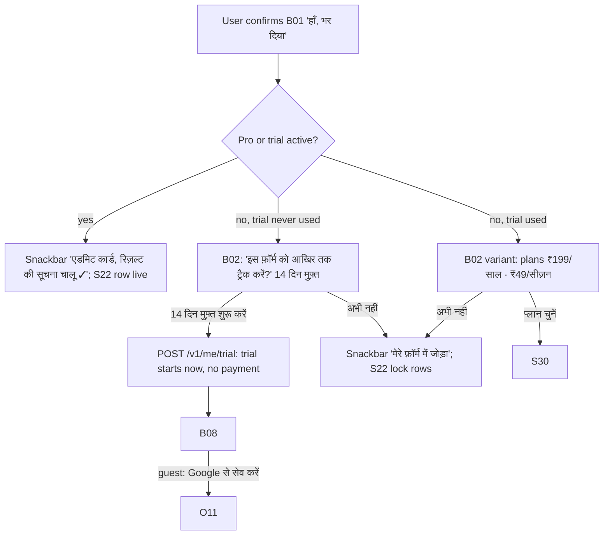
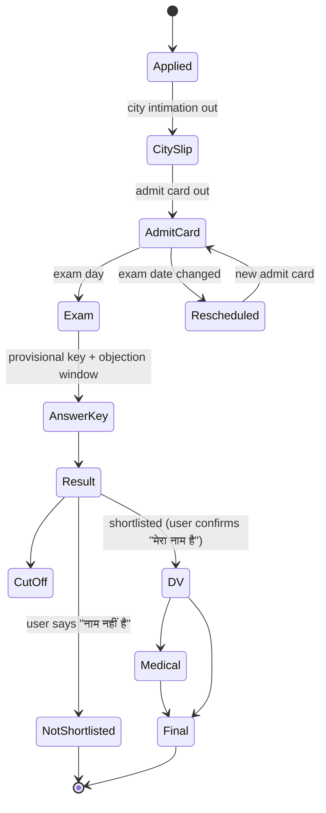

# 03 — Scenario Catalogue (user flows)

Every scenario lists **trigger → steps (screen IDs from 01) → end state**, the copy that matters, and edge cases. Screen-level copy and states are in 04-screens.md; push templates (`N-xx`) are in 05-notifications.md.

**2026-11-19 founder decisions applied:** sign-in is Google (Credential Manager) or guest, no phone/OTP (SC-03, SC-44–SC-46); Play Billing only (SC-25 retired); no WhatsApp or SMS at all (SC-31 retired; delivery = FCM push + on-device backup reminders); family alerts are pushes to the member's own app, linked by a shared link/QR (SC-32); privacy notice, notification pre-prompt and ads notice (SC-47, SC-48); multilingual (SC-04, SC-49). Retired scenario numbers are kept as headings so links stay valid.

Notation: `S21` screen · `B04` sheet · `D01` dialog · `O01` banner · `N-01` push template · `ev:` analytics event.

## 0. Core models the flows depend on

### 0.1 User-job state machine (one per user × post)

```mermaid
stateDiagram-v2
  [*] --> New: match published (eligible or checkYourself)
  New --> Reminding: first push sent (N-01)
  Reminding --> Snoozed: B04 snooze
  Snoozed --> Reminding: snooze time reached
  Reminding --> Applied: B01 confirm / push action
  Snoozed --> Applied
  Reminding --> NotInterested: B03
  Snoozed --> NotInterested
  NotInterested --> Reminding: Undo (6 s) or S25 "वापस लाएँ" (window open)
  Reminding --> ExpiredUnanswered: lastDate passed (IST 23:59)
  Snoozed --> ExpiredUnanswered
  ExpiredUnanswered --> Applied: "हाँ, भरा था" within 30 days
  Reminding --> NoLongerEligible: corrigendum / profile edit / age
  Snoozed --> NoLongerEligible
  NoLongerEligible --> Reminding: later change makes eligible again
  Reminding --> NoticeCancelled: notice withdrawn
  Applied --> Lifecycle: Pro or trial active
  Applied --> AppliedFree: no Pro (only stores; S22 shows lock rows)
  AppliedFree --> Lifecycle: buys Pro (backfills current stage)
  Lifecycle --> Closed: final result / DV done / user "अब ट्रैक न करें"
  Applied --> NoticeCancelled
```



Rules: reminders fire only in `New/Reminding`. `Applied` and `NotInterested` are user-reversible from S21/S25 ("गलती से दबाया? बदलें"). Server is the source of truth; the app writes optimistic local state in Room and syncs (queued in WorkManager if offline).

### 0.2 Reminder scheduler (server, per user-job)

| Slot | When (IST) | Free | Pro adds | On-device backup (all users) | Priority rank for daily cap |
| --- | --- | --- | --- | --- | --- |
| R0 New match | at publish (≤ 6 h after review) | N-01 | — | — | 4 |
| Rp Periodic | every 3 days after R0 at user's reminder time (default 19:00) while ≥ 4 days left | N-02 | — | — | 6 |
| R3 3 days before | L−3 at reminder time | N-03 | — | — | 5 |
| R1 1 day before | L−1 at reminder time, high priority | N-04 | family N-50 (P1) | local mirror at slot + 30 min if push not received | 2 |
| R-last Last day | L−0 at 08:00, high priority | N-05 | family N-51 (P1) | local mirror at 08:15 if push not received | 1 |
| Lifecycle critical (DV, medical, admit card, reschedule) | at publish | — | N-20.., family N-52/N-53 (P1) | — | 3 |
| Corrigendum / extension / cancelled | at publish | N-10..N-13 | — | — | 4 |

- **Daily cap = 3 pushes per user per IST day** (across all jobs). If more are due, the lowest-ranked are deferred: P0 → to the next day's first slot; P1 → folded into the **digest** (N-30, default 19:00, does not count toward the cap). Ranks 1–3 are never deferred (they can exceed the cap; observed max ≈ 5).
- **Quiet hours** 22:00–07:00 (user-editable in S28): due pushes wait until quiet hours end, except ranks 1–3 whose deadline/slot is within the next 24 h.
- **Snooze** (B04) suppresses Rp/R3 for that job until the chosen time; **R1 and R-last are never suppressed** (a snooze option can't go past them).
- **Collapse**: one job never gets two pushes on the same day; if R3 and Rp coincide, send R3. Updates replace the previous notification for the same job (tag = `match_id`, the push `collapse` value).
- **No second channel.** There is no WhatsApp or SMS escalation (removed 2026-11-19). The fallback when push fails is the **on-device backup reminder**: the app keeps a local mirror of R1 and R-last (same reminder ids) in WorkManager/AlarmManager and fires it only if the matching push was not received (S14, S28). It works without internet, for free and Pro users alike.
- **Family (Pro, P1)**: R1, R-last, admit card and DV/medical also go as push to each linked family member's own app (N-50…N-53). They do not count toward the member's own daily cap.
- Each slot is cancelled server-side the moment the user-job leaves `New/Reminding/Snoozed`.

### 0.3 Match verdicts

| Verdict | Shown? | Badge | When |
| --- | --- | --- | --- |
| eligible | Yes, normal reminders | ✓ योग्य (success) | All rules pass |
| checkYourself | Yes, normal reminders, card says why | ? ख़ुद जाँचें (warning) | ≥1 rule unknown: profile field `unknown`, ambiguous rule ("equivalent degree"), result-awaited qualification, certificate date unknown |
| notEligible | **Never pushed**; visible only in S25 if previously matched | ✗ योग्य नहीं (error) | Any rule fails |

---

## 1. Install, onboarding & sign-in

### SC-01 First install → full onboarding (happy path, < 2 min)

```mermaid
flowchart LR
  A[Install from Play / group link] --> S01 --> S02[S02 हिंदी selected] --> S03 --> S47[S47 Privacy notice] --> S04[Exams] --> S05[Qualification] --> S06[DOB] --> S07[Category] --> S08[State] --> S09[More] --> S10[You match 7 jobs]
  S10 -->|मुझे सूचना भेजें| S13 -->|Allow| S15 --> S16 --> S20[Home with 7 cards]
  S10 -->|Google से सेव करें| O11[O11 Google sheet] --> S13
```



| Step | Screen | What happens | Key copy (HI / EN) |
| --- | --- | --- | --- |
| 1 | S01 | Splash ≤ 1 s; anonymous Firebase UID created silently (guest; needed for FCM token + server match) | — |
| 2 | S02 | Hindi pre-selected unless the device locale is an enabled language; tap "आगे बढ़ें" | "अपनी भाषा चुनें / Choose your language" |
| 3 | S03 | Value + disclaimer | "सिर्फ़ आपकी नौकरियाँ। कोई मौका न छूटे।" |
| 3a | S47 | Privacy notice (SC-47), one button | "आपकी जानकारी, सीधी बात" |
| 4–9 | S04–S09 | One question per screen, progress "1/6"…; auto-advance on single-choice screens after 250 ms; back keeps answers; answers autosaved on device after each step (Room `profile_draft`, frontend state-management §5; `form-autosave`) | see 04 |
| 10 | S10 | Profile POSTed; server returns verdict counts; skeleton ≤ 3 s; if > 8 s show "नतीजे थोड़ी देर में आएँगे — हम सूचना भेज देंगे" and continue | "आप अभी **7** नौकरियों के योग्य हैं" |
| 11 | S13 | Pre-prompt → system prompt | "आखिरी तारीख से पहले याद दिलाने के लिए सूचना की इजाज़त दें" |
| 12 | S15 | Only on aggressive OEMs or when battery optimised (see SC-08) | — |
| 13 | S16 | Test push arrives → "सूचना पहुँच गई ✓" → "ठीक है" → S20 | "टेस्ट सूचना आई?" |

ev: `onb_start`, `onb_step_complete{step}`, `onb_complete{secs, fields_unknown}`, `match_count_shown{eligible, check}`.
Edge: process death mid-onboarding → resume at last incomplete step. Rotation/landscape → same layout in scroll. Back from S04 → S03 (not exit).

### SC-02 Skip / partial profile

- S09 questions each have "छोड़ें / Skip" → stored `unknown`. S05–S08 have no skip (needed for any match) but S07 has "पता नहीं / Not sure" → treated as **General** for matching *plus* every job that a reserved category would unlock is shown as `checkYourself` with rule line "? वर्ग पता नहीं — OBC/SC/ST हैं तो उम्र में छूट मिल सकती है".
- Leaving the app during onboarding → nothing is pushed (no profile = no matching). Day-1 local reminder (WorkManager, once): N-40 "आपकी प्रोफ़ाइल 4/6 पूरी है — 1 मिनट में पूरी करें".
- S10 shows `ProfileCompletenessBar` "प्रोफ़ाइल 80% पूरी" + chip per unknown field → S27.
- Home S20 shows inline card "2 जानकारी बाकी — इससे और सही मैच मिलेंगे" until filled or dismissed twice.
- ev: `onb_skip{field}`, `onb_abandon{step}`.

### SC-03 Google sign-in (optional) and guest mode

Founder decision: login is **free and optional**. Two states only:

| State | How | What works |
| --- | --- | --- |
| **Guest** (default) | Firebase anonymous UID created on first launch, no screen | Everything: matching, reminders, Applied, trial, Pro purchase, ads, family invite (accept side) |
| **Signed in with Google** | Credential Manager "Sign in with Google" (O11) → Google ID token → Firebase Auth Google provider, **linked** to the same UID (`linkWithCredential`) | Same, plus: profile, forms and Pro follow the account to a new phone (SC-46); data export by email address shown; account switching |

We read only the Google account's name, email and photo URL (standard `openid email profile` scopes), never contacts,
Drive or phone number. There is no password, phone number or OTP anywhere.

**Where sign-in is offered** (never blocking, never more than one offer per session):

| Moment | Surface | Copy (HI) |
| --- | --- | --- |
| After the first matches | S10 secondary button | "Google से सेव करें (ज़रूरी नहीं)" |
| Returning user on a new phone | S03 text link | "पहले इस्तेमाल किया है? Google से साइन इन करें" |
| Before a Pro purchase (guest, once) | B16 `pro` | "Pro को अपने Google अकाउंट से जोड़ें?" |
| After the trial starts (guest) | B08 | "Google से सेव करें — फ़ोन बदलने पर भी साथ रहेगा" |
| Has ≥ 1 Applied, still guest | S22 inline card → B16 `sync` (dismiss = 30 days) | "अपने फ़ॉर्म Google अकाउंट में सेव करें" |
| Pro guest opens family | B16 `family` | "परिवार का लिंक नए फ़ोन पर भी रहे" |
| Any time | S26 header, S38 | `GoogleSignInButton` |

```mermaid
flowchart TD
  E[Entry: S10 / S03 / B16 / B08 / S26 / S38] --> CM[O11 Credential Manager: GetSignInWithGoogleOption]
  CM -->|user cancels / no Google account on phone| BACK[Back to entry, still guest; snackbar only if they tapped from S26/S38: 'साइन इन नहीं हुआ']
  CM -->|ID token| LINK[Firebase linkWithCredential: guest UID → Google]
  LINK -->|ok, new Google account| DONE[Snackbar 'Google अकाउंट से जुड़ गया ✓'; account header shows email]
  LINK -->|account already exists| SW[signInWithCredential to that account]
  SW --> C{both sides have a profile?}
  C -->|only the account has one| R[Restore: account profile + forms + Pro load; local guest data merged: Applied/not-interested states kept, latest wins]
  C -->|only this phone has one| U[Upload this phone's profile to the account]
  C -->|both, and they differ| D10[D10 'कौन-सी प्रोफ़ाइल रखें?' — Google अकाउंट वाली (सुझाया) / इस फ़ोन वाली]
  D10 --> R
  CM -->|offline| OFF[Button disabled with reason 'साइन इन के लिए इंटरनेट चाहिए']
```

- Merging (API `merge=auto` → 409 `profile_conflict` → `keep_local` / `discard_local`, unchanged contract): job
  states merge by latest `updatedAt`; Pro entitlement is the union (an active purchase is never lost); the guest UID's
  FCM token moves to the account; reminders are re-planned once.
- No Google account on the phone (rare): O11 offers "Add account"; if the user backs out they stay guest. Phones
  without Google Play services cannot install from Play, so they are out of scope.
- ev: `signin_offer_view{surface}`, `signin_start{surface}`, `signin_result{result: linked|switched|cancelled|error, merge}`.

### SC-04 Language switch

- S40 (or S02 at onboarding): tap English → `AppCompatDelegate.setApplicationLocales("en")` → activity recreates, stays on S40 with snackbar "Language changed to English". Only enabled languages are selectable; the "जल्द आ रही हैं" list is informational (07 §6).
- Server stores `lang`; **all future pushes switch language** (pushes are built on the device from string keys, so they follow the app language immediately; server-rendered text such as rule lines follows `lang`). Already-delivered notifications are not rewritten.
- Choosing Urdu (once enabled) flips the layout to RTL on recreate (07 §4); the notification channel names are re-registered in the new language.
- Job data: titles from official notices are shown as published (often English); Hindi UI wraps them ("SSC CGL 2026 — आखिरी तारीख 24 अगस्त"). Rule lines are templated in both languages.
- ev: `language_changed{from,to,surface}`.

---

## 2. Permissions & delivery reliability

### SC-05 Notification permission granted (Android 13+)

S13 → "इजाज़त दें" → system `POST_NOTIFICATIONS` dialog → Allow → create channels (05 §1) → S15/S16. ev: `notif_perm_prompt`, `notif_perm_result{granted}`.

### SC-06 Notification permission denied

```mermaid
flowchart TD
  S13 -->|अभी नहीं| H1[S20 + O02 banner 'सूचना बंद है — आपको आखिरी तारीख की याद नहीं आएगी' 'चालू करें']
  S13 -->|Allow tapped but system Deny| H2[S20 + O02]
  O02[O02 tap] --> C{shouldShowRationale?}
  C -->|true (denied once)| S13
  C -->|false (denied twice / 'Don't ask again')| D01[D01 'सेटिंग में जाकर चालू करें' → ACTION_APP_NOTIFICATION_SETTINGS]
  D01 -->|return, now enabled| OK[snackbar 'सूचना चालू हो गई']
  H1 --> W[Weekly: if still off on app open, show S13 once more (max 3 times total)]
```

- Android 8–12: no runtime permission; check `NotificationManagerCompat.areNotificationsEnabled()` and per-channel importance (`IMPORTANCE_NONE` → banner "‘आखिरी तारीख’ वाली सूचनाएँ बंद हैं" → `ACTION_CHANNEL_NOTIFICATION_SETTINGS`).
- While off: Home still works, and the S20 banner stays until fixed. There is no other channel to fall back to, so S13's copy says this plainly ("सूचना बंद रही तो हम आपको याद नहीं दिला पाएँगे"). On-device backup reminders also need the notification permission.
- Metric: users who disable notifications < 15 % — ev `notif_disabled_detected{api, channel}`.

### SC-07 Exact-alarm permission (on-device backup; P0 since 2026-11-19)

Context: reminders are server-pushed (FCM high priority). Since WhatsApp was removed, the **on-device backup** is the only fallback and is **P0, on by default**: local alarms for **R1** (reminder time + 30 min) and **R-last** (08:15 last day), each cancelled when the matching push arrives. They need exact timing on Android 12+.
S28 toggle "बिना इंटरनेट भी आखिरी दिन की याद" → if `!alarmManager.canScheduleExactAlarms()` → S14 explainer → `ACTION_REQUEST_SCHEDULE_EXACT_ALARM` → on return re-check → toggle on/off + snackbar. Denied → fallback `setAndAllowWhileIdle` (inexact, ±15 min) and the toggle row says "लगभग समय पर (±15 मिनट)". Android 8–11: no permission needed. We do **not** request `USE_EXACT_ALARM` (Play policy restricts it to alarm/calendar apps).

### SC-08 OEM autostart / battery guide

Detection: `Build.MANUFACTURER` (lowercased) + `PowerManager.isIgnoringBatteryOptimizations()`.

| Brand (manufacturer) | Steps shown on S15 | Deep link attempts (in order; fallback = app details `ACTION_APPLICATION_DETAILS_SETTINGS`) |
| --- | --- | --- |
| Xiaomi / Redmi / POCO (`xiaomi`, MIUI/HyperOS) | 1. Autostart → चालू  2. Battery saver → "No restrictions"  3. Recent apps में ऐप को नीचे खींचकर 🔒 लॉक करें  4. Notifications → "Lock screen" & "Floating" चालू | `com.miui.securitycenter/com.miui.permcenter.autostart.AutoStartManagementActivity`; `com.miui.powerkeeper/.ui.HiddenAppsConfigActivity` (extras `package_name`, `package_label`) |
| Vivo / iQOO (`vivo`) | 1. Background power consumption → Allow  2. Autostart (i Manager → App manager → Autostart)  3. Recent apps lock | `com.vivo.permissionmanager/.activity.BgStartUpManagerActivity`; `com.iqoo.secure/.ui.phoneoptimize.BgStartUpManager` |
| Oppo (`oppo`, ColorOS) | 1. App info → Battery usage → "Allow background activity" + "Allow auto launch"  2. Recent apps lock | `com.coloros.safecenter/.permission.startup.StartupAppListActivity`; `com.oppo.safe/.permission.startup.StartupAppListActivity` |
| Realme (`realme`) | Same as Oppo (ColorOS/Realme UI) | same as Oppo + `com.coloros.safecenter/.startupapp.StartupAppListActivity` |
| OnePlus (`oneplus`) | Battery → Battery optimisation → Don't optimise; Recent apps lock | `ACTION_IGNORE_BATTERY_OPTIMIZATION_SETTINGS` |
| Samsung (`samsung`, One UI) | Battery → Background usage limits → remove from "Sleeping/Deep sleeping apps"; App battery → "Unrestricted" | `com.samsung.android.lool/com.samsung.android.sm.battery.ui.BatteryActivity`; then app details |
| Others / stock | Battery → Unrestricted | `ACTION_REQUEST_IGNORE_BATTERY_OPTIMIZATIONS` (allowed: alert app whose core function needs it — justify in Play declaration) else settings list |

Flow: S15 lists brand steps as `OemStepCard`s; each has "सेटिंग खोलें" (tries intents; if none resolves, opens app details + toast "‘बैटरी’ में जाकर ‘No restrictions’ चुनें"). User ticks "हो गया" per step (self-reported, stored). "आगे" → S16. If brand detection is ambiguous, chips "आपका फ़ोन: Redmi | Vivo | Oppo | Realme | Samsung | दूसरा". Re-entry: S29, and automatically if self-test fails (SC-35).
Copy header: "Redmi फ़ोन सूचनाएँ रोक देते हैं — 3 सेटिंग बदलें, 1 मिनट लगेगा".
ev: `oem_guide_view{brand}`, `oem_step_open{brand,step,resolved}`, `oem_step_done`.

### SC-35 App killed + push delivery self-test

- **Onboarding/S29 manual test:** S16 step 1 checks permission+channel; step 2 server sends N-41 (high-priority data+notification) → app receives `onMessageReceived` or user taps → ✓; step 3 "अब ऐप को Recent से हटा दें (swipe करें) — 1 मिनट में फिर से टेस्ट सूचना आएगी" → server sends N-41 after 60 s → if user taps it, ✓ "बंद ऐप में भी सूचना आती है". If nothing within 3 min → ✗ → S15 with brand guide + "फ़ोन पर बैकअप रिमाइंडर चालू रखें" (S14 if exact alarms are blocked). No paid channel is offered.
- **Weekly silent self-check:** server sends a data-only high-priority FCM `ping` (no UI) every 7 days at 12:00; app replies via WorkManager expedited job. Missing ack for 2 consecutive pings (14 days) → next app open shows O02 "अलर्ट शायद आप तक नहीं पहुँच रहे" → S29; the app also re-arms the on-device backup reminders for every open match.
- Delivery receipts: app posts `delivered` on receipt and `opened` on tap → shown in S24.

---

## 3. Matching & the reminder loop

### SC-09 No matches yet

S10 with 0 eligible: headline "अभी आपके लिए कोई खुली नौकरी नहीं है" + body "नई नौकरी आते ही हम सूचना भेजेंगे। हर महीने लगभग 20–40 नोटिस देखते हैं।" + CTA "सूचना चालू करें". S20 empty state (illustration `notifications_active`, same copy + "प्रोफ़ाइल जाँचें" text button + "जो 3 नौकरियाँ आपकी उम्र/पढ़ाई से थोड़ी दूर हैं" collapsed list (P1, ✗ reasons — helps trust)).
If 0 because of narrow exam interests: hint chip "आपने सिर्फ़ ‘Bank’ चुना है — और विभाग जोड़ें?" → S27(exams).

### SC-10 New match → push → card → act (core loop)

```mermaid
sequenceDiagram
  participant Srv as Server
  participant Ph as Phone (FCM)
  participant U as User
  Srv->>Ph: N-01 "नई नौकरी: आप योग्य हैं — SSC CGL 2026" [actions: भर दिया | बाद में]
  alt taps body
    U->>Ph: open → S21 (job detail)
    U->>Ph: reads What-you-need, Why-you-match
    U->>Ph: "फ़ॉर्म भरने की साइट खोलें" → Custom Tab (official site)
    Note over U,Ph: returns to app (onResume) → S21 shows prompt chip "फ़ॉर्म भर दिया?"
    U->>Ph: "फ़ॉर्म भर दिया" → B01 → B02 (paywall moment)
  else taps action "भर दिया"
    Ph->>Srv: applied (no app open; notification replaced by "✓ दर्ज हो गया। Pro से एडमिट कार्ड की सूचना पाएँ" w/ action "देखें")
  else taps action "बाद में"
    Ph->>Srv: snooze=tomorrow 09:00 (default); notif replaced "कल सुबह 9 बजे फिर याद दिलाएँगे"
  else swipes away / ignores
    Srv->>Ph: next slot per §0.2
  end
```

S21 layout order (top → bottom): verdict + deadline hero → primary actions (sticky bottom bar: "फ़ॉर्म भर दिया" primary, "रुचि नहीं" + "बाद में" secondary) → "आपको क्या चाहिए" card → "आप योग्य क्यों हैं" rules → links (PDF, apply site) → change log → "मैच गलत है?" → disclaimer.
After Applied: card animates out of S20 into S22; snackbar "‘SSC CGL 2026’ मेरे फ़ॉर्म में जोड़ा · बदलें".
After Not interested (B03): snackbar "छुपा दिया · वापस लाएँ" (6 s).
ev: `push_received{type}`, `push_opened{type}`, `push_action{action}`, `job_view{verdict,days_left,src}`, `apply_site_open`, `pdf_open`, `job_applied{src, days_left}`, `job_not_interested{reason}`, `job_snoozed{option}`.

### SC-11 No reply → escalating reminders

Example: SSC CGL, published 21 Jul, last date 24 Aug, user Ravi (free, reminder time 19:00).

| Date | Slot | Push | Copy (HI) |
| --- | --- | --- | --- |
| 21 Jul 15:10 | R0 | N-01 | "नई नौकरी: आप योग्य हैं ✓ SSC CGL 2026 · आखिरी तारीख 24 अगस्त" |
| 24 Jul, 27 Jul … 18 Aug 19:00 | Rp ×10 | N-02 | "SSC CGL 2026 — फ़ॉर्म अभी भरा नहीं? 31 दिन बाकी" |
| 21 Aug 19:00 | R3 | N-03 | "3 दिन बाकी: SSC CGL 2026 का फ़ॉर्म 24 अगस्त तक" |
| 23 Aug 19:00 | R1 | N-04 (high) | "कल आखिरी दिन! SSC CGL 2026 · फ़ीस ₹100 (OBC)" |
| 24 Aug 08:00 | R-last | N-05 (high, bypasses quiet hours not needed at 08:00) | "आज आखिरी दिन: SSC CGL 2026 · रात 11 बजे तक" |
| 25 Aug | — | none | moves to ExpiredUnanswered (SC-17) |

Long windows (> 30 days): Rp frequency lowers to every 5 days after the 3rd periodic push with no open (reduces fatigue; server rule `rp_backoff`). The phone also holds backup alarms for 23 Aug 19:30 and 24 Aug 08:15 (fire only if N-04/N-05 did not arrive). Pro with a linked family member (P1) adds N-50 (23 Aug) and N-51 (24 Aug) on the member's phone.

### SC-12 Snooze

B04 options computed from `daysLeft`:
- ≥ 4 days: "कल सुबह 9 बजे" · "आखिरी तारीख से 2 दिन पहले ({date})" (the PRD's two snooze options; API `tomorrow`, `two_days_before_last_date`).
- 2–3 days: "कल सुबह 9 बजे" · "आज शाम 7 बजे" (API `today_evening` = 19:00 IST).
- 1 day / last day: snooze not offered; B04 shows "आज/कल आखिरी दिन है — याद दिलाना बंद नहीं होगा" + "ठीक है".
Snackbar "{date} को फिर याद दिलाएँगे".

### SC-13 Quiet hours + daily cap + digest

- 3 matches publish at 23:30 → held until 07:00; then cap: only 3 pushes that day, ranked per §0.2; with 4 new matches on one day, 4th goes to digest N-30 at 19:00 "आज 4 नई नौकरियाँ आपके लिए — 1 सूचना में" (P1) or next morning (P0).
- Android notification grouping: all job pushes share group `jobs`; ≥ 2 visible → summary "Sarkari Match · 3 नौकरियाँ".
- S28 quiet hours change → server re-schedules pending slots immediately.

### SC-14 "Check yourself" verdict

Card shows warning chip "? ख़ुद जाँचें" and first unknown rule inline, e.g. "? ‘समकक्ष डिग्री’ — नोटिस पेज 7 देखें". Reminders same as eligible. B06 (tap chip) explains and offers resolution:
- Profile unknown (e.g. PwD skipped) → "अपनी जानकारी जोड़ें" → S27 → instant re-verdict.
- Notice ambiguity → "PDF खोलें (पेज 7)" + "मैं योग्य हूँ — अलर्ट चालू रखें" (stores user override; card becomes "✓ आपने जाँच लिया") / "मैं योग्य नहीं — छुपाएँ" (→ NotInterested reason `self_ineligible`).
- Result-awaited qualification → rule line "? आपका रिज़ल्ट अभी नहीं आया — यह नोटिस ‘फ़ाइनल ईयर’ वालों को अनुमति देता है/नहीं देता है".
ev: `check_yourself_open{rule}`, `check_yourself_resolve{how}`.

### SC-15 Wrong-match report

S21 "यह मैच गलत लगता है?" → B05 reason list → optional note → "भेजें" → snackbar "धन्यवाद! हम 24 घंटे में जाँचेंगे।" Card gets "रिपोर्ट भेजी" chip. Server queues review; outcome:
- Our rule error → corrected for all users; affected users get N-11 (verdict changed) — SC-19.
- User profile error → push N-42 "आपकी रिपोर्ट: नोटिस सही है — आपकी प्रोफ़ाइल में {field} देखें" → S27.
Offline: report stored and sent later; snackbar "इंटरनेट आने पर भेज देंगे".
ev: `wrong_match_report{reason}` (target < 1 % of matches).

### SC-16 Deadline extended (P1 push, P0 data)

Corrigendum publishes new last date → user-jobs in Reminding/Snoozed re-scheduled. Push N-10 "तारीख बढ़ी: SSC CGL 2026 अब 7 सितंबर तक" (only to unanswered users + Applied users if fee/correction window changed). S21 shows `ChangeBanner` (warning container) "आखिरी तारीख बढ़ी: 24 अगस्त → 7 सितंबर" + B07 diff. Countdown chip recalculates.

### SC-17 Deadline passed unanswered

At 00:05 after last date: state → ExpiredUnanswered; card leaves S20 "चालू" sections. Next app open within 7 days: S20 shows a single grouped card "क्या आपने ये फ़ॉर्म भरे थे?" listing up to 3 expired jobs with "हाँ, भरा था" / "नहीं" per job. "हाँ" → Applied (lifecycle backfill; triggers B02 if never shown). Job is listed in S25 "तारीख निकल गई". No push for this (respect cap). ev: `expired_unanswered_resolve{answer}`.

### SC-18 Notice cancelled / withdrawn

N-12 to Reminding + Applied users: "SSC XYZ भर्ती रद्द हो गई — आधिकारिक सूचना देखें". S21 shows full-width error banner `block` "यह भर्ती रद्द हो गई है ({date})" + link to cancellation notice; actions removed; Applied users see "फ़ीस वापसी की जानकारी नोटिस में देखें" (we don't promise refunds). Job moves to S25.

### SC-19 Corrigendum changes eligibility

```mermaid
flowchart TD
  C[Corrigendum reviewed & published] --> R[Re-run matching for this post]
  R --> A{old → new verdict}
  A -->|eligible → notEligible, unanswered| X1[State NoLongerEligible; cancel slots; N-11a 'बदलाव: अब आप SSC XYZ के योग्य नहीं — उम्र सीमा 27→25']
  A -->|eligible → notEligible, Applied| X2[Keep Applied; S23 warning 'नोटिस बदला — आपकी पात्रता पर असर हो सकता है, आधिकारिक सूचना देखें'; N-11b; no auto-removal]
  A -->|notEligible → eligible| X3[New match flow SC-10 with N-11c 'नया मौका! बदलाव के बाद आप SSC XYZ के योग्य हैं']
  A -->|eligible → checkYourself| X4[Card chip changes; quiet update (no push)]
  A -->|fee/dates/documents only| X5[ChangeBanner on S21; push only if a date moved earlier]
```

S21 for X1 (opened from push): hero shows ✗ "अब योग्य नहीं" + B07 diff + "मुझे लगता है मैं अब भी योग्य हूँ" → B05. Job → S25 "अब योग्य नहीं".

### SC-20 Profile edit → re-matching

Examples: graduation result arrives (S05 status "result awaited" → "passed"), got OBC certificate (S07), moved state.
S26 → row → S27 (pre-filled) → "सेव करें" → server re-match (≤ 3 s; skeleton in B10) → B10: "+2 नई नौकरियाँ आपके लिए" (list, "देखें") and "−1 अब योग्य नहीं: {job} (कारण)" with Applied jobs never removed. New matches enter SC-10 *without* push (user is in-app) but R3/R1/R-last still schedule.
D07 if back with unsaved edits: "बदलाव सेव नहीं हुए। छोड़ दें?" — "छोड़ें" / "सेव करें".
Sensitive changes (DOB, category) ask confirm inline: "जन्मतिथि 10वीं के सर्टिफ़िकेट जैसी ही डालें".
ev: `profile_edit{field}`, `rematch_result{added, removed}`.

### SC-21 Age crossing a limit (P1 notice, P0 matching)

Nightly job recomputes verdicts for users whose age on any open post's cutoff changes nothing (cutoffs are fixed dates) — but **future** posts: when a user crosses the general upper limit of a followed exam family (e.g. SSC CGL 32 for OBC), send once N-43 "आपकी उम्र अब SSC CGL की सीमा से ज़्यादा है (OBC: 35 तक)… बाकी विकल्प देखें" → B14 listing exams still open to them (with relaxation). P2: S43 countdown "SSC CGL — 2 मौके और" based on expected annual cycle. Tone: supportive, never "आप बहुत उम्रदराज़ हैं".

---

## 4. Pro: paywall, trial, purchase

### SC-22 Paywall moment after Applied + trial start



Frequency: the first Applied always shows B02; after that B02 (either variant) at most once per 7 days; never in the same session as a failed purchase. Trial: **offered** at the first Applied (PRD), **starts** when the user taps the CTA, runs 14 days from that tap (the server never auto-starts it); trial gets all Pro P0 features (lifecycle alerts, no ads).
ev: `paywall_view{surface=after_applied, variant}`, `trial_start`, `paywall_dismiss`.

### SC-23 Trial expiry

Day 12: N-31 "Pro ट्रायल 2 दिन में ख़त्म — आपके 2 फ़ॉर्म की अगली सूचना: एडमिट कार्ड" + B09 on next open. 14 days after the tap: trial ends → lifecycle tracking pauses (data continues server-side so a later purchase backfills); S22 rows show lock "Pro ख़त्म — एडमिट कार्ड की सूचना नहीं मिलेगी"; ads return on the next S20 visit; family alerts pause (members see "रुका हुआ" on S49). The in-app lock rows and N-31 carry the news. Applied jobs remain listed.

### SC-24 Purchase via Play Billing (success / pending / fail / cancel)

```mermaid
flowchart TD
  S30 -->|plan selected + 'Pro लें ₹199'| L{guest and B16 pro not shown yet?}
  L -->|yes| B16[B16 pro: 'Pro को Google अकाउंट से जोड़ें?'] -->|Google से साइन इन / अभी नहीं| PB
  L -->|no| PB[BillingClient.launchBillingFlow with obfuscatedAccountId = our UID hash]
  PB -->|PURCHASED| VER[Server verifies token → acknowledges] -->|ok| OK[S31 success 'Pro चालू! {date} तक'] --> S22
  VER -->|verify timeout| PEND2[S31 pending 'पुष्टि हो रही है…' + auto-retry; entitlement granted provisionally for 3 days]
  PB -->|PENDING (e.g. UPI inside Play not yet confirmed)| PEND[S31 pending 'भुगतान पूरा होते ही Pro चालू होगा' ] --> RTDN[Server RTDN → N-32 'Pro चालू हो गया']
  PB -->|USER_CANCELED| BACK[S30 stays; snackbar 'भुगतान रद्द किया']
  PB -->|ERROR / ITEM_UNAVAILABLE / network| FAIL[S31 failed 'भुगतान नहीं हुआ। पैसे कटे हों तो 3–5 दिन में वापस आ जाते हैं।' — 'फिर से कोशिश करें']
  PB -->|ITEM_ALREADY_OWNED| RESTORE[Run restore SC-26]
```

Products: Play product `pro`, base plans `yearly-autorenew` (₹199) and `season-4m-prepaid` (₹49) (frontend billing.md). Prices from `ProductDetails` (localised), never hard-coded except as fallback copy. **Google Play Billing is the only payment path** (founder decision 4): UPI, cards and Play balance are offered by Play's own sheet (O06); the app never opens a UPI link or a payment gateway. Purchasing as a guest is allowed: the purchase is tied to the phone's Play account and to our UID through `obfuscatedAccountId`.
ev: `purchase_start{plan, method}`, `purchase_result{status, code}`.

### SC-25 UPI payment — retired 2026-11-19

No external UPI links or payment gateways. UPI is available inside Play's purchase sheet (SC-24). The validation test
also uses Play Billing: it runs as a **Play closed-testing build** with real products and license testers for QA
(PRD decision 8), so there is no `upi` flavour and no B11 sheet.

### SC-26 Restore purchase / multi-device

S32 or S30 "पहले ख़रीदा था? वापस लाएँ" → `queryPurchasesAsync` (the phone's Play account) + server entitlement lookup for the signed-in Google account → D08: "Pro वापस आ गया ✓ {date} तक" / "इस Google अकाउंट पर कोई Pro नहीं मिला" + "मदद". Works for guests too when the phone's Play account made the purchase (server re-binds it to the current UID). No phone number involved.
Multi-device: entitlement is per account (Google; or per guest UID until sign-in). Alerts go to **one primary device** (latest sign-in). Old device on next open: B15 "आपके अलर्ट अब {model} पर आ रहे हैं" — "इसी फ़ोन पर पाएँ" (switch primary) / "ठीक है"; the old device also gets N-47 once. Both devices can browse.

### SC-27 Season pass expiry

Season = 4 months from purchase. T−7 days: N-33 "आपका Pro सीज़न 7 दिन में ख़त्म — साल भर का ₹199 (₹17/महीना)". T−1: in-app banner on S22. Expired: same as SC-23 trial end. Upgrade from season to year mid-way: price shown as full ₹199 (no proration in v1; open question).

---

## 5. Lifecycle (Pro) — after Applied

### SC-28 Lifecycle stages



| Stage | Push (Pro) | Family push (Pro, P1) | S23 "क्या करें" copy |
| --- | --- | --- | --- |
| City slip | N-20 "SSC CGL: परीक्षा शहर की सूचना आ गई" | — | "अपना शहर देखें और यात्रा की योजना बनाएँ" |
| Admit card | N-21 (high) "एडमिट कार्ड आ गया — परीक्षा {date}" | N-52 | "डाउनलोड करें, 2 प्रिंट रखें, फ़ोटो ID साथ ले जाएँ" |
| Reschedule | N-22 (high) "परीक्षा की तारीख बदली: {old} → {new}" | — | "नया एडमिट कार्ड आएगा, हम बताएँगे" |
| Exam day −1 | N-23 "कल परीक्षा: {time}, रिपोर्टिंग {time}" | — | — |
| Answer key | N-24 "आंसर की आई — आपत्ति {date} तक (₹{fee}/प्रश्न)" | — | "अपने जवाब मिलाएँ; आपत्ति की आखिरी तारीख {date}" + countdown |
| Result | N-25 "रिज़ल्ट आ गया" | — | "PDF में अपना रोल नंबर खोजें" + buttons "मेरा नाम है" / "नाम नहीं है" |
| Cut-off | N-26 "कट-ऑफ़ आया: OBC {marks}" | — | shows the user's category row first |
| DV / medical slot | N-27 (high, bypasses quiet hours if < 24 h) "DV की तारीख: {date} — न जाने पर दोबारा मौका नहीं मिलेगा" | N-53 | "ये दस्तावेज़ साथ लाएँ: …" (from notice) |

Free user Applied: S22 row shows the *name* of the next stage with lock ("अगला चरण: एडमिट कार्ड · Pro में सूचना") → S30. We still record stages server-side so purchase backfills.
"मेरा नाम है/नहीं" is user-reported; we never claim to know their result.

### SC-29 Clash alert (P1)

Server detects two Applied exams with exam dates within the same day (clash) or same 7 days (busy week) → N-28 "परीक्षा टकराव: SSC GD और UP Police एक ही हफ़्ते में" → S37 compare card + guidance "बोर्ड से तारीख बदलने का नियम आधिकारिक नोटिस में देखें" → links. S22 shows `ClashBanner`.

### SC-30 Certificate validity alert (P1)

S36 stores certificate month/year only (no documents, per PRD). Rule examples: OBC-NCL must be issued for FY in notice ("1 अप्रैल 2026 के बाद का"); EWS for FY 2025-26. When a new match's rule conflicts: rule line on S21 "⚠ आपका OBC सर्टिफ़िकेट (मार्च 2025) इस नोटिस के लिए पुराना हो सकता है — नया बनवाएँ" (warning, does **not** change verdict to ✗; verdict becomes `checkYourself`) + N-29 once per certificate per season.

### SC-31 WhatsApp opt-in / opt-out — retired 2026-11-19

No WhatsApp messaging at all (founder decision 7): no opt-in screen (S33 retired), no templates, no STOP handling, no
consent row. Pro's "never miss" promise is now kept by push + on-device backup reminders (SC-07) + delivery health
(S29) + family pushes (SC-32).

### SC-32 Family member invite / accept / remove (P1, Pro)

Family = a parent or sibling gets the aspirant's **critical** dates as push on **their own phone**, in their own copy
of the app. No phone numbers, no WhatsApp, no SMS: the link travels however the aspirant chooses (any app in the
Android sharesheet, or a QR shown face to face).

```mermaid
sequenceDiagram
  participant A as Aspirant (Pro)
  participant App as Aspirant's app
  participant Srv as Server
  participant F as Family member's phone
  A->>App: S34 "सदस्य जोड़ें" → B12 relation (पिता) + optional nickname
  App->>Srv: create invite (relation, nickname) → token, expires in 7 days
  App->>A: S48 link + QR, "शेयर करें"
  A->>F: sends link through any app (sharesheet O08) or shows QR
  F->>F: taps link / scans QR with camera → App Link
  alt app installed
    F->>F: S35 "Ravi ने आपको परिवार अलर्ट के लिए जोड़ा है"
  else not installed
    F->>F: Play Store (install referrer keeps token) → first open goes straight to S02 language → S35
  end
  F->>Srv: accept (guest UID + FCM token; no profile, no sign-in)
  Srv->>App: N-44 "पापा ने परिवार अलर्ट स्वीकार किया"; S48/S34 status "जुड़ गए"
  F->>F: S13 notification primer (family variant) → S49 "मुझे किसके अलर्ट आते हैं"
```

- **Member receives only** R1, R-last, admit card, DV/medical (N-50…N-53), with first name + job short title, never
  profile details (DOB, category, state). Channel `family` on the member's phone.
- **Limits:** 2 members per aspirant; one token per invite, single use, 7-day expiry; "निमंत्रण रद्द करें" on S48.
- **Member stops:** S49 → D12 → link removed; aspirant sees "हटा दिया" on S34 (no push to the aspirant).
- **Aspirant removes:** S34 row overflow → D06 → removed; member gets N-54 "अब आपको {name} के अलर्ट नहीं आएँगे".
- **Pro lapse:** links pause (S49 shows "रुका हुआ"); resume on renewal; no push about the pause to the member.
- **New phone (member):** a guest member who reinstalls loses the link unless they signed in with Google (S49 offers
  B16 `family` once). The aspirant can always send a new invite.
- **Privacy:** the member's app never sees the aspirant's email or UID; the server maps member UID → aspirant UID.
  Members can also have their own profile (sibling who is also an aspirant): S49 is then a row in S26.
- ev: `family_invite_create{relation}`, `family_invite_share{method: sharesheet|qr}`, `family_accept`, `family_decline`, `family_remove{by}`.

---

## 6. Network, platform & account

### SC-33 Offline / poor network

- Room cache is the UI source; screens render cached data immediately with O01 "इंटरनेट नहीं है · {time} की जानकारी" (shows age of cache).
- Actions (Applied, Not interested, snooze, report, profile edit) are optimistic → queued (WorkManager unique work, `NetworkType.CONNECTED`, exponential backoff) → snackbar "सेव हो गया — इंटरनेट आते ही भेज देंगे".
- Opening official PDF/apply site offline → snackbar "यह खोलने के लिए इंटरनेट चाहिए" (no Custom Tab).
- Slow network (> 3 s): skeletons; requests time out at 15 s → inline error "जानकारी नहीं आ पाई" + "फिर कोशिश करें". Images: none in lists. Payload budgets: home ≤ 30 KB gzipped.
- Purchase and sign-in buttons disabled offline with reason text (not hidden).

### SC-34 Deep links from push and shared links

- Push tap → `PendingIntent` to MainActivity with route; back-stack synthesised per 01 table; `src=push`, notification id cleared.
- Shared links (`/p/{postId}?src=share`, family `/f/{token}`) → App Link → S21 / S35. App not installed → web fallback page (minimal, mobile web: job summary or invite explainer + Play Store button) — **out of scope for app design**, noted for backend.
- Job unavailable (deleted/merged) → S21 error state "यह नौकरी अब उपलब्ध नहीं है" + "मेरी नौकरियाँ देखें".
- Link to another account's job (shared) → S21 shows the job with *the viewer's* verdict (re-computed) or "अपनी पात्रता देखने के लिए प्रोफ़ाइल बनाएँ" if no profile.

### SC-36 App update required

S01 reads Remote Config `min_version_code`. Below → S41 blocking ("ज़रूरी अपडेट — पुराने वर्ज़न में अलर्ट सही नहीं आएँगे") with Play In-App Update IMMEDIATE; fallback Play Store intent. Below `recommended_version_code` → D09 once per version (flexible update, snackbar "अपडेट तैयार — ऐप फिर से शुरू करें").

### SC-37 Server outage

- `/health` or 3 consecutive 5xx → O03 banner on S20 "हमारे सर्वर में दिक्कत है। आपकी सेव की हुई जानकारी दिख रही है। अलर्ट थोड़ी देर से आ सकते हैं।"; all reads from cache, writes queued.
- No cache (fresh install) → S42 full screen "अभी हमारा सर्वर काम नहीं कर रहा। थोड़ी देर में फिर कोशिश करें।" + "फिर कोशिश करें" + Remote-Config message slot (e.g. "शाम 6 बजे तक ठीक हो जाएगा").
- Post-outage: server sends catch-up reminders honoring cap; R-last never skipped.

### SC-38 Account deletion & data export (DPDP Act)

```mermaid
flowchart TD
  S38 -->|'मेरा डेटा डाउनलोड करें'| EX[exportLocal on the phone: profile, match statuses, applications, consents + getMe if signed in] --> D04[D04 'आपका डेटा तैयार है' → saves the local JSON via SAF CreateDocument 'sarkari-match-data.json'] 
  S38 -->|'अकाउंट हटाएँ'| W[Screen section explains: profile, forms, alerts history, family links and the Google sign-in link deleted in 7 days; Pro not refunded automatically; Play subscription must be cancelled in Play]
  W --> D03[D03 step 1 'क्या आप पक्का अकाउंट हटाना चाहते हैं?' → step 2 type 'हटाएँ' (guest) / re-confirm with Google via O11 (signed in)]
  D03 -->|confirmed| DEL[Server soft-delete → hard-delete ≤ 7 days; FCM token removed; local Room + DataStore cleared] --> S02[App returns to S02 with snackbar 'आपका अकाउंट हटा दिया गया']
  D03 -->|active subscription| SUB[Extra line: 'Play Store में सब्सक्रिप्शन बंद करें' button first]
```

Also: family links can be removed in S34/S49. Guests can delete too (local + server UID). The privacy notice (S47) says where this is.

### SC-39 Sign out

S38 "साइन आउट" (signed-in users only) → D02 (copy in 04: profile and jobs stay on this phone as a guest; Pro, family links and backup stay with the Google account) → "साइन आउट" (destructive) → final encrypted backup (if on) → `deleteDevice` → Credential Manager `clearCredentialState()` → Firebase sign-out → account state cleared (entitlement, family, account row). The **local profile, matches, applications and reminders are kept**; the user continues as a guest on S20 (frontend data-layer.md). Only if the user also ticks "इस फ़ोन से सब कुछ भी हटाएँ" does the D03 guest local wipe run (→ S02). Server keeps the account. Guests have no sign-out (it would orphan the profile): S38 shows only "Google से साइन इन करें" and "अकाउंट हटाएँ".

### SC-40 Multi-device

See SC-26 and SC-46. Additionally the profile edits sync (server is source of truth, last-write-wins with `updatedAt`); Applied/NotInterested from either device apply to both.

### SC-41 Invite a friend (P1)

S45 share text "मुझे Sarkari Match सिर्फ़ उन नौकरियों की सूचना देता है जिनके लिए मैं योग्य हूँ। आप भी देखें: {link}". Friend's first Applied → both +1 month Pro (N-45).

### SC-42 Shareable eligibility card (P1)

S10/S20 overflow → S46 renders card "मैं 7 सरकारी नौकरियों के योग्य हूँ — आप कितनी के? Sarkari Match" (no DOB/category shown) → sharesheet.

---

### SC-43 Ads in the free tier

- Free user scrolls S20 to the end → `NativeAdSlot` (O10) requested when within 2 items of the end → shows labelled "विज्ञापन · Ad" or collapses on no-fill/offline. Same at the end of S44 digest.
- Tap "विज्ञापन हटाएँ" → S30 (`surface=ad_slot`), benefit "कोई विज्ञापन नहीं" highlighted.
- Trial starts or Pro bought → ad slot disappears immediately (entitlement flow emits; no restart). Pro lapses → slot returns on next S20 visit.
- Hard rules: no ads in S21, any sheet, S22/S23, onboarding, permission screens, paywall, family screens (S34/S35/S48/S49), push; no interstitial/app-open/video; blocked categories per 06 §J1. Ad loading must never delay the feed (slot is last and lazy).
- ev: `ad_slot_view`, `ad_no_fill`, `ad_click`, `ad_remove_tap`.

### SC-44 Guest → Google upgrade (keeps everything)

Trigger: any sign-in offer (SC-03 table) while guest. Steps: O11 → `linkWithCredential` on the **same** Firebase UID,
so nothing moves: profile, matches, Applied forms, snoozes, trial/Pro, notification prefs, family links and the
on-device backup alarms stay as they are. Only `account.google_email` is added. Snackbar "Google अकाउंट से जुड़ गया ✓
अब फ़ोन बदलने पर भी सब साथ रहेगा". If the Google account already belongs to another UID → SC-03 merge path (D10).
Edge: guest bought Pro, then signs in to an account that also has Pro → entitlement = later expiry; S32 shows both
receipts.

### SC-45 Switch Google account

S38 "अकाउंट बदलें" → D11 "इस फ़ोन पर {email} की जगह दूसरा अकाउंट?" → current data is already on the server (sync
first; if offline the button is disabled with reason) → sign out locally (SC-39 without leaving the screen) → O11 with
the account chooser → sign in to the other account → its profile loads (or onboarding S04 if it has none). The
previous account keeps its data; its alerts stop on this phone (it can be signed in elsewhere). Analytics never logs
the email.

### SC-46 New phone / reinstall

| Situation | What the user does | Result |
| --- | --- | --- |
| Signed in before | S02 language → S03 "पहले इस्तेमाल किया है? Google से साइन इन करें" → O11 | Profile, forms, Pro and family links restored; skips S47 if already acknowledged on the account, and S04–S10; goes to S13 → S15 → S16 → S20. Old phone gets N-47 / B15 |
| Guest before, same Play account | Onboards again as a new guest | Pro restorable via S32 "वापस लाएँ" (Play purchase history). Profile and forms are **not** recoverable (nothing identifies the old guest); S47 says this ("साइन इन नहीं किया तो फ़ोन बदलने पर प्रोफ़ाइल दोबारा बनानी होगी") |
| Family member (guest) | Reinstalls | Link lost; aspirant sends a new invite (S48). Members who signed in keep it |

Android Auto Backup is **off** for the auth/database files (avoids restoring a stale guest UID onto a second phone);
only language and theme preferences are backed up.

### SC-47 Privacy notice in onboarding

S03 "शुरू करें" → S47 (before the first profile question). Five plain items, each icon + one line + one
"क्यों" line (04 §S47): what we ask, what we never ask, where it goes (our server in India, encrypted; not sold;
not shared with advertisers), ads, how to delete. One primary "समझ गया, आगे बढ़ें" and a link "पूरी प्राइवेसी नीति"
(Custom Tab). No checkboxes: nothing here needs special consent (no phone, Aadhaar, documents, location, contacts),
and continuing is the notice being shown, recorded as `privacy_notice_ack{version}` with the timestamp. When the
notice text changes materially, S47 is shown once more on next open (`notice_version` from Remote Config).
Always reachable: S38 "प्राइवेसी नोटिस", S39.

### SC-48 Notification pre-prompt and ads notice

- **Notification pre-prompt (S13)**: shown before the system dialog with a sample notification and three facts
  ("कब: नई नौकरी, हर 3 दिन, आखिरी 3 दिन और आखिरी दिन सुबह", "दिन में 3 से ज़्यादा नहीं, रात 10–सुबह 7 चुप",
  "सिर्फ़ इसी ऐप में — कोई SMS या WhatsApp नहीं"). Denial path unchanged (SC-06).
- **Ads notice**: S47 item 4 states ads up front. The ad slot's label row has "क्यों?" → B17: why there is an ad,
  what the ad network gets (non-personalised request, no advertising ID, no profile fields), where ads never appear,
  report a bad ad, "Pro में कोई विज्ञापन नहीं" → S30. ev `ads_notice_view{surface}`.

### SC-49 Using the app in another language (future languages)

When a language is enabled (07 §9): S40 shows it as selectable; choosing it recreates the activity, downloads that
script's font in the background (Mukta/system font until then, no blank text), re-registers channel names, and the
server switches `lang` for rule lines. Urdu flips the layout to RTL (07 §4). Exam names, fees and dates keep their
Western digits and official spellings. Planned languages appear in S02/S40 under "जल्द आ रही हैं" and cannot be
selected.

## 7. Coverage matrix (scenario → screens)

| Scenario | Screens / sheets | Notifications |
| --- | --- | --- |
| SC-01 onboarding | S01–S10, S47, S13, S15, S16, S20 | N-41 |
| SC-02 partial profile | S09, S10, S20, S27 | N-40 |
| SC-03 sign-in | O11, B16, D10, S10, S03, S26, S38 | — |
| SC-04 language | S02, S40 | all (built on device in app language) |
| SC-05/06 notif perm | S13, D01, O02, S29 | — |
| SC-07 on-device backup | S28, S14, S29 | local mirror of N-04/N-05 |
| SC-08 OEM | S15, S29 | — |
| SC-09 no matches | S10, S20 empty | — |
| SC-10/11 core loop | S20, S21, B01, B03, B04 | N-01–N-05, N-50/N-51 (family) |
| SC-12 snooze | B04 | N-02 |
| SC-13 cap/digest | S28, S44 | N-30 |
| SC-14 check yourself | S21, B06, S27 | N-01 |
| SC-15 wrong match | B05, S27 | N-42, N-11 |
| SC-16 extended | S21, B07 | N-10 |
| SC-17 expired | S20, S25 | — |
| SC-18 cancelled | S21, S25 | N-12 |
| SC-19 corrigendum | S21, B07, S23 | N-11a/b/c |
| SC-20 profile re-match | S26, S27, B10, D07 | — |
| SC-21 age | B14, S43 | N-43 |
| SC-22 paywall/trial | B01, B02, B08, S30 | — |
| SC-23 trial expiry | B09, S22 | N-31 |
| SC-24 purchase (SC-25 retired) | S30, B16, O06, S31 | N-32 |
| SC-26 restore | S32, D08, B15 | N-47 |
| SC-27 season expiry | S22, S32 | N-33 |
| SC-28 lifecycle | S22, S23 | N-20–N-27, N-52/N-53 (family) |
| SC-29 clash | S37, S22 | N-28 |
| SC-30 certificates | S36, S21 | N-29 |
| SC-31 WhatsApp | retired | — |
| SC-32 family | S34, B12, S48, O08, S35, S49, D06, D12 | N-44, N-50–N-54 |
| SC-33 offline | O01 all | — |
| SC-34 deep links | S21, S23, S30, S35, S44 | all |
| SC-35 self-test | S16, S29, S15 | N-41, data ping |
| SC-36 update | S41, D09 | — |
| SC-37 outage | O03, S42 | — |
| SC-38 delete/export | S38, D03, D04 | — |
| SC-39 sign out | S38, D02 | — |
| SC-40 multi-device | B15 | N-47 |
| SC-41/42 growth | S45, S46 | N-45 |
| SC-43 ads | S20, S44, O10, B17, S30 | — |
| SC-44 guest → Google | O11, S10, B08, B16 | — |
| SC-45 switch account | S38, D11, O11 | — |
| SC-46 new phone | S03, O11, S32, B15 | N-47 |
| SC-47 privacy notice | S47, S38, S39 | — |
| SC-48 notif pre-prompt + ads notice | S13, B17 | — |
| SC-49 other languages | S02, S40 | all |
