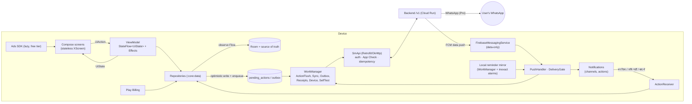
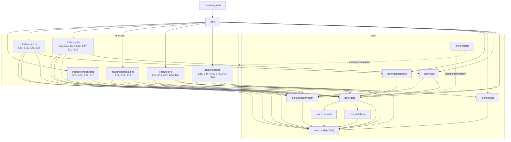

# Sarkari Match — Android frontend architecture

Status: design-level architecture v1 (2026-11-19). Inputs: `docs/PRD.md`, `docs/design/01–06 + tokens.json`, `docs/api/openapi.yaml` + `docs/api/README.md`, `docs/backend/README.md`.

Stack: **Kotlin 2.4 · Jetpack Compose (Material 3, BOM 2026.11.01) · Navigation Compose 2.10 (type-safe) · Hilt · Coroutines/Flow · Room 2.8 · DataStore · WorkManager 2.12 · Retrofit 3 + OkHttp 5 + kotlinx.serialization · Firebase (Auth, FCM, App Check, Crashlytics, Analytics) · Play Billing 9.1 · Google Mobile Ads (native, free tier only)**. minSdk 26, target 36, Hindi first.

## Documents

| File | What |
| --- | --- |
| [navigation.md](navigation.md) | Every inventory screen → route → ViewModel → UiState; graphs; deep links; back stack; process death |
| [data-layer.md](data-layer.md) | Repositories, Room entities/DAOs, DataStore, sync, offline action queue, auth/session, **repository → operationId table** |
| [state-management.md](state-management.md) | UDF pattern; UiState/UiAction/UiEffect; examples S20 Home, S21 Job detail, S30 Paywall |
| [notifications.md](notifications.md) | FCM data messages, channels, action buttons → Room → WorkManager → API, local reminder mirror, quiet hours/cap, OEM autostart, self-test |
| [billing.md](billing.md) | Play Billing flow, server verification, entitlement cache, restore, paywall triggers, UPI policy |
| [ads.md](ads.md) | Free-tier native ad slot (feed bottom + digest), lazy SDK init, entitlement + consent gating |
| [i18n-and-design-system.md](i18n-and-design-system.md) | Per-app language, IST dates/₹, Devanagari fonts; tokens → Compose theme; component catalogue |
| [performance-accessibility.md](performance-accessibility.md) | Size/startup budgets, R8, baseline profiles, Compose hygiene, low-RAM, a11y; analytics/crash, flags, force update, DPDP privacy |
| [testing-ci.md](testing-ci.md) | Test pyramid, fakes/fake backend, Roborazzi, migrations, GitHub Actions |
| [project-skeleton.md](project-skeleton.md) | Version catalog (verified versions), module/package layout, phased tickets |

## 1. Architecture in one picture

**How UI ↔ data ↔ backend connect:** screens render only `UiState` from their ViewModel; ViewModels combine Room `Flow`s (matches, detail, notices, applications, entitlement, prefs) with connectivity/config; every user command goes to a repository that writes Room first (optimistic) and queues the network call (idempotent, `action_id` / `Idempotency-Key` persisted at tap time). `SyncEngine` pulls `/v1/me/sync` deltas into Room (on start, push, pull-to-refresh, every 12 h). Pushes are data-only; the device renders them in the user's language, enforces quiet hours / cap / "already acted", and handles action buttons without opening the app. The server owns eligibility, schedules and entitlement; the app never decides a verdict or Pro status itself.

## 2. Modules

16 modules (+ `build-logic`). Why not fewer: a solo dev pays for modules once (convention plugins), and gets incremental builds, enforced boundaries (features can't reach each other or Retrofit/Room), and per-module screenshot tests. Why not more (e.g. `:core:datastore`, `:feature:settings`, `:feature:family`, `:feature:matchdetail` separately): those would split code that changes together; family (P1) lives as a package in `:feature:profile` and can be extracted later. Feature modules never depend on each other — cross-feature navigation is via callbacks wired in `:app` (navigation.md §1).

## 3. Key decisions

| # | Decision | Alternatives | Why |
| --- | --- | --- | --- |
| D1 | MVVM + UDF, one `StateFlow<UiState>` per screen, effects via `Channel` | MVI framework (Orbit, Mavericks) | Zero extra deps; matches Compose guidance; easy to test with Turbine |
| D2 | Hilt | Koin, manual DI | Compile-time safety, first-class ViewModel/WorkManager integration (`hilt-work`) |
| D3 | Navigation Compose 2.10 type-safe, nested graphs per tab | Navigation 3 | Built-in deep links with synthesised back stacks + multiple back stacks; Nav 3 later if needed |
| D4 | **Offline-first: Room is the source of truth**; delta sync via `/v1/me/sync` tokens; ETags for notices/config/reference | network-first with cache | Slow/flaky networks; push tap must open offline; one sync call instead of many |
| D5 | Optimistic actions in `pending_actions` + `actOnMatchesBatch` via expedited WorkManager; `action_id` generated at tap | direct API call | Notification buttons must work offline and without opening the app; server orders by `occurred_at` |
| D6 | Data-only FCM + device-rendered notifications + local reminder mirror (WorkManager + inexact alarms; exact alarms only as P1 opt-in) | notification messages; exact alarms by default | Hindi/English, action buttons, dedupe, quiet hours; OEMs kill FCM; Android 14 exact-alarm policy |
| D7 | Firebase Auth anonymous → backend OTP → custom token; no own token storage | Firebase phone auth; own JWT store | Matches backend contract (cheaper OTP via WhatsApp/DLT); SDK handles refresh; nothing secret to encrypt locally |
| D8 | Retrofit 3 + OkHttp 5 + kotlinx.serialization, hand-written DTOs + CI contract diff | Ktor client; OpenAPI generator | Smallest dependency surface; generator adds build complexity for ~40 DTOs |
| D9 | Server-authoritative entitlement; client never acknowledges purchases | client-side entitlement | API contract; fraud-resistant; one truth across devices |
| D10 | Mukta via downloadable fonts, system Noto fallback | bundled subset | 0 KB in APK; Noto Devanagari exists on all Android 8+ |
| D11 | Tokens hand-mapped to Compose + `TokensParityTest` against `tokens.json` | Style Dictionary codegen | Small token set; test catches drift both ways |
| D12 | No Paging, no image loader, no Remote Config SDK, no SQLCipher | — | Small volumes, no rasters, `/v1/config` has flags, FBE + data minimisation |
| D13 | Native ad via Google Mobile Ads Next-Gen SDK, lazily initialised on first slot scroll-in, never for Pro, gated by `config.ads` + `entitlement.ads_enabled` | classic SDK; mediation | PRD free-tier light ads without hurting startup; kill switch server-side |
| D14 | Roborazzi (JVM) screenshots in Hindi/English × light/dark × font 1.0/2.0 | Paparazzi; device screenshots | Runs in CI without emulators; Robolectric shared with Compose UI tests |

## 4. Size & performance targets

Download ≤ 8 MB without ads / ≤ 10 MB with the ads SDK (PRD < 15 MB); cold start TTID ≤ 2.0 s on Galaxy A03-class 2 GB phones; feed jank < 5 %; notification action → Room < 100 ms. Details in performance-accessibility.md.

## 5. Contract gaps

All gaps found while reconciling with `docs/design/*` and `docs/api/*` (G-02…G-18, plus the ones found in the
cross-doc pass) are **resolved** as of 2026-11-19. The decision, and every file changed for it, is in
[`../contract-alignment.md`](../contract-alignment.md). Summary for the app:

| ID | Resolution |
| --- | --- |
| G-02 trial | Opt-in. `applied` returns `paywall.variant=trial_offer`; B02 "14 दिन मुफ़्त शुरू करें" calls `startTrial`. No auto-start. |
| G-03 ids | `/j/{match_id}` (per user), `/p/{post_id}` (shared), `/a/{application_id}`; S21 route arg is `matchId`. |
| G-04 channels | Design IDs are canonical and sent as-is in `PushData.channel`: `critical, new_match, reminders, job_updates, digest, account`. |
| G-05 apply URL | `apply_url`, `pdf_url` in the push payload. |
| G-06 reasons | `not_interested_reasons[]`: `not_interested_in_post, location, not_prepared, already_employed, not_eligible, other`. |
| G-08 rank/slot/id | Payload `reminder_id` (= `msg_id`), `kind`, `rank`; `NotificationPrefs.reminder_time` (default 19:00). |
| G-09 B06 | Action `confirm_eligible {rule}`; `MatchSummary.user_confirmed_eligible`. |
| G-10 digest (P1) | `InboxItem.digest {date, match_ids, inbox_ids}` + `PushData.digest_date`; render from Room. |
| G-11 age (P1/P2) | Deferred: B14 via inbox `template=N-43` (P1); S43 + `GET /v1/me/age-chances` in P2. |
| G-12 certificate (P1) | `RuleExplanation.rule=certificate`, `result=info`; `fix_field` for "जोड़ें". |
| G-13 devices | `listDevices`. |
| G-14 receipts | `listPurchases` (already in the spec). |
| G-15 ads consent | `Consent.purpose=ads_personalisation` reserved, never requested in v1. |
| G-16 mapping | Gender chip label "ट्रांसजेंडर" (`transgender`), skip → `null`; "पता नहीं" category → `category_unsure`; S05 "पास हो गया" → `completed`, "आखिरी साल / रिज़ल्ट बाकी" → `final_year`. |
| G-17 listNotices | No P0 screen; used in P1 by B14. |
| G-18 self-test | Client shows "अभी भी इंतज़ार…" after 60 s, final result at the server's 120 s timeout. |

Every screen in `01-screen-inventory.md` (S01–S46, B01–B15, D01–D09, O01–O10) is mapped in navigation.md §3; every repository call maps to an operationId in data-layer.md §8.

## 6. Open questions

1. Launch state(s): working assumption UP + Bihar; S08 pins `ReferenceBundle.pinned_states`, so only QA scope and Hindi copy review depend on the answer.
2. Domain for App Links (`sarkarimatch.in` placeholder, one build constant); `assetlinks.json` is served by Firebase Hosting (backend).
3. Whether Play user-choice billing will be used (UPI in production). Trial semantics are settled (opt-in, G-02).
4. Ads: final SDK version/size measurement; whether ads are on from day 1 or after the validation test (`config.ads.enabled`).
5. Is a Wear/tablet layout ever needed? (Assumed no; content max width 600 dp only.)
6. Minimum supported Play services version for App Check (Play Integrity) on very old devices — fallback behaviour if App Check fails.
