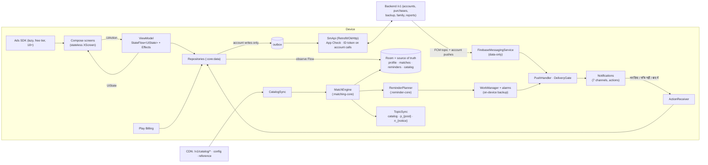
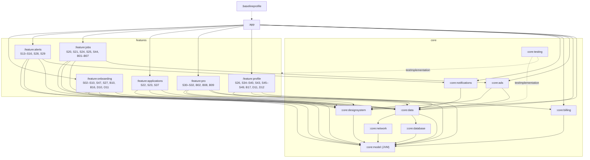

# Sarkari Match — Android frontend architecture

Status: design-level architecture v1 (2026-11-19). Inputs: `docs/PRD.md`, `docs/design/01–06 + tokens.json`, `docs/api/openapi.yaml` + `docs/api/README.md`, `docs/backend/README.md`.

Stack: **Kotlin 2.4 · Jetpack Compose (Material 3, BOM 2026.11.01) · Navigation Compose 2.10 (type-safe) · Hilt · Coroutines/Flow · Room 2.8 · DataStore · WorkManager 2.12 · Retrofit 3 + OkHttp 5 + kotlinx.serialization · `:matching-core` + `:reminder-core` (KMP, shared with the backend) · Firebase (Auth with Google + anonymous, FCM topics, App Check, Crashlytics opt-in) · Credential Manager + Google ID · Block Store · Play Billing 9.1 · GMA Next-Gen SDK + UMP (native ad, free tier, adults only)**. minSdk 26, target 36. Hindi + English at launch; resources, fonts and layouts ready for all 13 major Indian languages incl. Urdu (RTL).

**Founder decisions of 2026-11-19** (see `docs/PRD.md`, `docs/backend/README.md` ADR-02/05/06/11/12): the profile and matching run **on the device** against a public catalog; login is Google Sign-In or guest; Play Billing only; no WhatsApp, SMS, OTP or phone number; FCM pushes + on-device backup reminders; light native ads with non-personalised requests; a privacy notice (S47) and our own notification explanation (S13).

## Documents

| File | What |
| --- | --- |
| [navigation.md](navigation.md) | Every inventory screen → route → ViewModel → UiState; graphs; deep links; back stack; process death |
| [data-layer.md](data-layer.md) | Repositories, Room entities/DAOs, DataStore, catalog sync + on-device matching, local actions, accounts/backup, **repository → operationId table** |
| [state-management.md](state-management.md) | UDF pattern; UiState/UiAction/UiEffect; examples S20 Home, S21 Job detail, S30 Paywall |
| [notifications.md](notifications.md) | FCM topic + account pushes, 7 channels, local action buttons, device-side schedule + on-device backup reminders, quiet hours/cap, OEM autostart, self-test, family |
| [billing.md](billing.md) | Play Billing flow (only payment path), server verification, entitlement token, restore, paywall triggers |
| [ads.md](ads.md) | Free-tier native ad slot (feed bottom + digest), lazy SDK init, entitlement + consent gating |
| [i18n-and-design-system.md](i18n-and-design-system.md) | 13 languages: per-app locales, resource strategy, fonts per script, RTL, pseudo-locales; IST dates/₹; tokens → Compose theme; component catalogue |
| [performance-accessibility.md](performance-accessibility.md) | Size/startup budgets, R8, baseline profiles, Compose hygiene, low-RAM, a11y; analytics/crash, flags, force update, DPDP privacy |
| [testing-ci.md](testing-ci.md) | Test pyramid, fakes/fake backend, Roborazzi, migrations, GitHub Actions |
| [project-skeleton.md](project-skeleton.md) | Version catalog (verified versions), module/package layout, phased tickets |

## 1. Architecture in one picture

**How UI ↔ data ↔ backend connect:** screens render only `UiState`; ViewModels combine Room `Flow`s (matches, catalog notices, applications, entitlement, prefs) with connectivity/config. The app downloads the public catalog (snapshot + batches) and **decides every verdict and every reminder itself**; the profile never leaves the phone except inside the user's own end-to-end-encrypted backup. User commands are local Room writes that work offline and from notification buttons. The server owns only the catalog, entitlements, accounts and family relay; the app never decides Pro status itself (signed entitlement token).

## 2. Modules

18 modules (+ `build-logic`): the 16 above plus the shared KMP modules `:matching-core` and `:reminder-core` (consumed by `:core:data`, published from the backend repo or a shared Gradle build). Why not fewer: a solo dev pays for modules once (convention plugins), and gets incremental builds, enforced boundaries (features can't reach each other or Retrofit/Room), and per-module screenshot tests. Why not more (e.g. `:core:datastore`, `:feature:settings`, `:feature:family`, `:feature:matchdetail` separately): those would split code that changes together; family (P1) lives as a package in `:feature:profile` and can be extracted later. Feature modules never depend on each other — cross-feature navigation is via callbacks wired in `:app` (navigation.md §1).

## 3. Key decisions

| # | Decision | Alternatives | Why |
| --- | --- | --- | --- |
| D1 | MVVM + UDF, one `StateFlow<UiState>` per screen, effects via `Channel` | MVI framework (Orbit, Mavericks) | Zero extra deps; matches Compose guidance; easy to test with Turbine |
| D2 | Hilt | Koin, manual DI | Compile-time safety, first-class ViewModel/WorkManager integration (`hilt-work`) |
| D3 | Navigation Compose 2.10 type-safe, nested graphs per tab | Navigation 3 | Built-in deep links with synthesised back stacks + multiple back stacks; Nav 3 later if needed |
| D4 | **Privacy-first, device-only data: Room is the only copy** of profile, matches, actions, applications; public catalog delta-synced by sequence (snapshot + immutable batches from the CDN) | server-side profile + matching | Founder decision 5 / ADR-11: no caste/disability data on servers, minor mode without parental consent, short Data safety form; works fully offline |
| D5 | **On-device matching** with the shared KMP `:matching-core` (+ `evaluator_min_version` gate) and `:reminder-core` | server verdicts | Same code as the server's review previews; < 10 ms per batch on 2 GB phones |
| D6 | Data-only FCM **topics** (`catalog`, `p_{post}`, `n_{notice}`) + device-composed notifications + **on-device backup reminders** for R1/R-last (exact alarms when granted via S14, P0) | per-user server pushes; notification messages | The server cannot know recipients; all enabled languages, action buttons, dedupe, quiet hours; OEMs kill FCM |
| D7 | Google Sign-In via Credential Manager → Firebase Auth (Google); guest = no account, Firebase anonymous only when a server feature needs one, linkable later; no own token storage | phone OTP; mandatory login | Founder decision 2: free, no phone; SDK handles refresh |
| D8 | Retrofit 3 + OkHttp 5 + kotlinx.serialization, hand-written DTOs + CI contract diff | Ktor client; OpenAPI generator | Smallest dependency surface; generator adds build complexity for ~40 DTOs |
| D9 | Server-authoritative entitlement with a signed offline token; client never acknowledges purchases; Play Billing is the only payment path | client-side entitlement; UPI links | Founder decision 4; fraud-resistant; works offline for topic gating |
| D10 | Per-script font chain (design tokens `font.script.*`): Mukta for Devanagari+Latin via downloadable fonts; other scripts (Bengali, Telugu, Tamil, Gujarati, Kannada, Odia, Malayalam, Gurmukhi, Urdu Nastaliq) downloaded lazily **only for the active language**, system Noto fallback | bundled subsets per script | 0 KB in APK; system Noto covers every Indic script on Android 8+ |
| D11 | Tokens hand-mapped to Compose + `TokensParityTest` against `tokens.json` | Style Dictionary codegen | Small token set; test catches drift both ways |
| D12 | No Paging, no image loader, no Remote Config SDK, no SQLCipher, **no Firebase Analytics** | — | Small volumes, no rasters, `/v1/config` has flags, FBE + data minimisation; metrics = opt-in identifier-free counters + Play Console |
| D13 | Native ad via GMA Next-Gen SDK, lazily initialised on first slot scroll-in, never for Pro or minor mode, non-personalised (`npa=1`) after UMP, gated by `config.ads` + entitlement | classic SDK; mediation | PRD free-tier light ads without hurting startup; kill switch server-side |
| D14 | Roborazzi (JVM) screenshots in hi/en × light/dark × font 1.0/2.0, plus pseudo-locales `en-XA` (long) and `ar-XB` (RTL) and one long Indic script (ta) | Paparazzi; device screenshots | Catches truncation/RTL bugs before new languages ship |

## 4. Size & performance targets

Download ≤ 8 MB without ads / ≤ 10 MB with the ads SDK (PRD < 15 MB); cold start TTID ≤ 2.0 s on Galaxy A03-class 2 GB phones; feed jank < 5 %; notification action → Room < 100 ms. Details in performance-accessibility.md.

## 5. Contract gaps

All earlier gaps (G-02…G-18) were resolved on 2026-11-19 and are recorded in
[`../contract-alignment.md`](../contract-alignment.md) (#1–#41). The founder-decision change set of the same day
(on-device matching, Google/guest login, Play-only billing, no WhatsApp/SMS/OTP, 13 languages, ads/UMP, minor mode)
is rows #42 onward there. Every screen in `01-screen-inventory.md` (S01–S49 minus retired S11, S12, S33; B01–B17 minus
B11; D01–D12 minus D05; O01–O11) is mapped in navigation.md §3; every network call maps to an operationId in
data-layer.md §8.

## 6. Open questions

1. Launch state(s): working assumption UP + Bihar; S08 pins `ReferenceBundle.pinned_states`.
2. Domain for App Links (`sarkarimatch.in` placeholder, one build constant); `assetlinks.json` on Firebase Hosting.
3. Ads: final Next-Gen SDK + UMP size measurement; whether `npa=1` is still honoured by the Next-Gen SDK in India
   (verify against current docs).
4. Minor mode: legal confirmation (backend README Q2); whether a 17-year-old may buy Pro.
5. Snapshot size on 2G for first install (target ≤ 1 MB gzipped); if exceeded, split per state set.
6. Minimum Play services version for App Check / Block Store / Credential Manager on very old devices — fallback
   behaviour (guest-only, no backup).
