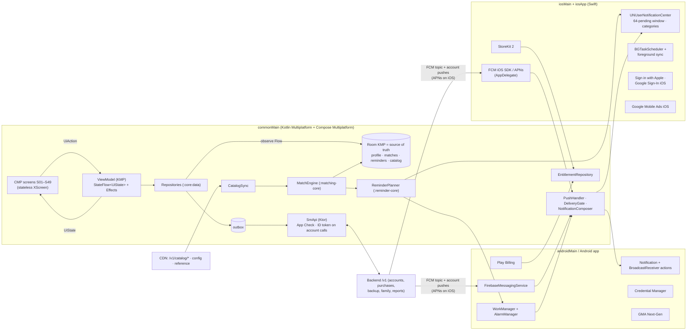
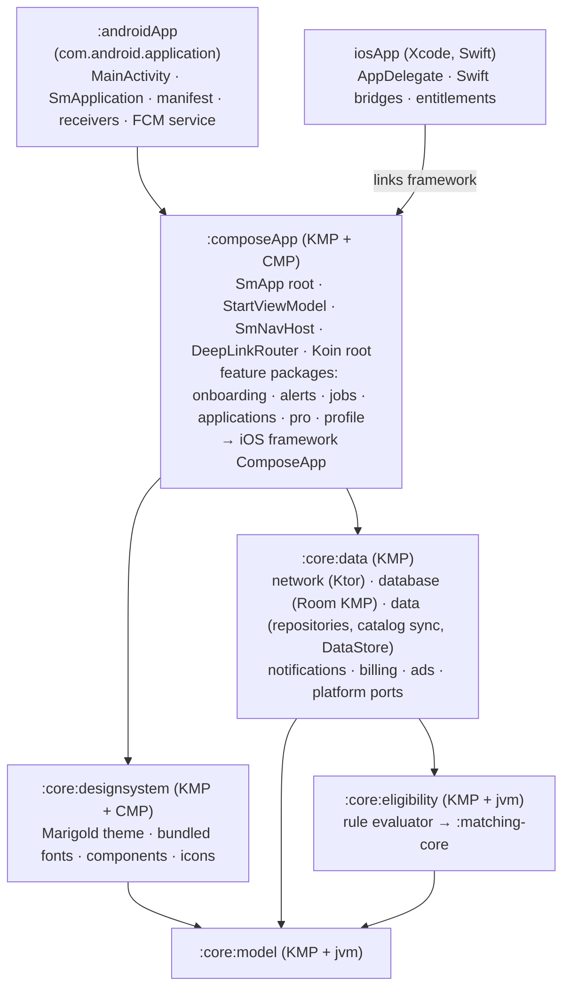

# Sarkari Match — mobile frontend architecture (Android + iOS)

Status: design-level architecture **v2** (2026-11-19). v1 was Android-only; founder decision 9 (`docs/PRD.md`) makes it
**one Kotlin Multiplatform + Compose Multiplatform codebase for Android and iOS**. Inputs: `docs/PRD.md`,
`docs/design/01–07 + tokens.json`, `docs/api/openapi.yaml` + `docs/api/README.md`, `docs/backend/README.md`,
`docs/backend/matching-engine.md` §0.

Stack (exact versions in [project-skeleton.md](project-skeleton.md) §1): **Kotlin Multiplatform (Kotlin 2.4) ·
Compose Multiplatform (Material 3, compose resources) · Navigation Compose multiplatform (type-safe) · AndroidX
Lifecycle ViewModel KMP · Koin · Coroutines/Flow · Room KMP (bundled/native SQLite driver) · DataStore KMP · Ktor client
(OkHttp engine on Android, Darwin on iOS) + kotlinx.serialization · kotlinx-datetime · `:core:eligibility`
(→ `:matching-core`) + `:reminder-core` (pure KMP, shared with the backend's review previews)**.
Platform SDKs behind Kotlin interfaces: **Android** — Firebase (Auth Google + anonymous, FCM topics, App Check Play
Integrity, Crashlytics opt-in), Credential Manager + Google ID, Block Store, Play Billing, WorkManager + AlarmManager,
GMA Next-Gen + UMP. **iOS (Swift)** — Firebase iOS (Auth Google/Apple/anonymous, FCM over APNs, App Check App Attest,
Crashlytics opt-in), Google Sign-In iOS, Sign in with Apple, StoreKit 2, `UNUserNotificationCenter`, `BGTaskScheduler`,
Google Mobile Ads iOS + UMP. Android minSdk 26 / target 36; **iOS 16+** (§4). Hindi + English at launch; resources,
fonts and layouts ready for all 13 major Indian languages incl. Urdu (RTL).

**Founder decisions of 2026-11-19** (see `docs/PRD.md`, `docs/backend/README.md` ADR-02/05/06/11/12): the profile and
matching run **on the device** against a public catalog; login is Google Sign-In (+ **Sign in with Apple on iOS**) or
guest; **Play Billing on Android, StoreKit 2 on iOS**, no other payment path; no WhatsApp, SMS, OTP or phone number;
FCM pushes (APNs on iOS) + on-device reminders; light native ads with non-personalised requests; a privacy notice (S47)
and our own notification explanation (S13); the same Marigold Home design on both platforms.

## Documents

| File | What |
| --- | --- |
| [platform-interop.md](platform-interop.md) | **Shared vs platform code, `expect`/`actual` vs Koin interfaces, the Swift boundary (StoreKit 2, Apple/Google sign-in, FCM/APNs, AdMob iOS), iOS app shell, App Store review risks** |
| [navigation.md](navigation.md) | Every inventory screen → route → ViewModel → UiState; graphs; deep links (Android App Links, iOS Universal Links); back stack; process death |
| [data-layer.md](data-layer.md) | Repositories, Room KMP entities/DAOs, DataStore KMP, Ktor, catalog sync + on-device matching, local actions, offline queue (WorkManager / BGTaskScheduler), accounts/backup, **repository → operationId table** |
| [state-management.md](state-management.md) | UDF pattern in common code; UiState/UiAction/UiEffect; examples S20 Home, S21 Job detail, S30 Paywall |
| [notifications.md](notifications.md) | Push (FCM topics; APNs on iOS), 7 Android channels / iOS categories + interruption levels, action buttons without opening the app, device schedule (Android alarms; iOS 64-pending window), OEM reliability, self-test, family |
| [billing.md](billing.md) | Unified entitlement interface; Play Billing; StoreKit 2 (yearly auto-renewable + season non-renewing, intro-offer trial); server verification; restore |
| [ads.md](ads.md) | Free-tier native ad slot on both platforms, lazy SDK init, entitlement + UMP gating, no ATT prompt |
| [i18n-and-design-system.md](i18n-and-design-system.md) | 13 languages with compose resources, per-app language on both platforms, bundled fonts per script + size budget, RTL, Dynamic Type; tokens → CMP theme; component catalogue |
| [performance-accessibility.md](performance-accessibility.md) | Size/startup budgets per platform, iOS Compose rendering, a11y (TalkBack + VoiceOver), metrics, flags, force update, DPDP privacy |
| [testing-ci.md](testing-ci.md) | `commonTest` pyramid, Android + iOS-simulator tests, screenshots, CI on ubuntu + macOS, release to Play + App Store/TestFlight |
| [project-skeleton.md](project-skeleton.md) | Version catalog, module/source-set layout, phased tickets for both platforms |

## 1. Architecture in one picture

**How UI ↔ data ↔ backend connect** (unchanged by the second platform): screens render only `UiState`; ViewModels
combine Room `Flow`s with connectivity/config. The app downloads the public catalog and **decides every verdict and
every reminder itself**; the profile never leaves the phone except inside the user's own end-to-end-encrypted backup.
User commands are local Room writes that work offline and from notification buttons on both platforms. The server
owns only the catalog, entitlements, accounts and family relay; the app never decides Pro status itself.

**What differs per platform** is only delivery and commerce: Android trusts FCM less (OEM kills) and adds exact-alarm
backups; iOS trusts scheduled local notifications more (the OS delivers them even when the app is killed) but caps
them at 64 and gives background execution sparingly, so the iOS schedule is a rolling window refilled on every
foreground, background refresh, silent push and notification action (notifications.md §5).

## 2. Modules and source sets

Six Gradle modules (as built under `mobile/`, project-skeleton.md §2). Every shared module has `commonMain`,
`androidMain` and `iosMain` (targets: KMP Android, `iosArm64`, `iosSimulatorArm64`; the two pure modules also `jvm`;
no `iosX64`). Platform code lives in the module that owns the concern (e.g. `:core:data/androidMain` has the
notification channels and receivers; `iosMain` the `UNUserNotificationCenter` scheduler), or in Swift behind a port.
Feature code is ~100 % `commonMain`.

- **Why `:androidApp` is separate from `:composeApp`:** AGP 9 does not allow the Kotlin Multiplatform plugin together
  with `com.android.application` in one module; KMP libraries use `com.android.kotlin.multiplatform.library`. The
  Android shell (manifest, `Application`, receivers, services) is a thin application module; `:composeApp` is the KMP
  library that holds the shared app root and produces the iOS framework.
- **Why 6 modules instead of v1's 18:** on KMP each module compiles per target and every iOS-facing module is exported
  into one framework, so module count multiplies Kotlin/Native compile/link time on macOS CI. v1's boundaries survive as
  **packages** (features never import each other; only `core.data` touches Ktor/Room) enforced by detekt
  `ForbiddenImport`/Konsist rules. A package becomes a module again only for a measured reason.

## 3. Key decisions

| # | Decision | Alternatives | Why |
| --- | --- | --- | --- |
| D1 | MVVM + UDF, one `StateFlow<UiState>` per screen, effects via `Channel`, **in `commonMain`** with the AndroidX Lifecycle KMP `ViewModel` | MVI framework; Decompose | Zero extra deps; same pattern as v1; KMP ViewModel + `SavedStateHandle` work on both platforms |
| D2 | **Koin** (+ `koin-compose-viewmodel`), `checkModules`/`verify` test in CI | Hilt (Android-only), kotlin-inject, manual | Hilt cannot run on Kotlin/Native; Koin is KMP, no codegen, Swift can register implementations at startup (platform-interop.md §2) |
| D3 | **Navigation Compose multiplatform** (`org.jetbrains.androidx.navigation`), type-safe `@Serializable` routes, nested graphs per tab, own `DeepLinkRouter` that synthesises back stacks on both platforms | Voyager, Decompose, Navigation 3 | Same API as v1 (routes carry over); first-party JetBrains port; deep links via `navDeepLink` on both platforms |
| D4 | **Privacy-first, device-only data: Room KMP is the only copy** of profile, matches, actions, applications; public catalog delta-synced by sequence | server-side profile; SQLDelight | Founder decision 5 / ADR-11 unchanged. Room KMP over SQLDelight: existing entities/DAOs/migrations port as-is, `MigrationTestHelper`-style tests, Flow DAOs; SQLDelight's SQL-first model would mean rewriting the schema |
| D5 | **On-device matching** with the pure-Kotlin `:core:eligibility`/`:matching-core` + `:reminder-core` compiled for Android, iOS and the backend's JVM | server verdicts; Swift port | One evaluator, one set of golden tests; `evaluator_min_version` gate on both |
| D6 | Data-only FCM **topics** + device-composed notifications. **Android:** + on-device exact-alarm backups for R1/R-last. **iOS:** scheduled local notifications are the **primary** reminder path (rolling 64-request window); `catalog` sync is a background push; `p_` reminder alerts (APNs `loc-key`s) are subscribed only for matches outside the local window, so they are a fallback and never duplicate; lifecycle/account/self-test pushes are visible alerts | Notification messages everywhere; per-user server pushes | Server can't know recipients; iOS throttles background pushes and drops them after force-quit, but always fires scheduled local notifications (notifications.md §1, §5) |
| D7 | Auth via **platform SDKs behind `AuthPlatform`** (Android Kotlin; iOS Swift: Firebase Auth iOS + Google Sign-In iOS + **Sign in with Apple**); guest = no account until needed, then Firebase anonymous, linkable | GitLive `firebase-kotlin-sdk` | GitLive wraps the same SDKs but needs Firebase linked into the Kotlin framework (cinterop) and still cannot do the Google/Apple UI flows; our auth surface is ~6 calls (data-layer.md §7) |
| D8 | **Ktor client 3** + kotlinx.serialization, hand-written DTOs in `commonMain` + CI contract diff; OkHttp engine on Android, Darwin on iOS | Retrofit (JVM-only); OpenAPI generator | Only KMP HTTP client with mature engines; DTOs carry over unchanged |
| D9 | Server-authoritative entitlement with a signed offline token; one `BillingClientPort` with **Play Billing** and **StoreKit 2** implementations; the client never grants Pro itself | client-side receipts; RevenueCat | Same contract on both stores; App Store Server API / Notifications V2 on the server; no third-party billing processor (cost, data) |
| D10 | Fonts **bundled as compose resources** for Latin + Devanagari (Baloo 2 600 + Hind 400/600, subset, ≤ 450 KB); other scripts: Android Downloadable Fonts, iOS system fonts (Kohinoor/Sangam/Noto Nastaliq) with optional CDN download of the Baloo/Hind sister family | Downloadable fonts only | Downloadable Google Fonts do not exist on iOS; one shared `FontFamily` for the launch languages keeps both platforms pixel-identical (i18n §A3) |
| D11 | Tokens hand-mapped to the CMP theme + `TokensParityTest` (`commonTest`) against `tokens.json` | Style Dictionary codegen | Small token set; test catches drift both ways |
| D12 | No Paging, no image loader, no Remote Config SDK, no SQLCipher, **no Firebase Analytics** — on either platform | — | Unchanged; also keeps the iOS binary small |
| D13 | Native ad via GMA Next-Gen (Android) / Google Mobile Ads (iOS) behind `NativeAdLoader`, hosted in CMP through `AndroidView` / `UIKitView`; lazily initialised; non-personalised; **no ATT prompt** | ATT + personalised; no ads on iOS | PRD light ads on both; ATT is only required to access IDFA/track, which we never do (ads.md §7) |
| D14 | Screenshot tests with **Roborazzi** (Android JVM, all locales/scales) as the gate, plus a small **iOS simulator snapshot** suite for platform deltas (fonts, safe areas, Dynamic Type) | Paparazzi; device screenshots | Compose UI is shared, so one exhaustive suite + a thin iOS suite catches both |
| D15 | iOS UI is **all Compose Multiplatform**; SwiftUI only for the app shell, plus native-presented system UI (StoreKit sheet, Apple/Google sign-in, share sheet, mail) | SwiftUI screens on iOS | Founder decision 9 (shared UI, same design); per-platform screens would double UI work for a solo developer |

## 4. Platform targets, size & performance

| | Android | iOS |
| --- | --- | --- |
| Minimum OS | 8.0 (API 26) | **iOS 16** (StoreKit 2 needs 15; time-sensitive notifications 15; CMP supports 13+; 16 drops ~2–3 % of Indian iPhones and gives modern `UIScene`, `BGTaskScheduler` fixes and `Transaction.currentEntitlements` behaviour we test against) |
| Download budget | ≤ 8 MB without ads / ≤ 10 MB with the ads SDK | ≤ 25 MB App Store download (arm64, App Thinning) — Kotlin/Native + Skia ≈ 9–12 MB, Firebase ≈ 4–6 MB, ads ≈ 3–5 MB; measured in CI |
| Cold start | TTID ≤ 2.0 s on Galaxy A03-class 2 GB phones | first frame ≤ 1.5 s on iPhone XR/11-class (oldest common iPhones in India) |
| Feed scroll | jank < 5 % | ≥ 58 fps on 60 Hz, no dropped-frame bursts on ProMotion |

Details in performance-accessibility.md.

## 5. Contract gaps

All earlier gaps (G-02…G-18) were resolved and are recorded in [`../contract-alignment.md`](../contract-alignment.md)
(#1–#63). The iOS change set (Sign in with Apple, App Store purchase verification + Server Notifications V2,
`appAccountToken` = `billing_account_ref` as a UUID, APNs-specific topic push shapes, iOS deep-link association file,
iOS trial as an introductory offer) is rows **#74 onward** (backend-side iOS rows are #64–#73) there; the server/API side is being added by the backend
pass. Every screen in `01-screen-inventory.md` is mapped in navigation.md §3; every network call maps to an
operationId in data-layer.md §8.

## 6. Open questions

1. Launch state(s): working assumption UP + Bihar; S08 pins `ReferenceBundle.pinned_states`.
2. Domain for App Links + Universal Links (`sarkarimatch.in` placeholder): `assetlinks.json` **and**
   `apple-app-site-association` on Firebase Hosting.
3. Ads: final SDK + UMP size on both platforms; whether `npa=1` is still honoured by the Next-Gen SDK and the iOS SDK in
   India (verify against current docs).
4. Minor mode: legal confirmation (backend README Q2); whether a 17-year-old may buy Pro (and App Store Family
   Sharing / Ask to Buy interactions).
5. Snapshot size on 2G for first install (target ≤ 1 MB gzipped); if exceeded, split per state set.
6. iOS **trial**: introductory offer on the yearly plan (needs an Apple payment method and auto-converts) vs the
   Android server-granted, no-payment trial — confirm the asymmetric B02 copy with the founder (billing.md §10).
7. iOS **season pass** as a non-renewing subscription at ₹49 / 4 months: confirm the ₹49 App Store price point for
   India and that a non-renewing subscription (not an auto-renewable) is the intended product.
8. iOS **new-match latency**: background pushes are throttled and dropped after force-quit. Apply for the
   `com.apple.developer.usernotifications.filtering` entitlement (lets a Notification Service Extension suppress a
   push), which would allow visible catalog alerts filtered on the device (notifications.md §11)?
9. Minimum Play services version for App Check / Block Store / Credential Manager on very old Android devices —
   fallback behaviour (guest-only, no backup). On iOS: App Attest availability on iOS 16 devices (fallback
   DeviceCheck provider).
