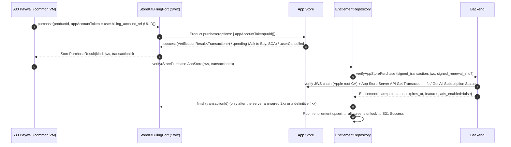

# Billing (Pro)

Stores: **Google Play Billing** on Android (`com.android.billingclient:billing-ktx`, `:core:data` `core.billing` package, `androidMain`) and
**StoreKit 2** on iOS (Swift `StoreKitBillingPort` in `iosApp`, platform-interop.md §3), behind one common
`BillingClientPort`. The server is the authority for entitlement (API README §12) on both. **The platform store is the
only payment path** (founder decisions 4 and 9): on Android UPI, cards and Play balance inside Play's sheet (O06); on
iOS whatever the user's Apple Account has (cards, UPI, App Store balance) inside Apple's sheet. No UPI links, gateways,
user-choice billing or external purchase links on either platform.

Android sections §1–§9 are unchanged in substance; §10 adds iOS; §11 the unified interface both implement.

## 1. Products (from `listProducts`, never hard-coded)

| Our `product_id` | Play product / base plan | Kind | Shown as |
| --- | --- | --- | --- |
| `pro_year` | `pro` / `yearly-autorenew` | auto-renewing subscription | ₹199/साल (≈ ₹17/महीना, computed from `priceAmountMicros / 12`) — highlighted |
| `pro_season` | `pro` / `season-4m-prepaid` (`P4M`; fallback `P3M`) | **prepaid base plan** of the subscription (no auto-renew, user can top up) — chosen over a one-time product, backend payments §1.1 | ₹49 / 4 महीने · "अपने-आप रिन्यू नहीं होगा" |
| `pro_month` (only if tests show demand) | `pro` / `monthly-autorenew` | auto-renewing | ₹20/महीना |

Prices, currency formatting and offer eligibility come only from Play `ProductDetails` (`formattedPrice`), so Play price experiments, taxes and regional pricing are correct. If `ProductDetails` can't load (no Play/old Play Store), the paywall shows `billingAvailable = false` with "Play Store अपडेट करें".

**Account first.** Purchase and trial need a server account. For a guest, B16 `pro` (once, before the store sheet) offers Google sign-in (and Sign in with Apple on iOS); "अभी नहीं" creates a Firebase anonymous account (`SessionRepository.ensureAccount`). Minor mode hides purchase and trial.

**Trial (Android)** is *not* a Play free trial (prepaid plans cannot carry offers anyway). It is a server-granted 14-day Pro, **offered** at the first *भर दिया* (decided locally: B02 `trial_offer` while `trial_available`, guests count as available) and **started** only when the user taps it (`startTrial` → `Entitlement` with `source = trial`, 14 days from the tap). No card/UPI mandate is needed, matching the PRD ("Trial: 14 days of Pro from first Applied") and the B02 caption "कोई पैसा नहीं लगेगा, कार्ड नहीं चाहिए". While `trial_available`, S30 also shows a "14 दिन मुफ़्त आज़माएँ" text button that calls `startTrial`.

## 2. Components

```kotlin
/** androidMain; app-scoped. One BillingClient for the whole process. Implements the common BillingClientPort (§11). */
interface BillingRepository {
    val purchaseUpdates: SharedFlow<PurchaseEvent>          // from PurchasesUpdatedListener
    suspend fun productDetails(products: List<Product>): Result<List<PlanOffer>>
    fun launch(activity: Activity, offer: PlanOffer, accountRef: String, replace: ReplaceSpec? = null): BillingResult
    suspend fun unverifiedPurchases(): List<Purchase>       // queryPurchasesAsync(SUBS) where !isAcknowledged
}

class PlayBillingRepository(ctx: Context, private val scope: CoroutineScope) : BillingRepository {   // bound in androidModule (Koin)
    private val _updates = MutableSharedFlow<PurchaseEvent>(extraBufferCapacity = 8)
    override val purchaseUpdates = _updates.asSharedFlow()

    private val client = BillingClient.newBuilder(ctx)
        .setListener { result, purchases -> _updates.tryEmit(PurchaseEvent.from(result, purchases)) }
        .enablePendingPurchases(PendingPurchasesParams.newBuilder().enableOneTimeProducts().enablePrepaidPlans().build())
        .enableAutoServiceReconnection()               // PBL 8+: reconnects automatically on SERVICE_DISCONNECTED
        .build()
    // connect lazily on first use; never at cold start (startup time on 2 GB phones)
}
```

`EntitlementRepository` (`core.data`, common) owns verification and the Room `entitlement` row; the store implementations only talk to Play / the App Store.

## 3. Purchase flow

```mermaid
sequenceDiagram
  autonumber
  participant U as User
  participant P as S30 Paywall (VM + Route)
  participant B as BillingRepository
  participant Play as Google Play
  participant E as EntitlementRepository
  participant API as Backend
  U->>P: selects ₹199/साल, taps "Pro लें"
  P->>B: productDetails() (already loaded) → launch(activity, offer,<br/>setObfuscatedAccountId(user.billing_account_ref))
  B->>Play: launchBillingFlow
  Play-->>U: Play sheet (O06), UPI / card / Play balance
  Play-->>B: onPurchasesUpdated(OK, purchase{token, state})
  B-->>P: PurchaseEvent.Purchased(token) (SharedFlow)
  alt purchaseState == PURCHASED
    P->>E: verify(product, basePlan, token, orderId)
    E->>E: persist token in outbox (PurchaseVerifyWorker backup)
    E->>API: verifyPlayPurchase {product_id, base_plan_id, purchase_token, order_id}
    API->>Play: purchases.subscriptionsv2.get + acknowledge (server-side)
    API-->>E: Entitlement{plan=pro, status=active, expires_at, features}
    E->>E: Room entitlement upsert → all screens unlock
    P-->>U: navigate S31 Success (popUpTo Paywall)
  else purchaseState == PENDING (e.g. UPI in Play, cash)
    P-->>U: S31 Pending "भुगतान पूरा होते ही Pro चालू हो जाएगा"
    Note over E,API: later: Play RTDN → server grants; app learns via the `account` push (template `entitlement`) or next start
  else USER_CANCELED
    P-->>U: stay on S30 (no error)
  else error
    P-->>U: PurchaseStep.Failed (retry / "Play Store अपडेट करें")
  end
```

Rules:

- **The client never calls `acknowledgePurchase`** — the server acknowledges after verifying (API contract). If verification can't reach the server, `PurchaseVerifyWorker` (unique, network-constrained, exponential backoff) retries; Play refunds unacknowledged purchases after 3 days, so the worker is also triggered on every app start for any `unverifiedPurchases()`.
- `409 purchase_owned_by_other_account` → S31 Failed with "यह खरीद दूसरे Google अकाउंट से जुड़ी है — उसी से साइन इन करें" (→ O11).
- `402` (payment invalid) → S31 Failed.
- **Pro UI is gated on the server entitlement only** (Room `entitlement` row + signed `token` from `getEntitlement` / `startSession` / verify / trial result). Never on local `Purchase` state.

## 4. Entitlement caching

| Field | Use |
| --- | --- |
| `plan`, `status` (`active / in_grace / on_hold / expired / none`) | `isPro = plan == pro && status in (active, in_grace)` |
| `token` (JWT, ES256, verified with `config.entitlement_token_jwks`) | offline gating; lifecycle topic subscription (`n_{notice}`) only while the token says Pro/trial and has not expired (≤ 7 days); after that, show Pro UI read-only with "इंटरनेट से जुड़ें" |
| `features.*` | per-feature gates (lifecycle, family, clash, certificate, ad-free) — combined with `AppConfig.features` remote flags |
| `manage_url` | S32 "Play Store में मैनेज करें", D03 warning |
| `trial_available`, `source = trial` | B02/B08/B09 variants |

Refresh points (accounts only): app start (`startSession`), `account` push with template `entitlement` (sent after RTDN changes), after verify/trial, S32 open, pull-to-refresh on S22, daily reconcile. Guests without an account are always `free` with `trial_available = true`.

`in_grace` / `on_hold`: banner on S22/S32 "भुगतान में दिक्कत — Play Store में ठीक करें" with `manage_url` deep link (`https://play.google.com/store/account/subscriptions?sku=…&package=…`).

## 5. Restore & multi-device

- S30/S32 "ख़रीद वापस लाएँ": `queryPurchasesAsync(SUBS)` → `verifyPlayPurchase` for each → `getEntitlement` → D08 result ("Pro वापस आ गया" / "इस Google खाते में कोई ख़रीद नहीं मिली").
- A purchase is bound to our account through `obfuscatedAccountId`; on a new phone, Google sign-in (O11) restores the entitlement via `startSession` without touching Play. A guest who never linked Google restores through "ख़रीद वापस लाएँ" (Play account history → `verifyPlayPurchase`; the server moves it from the idle anonymous account).

## 6. Upgrade season → year (S32)

`launch(…, replace = ReplaceSpec(oldToken))` using `SubscriptionProductReplacementParams` (the per-product replacement API; `setReplacementMode` on the old update params is deprecated). Replacement mode for prepaid → auto-renew is chosen per Play's prepaid-plan rules (verify at implementation time). The server re-verifies and returns the new entitlement.

## 7. Removed: UPI payment links

The `upi` product flavour, `createUpiPaymentLink`, B11 and the `upi_link_purchase` flag are removed (founder decision
4). The validation test is a **Play closed-testing** build with real Play Billing purchases (decision 8);
licence testers are used only for QA purchases.

## 8. Paywall triggers (PRD + inventory)

| Trigger | Surface | Rule |
| --- | --- | --- |
| Right after *भर दिया* (in-app B01 confirm or push action) | B02 | `trial_offer`: "14 दिन मुफ़्त शुरू करें" → (guest: B16 `pro` / anonymous account) → Android `startTrial` / iOS intro-offer purchase of `pro_year` (§10.1) → B08; `plans` (trial used): plan cards → S30. First Applied always; afterwards max once / 7 days. Never in minor mode |
| Trial day 12–14 on app open, or trial-ending push | B09 → S30 | once per day |
| Locked lifecycle row on S22 / locked S23 | S30 (`source = LockedRow`) | always available |
| S34/S36/S37 opened by a free user | inline locked state → S30 | |
| Profile Pro card | S30 / S32 | |
| "विज्ञापन हटाएँ" on the free-tier native ad (O10) | S30 (`source = AdSlot`) | ads.md; Pro and trial remove ads (`Entitlement.ads_enabled = false`) |
| Deep link `https://sarkarimatch.in/pro?plan=` | S30 preselect | |

Never on first launch, never during onboarding, no interstitials (PRD: "no upselling", free tier ad-free). `paywall_enabled` remote flag hides all upsell surfaces during the validation phase if needed.

Metrics: with the usage-counter opt-in, daily counts `paywall_view_{source}`, `purchase_start`, `purchase_ok`, `trial_started` (no identifiers); conversion truth comes from server `purchase` rows and Play Console.

## 9. Testing

- `FakeBillingClientPort` in `:core:testing` (`commonTest`) drives all PaywallViewModel tests on both platforms (purchased / pending / cancelled / error / 409 / iOS intro-offer eligible / not eligible / non-renewing expiry).
- Android: Play's static test product ids + licence testers on the internal test track for end-to-end; server verification hits staging. The closed-testing track (validation test) uses real purchases.
- iOS: a **StoreKit configuration file** (`SarkariMatch.storekit`) in the Xcode scheme for local runs and the iOS
  simulator suite (`SKTestSession` in XCTest: buy, intro offer, renewal, expiry, refund, Ask to Buy pending, interrupted
  purchase); **Sandbox** testers on TestFlight builds against staging server verification (sandbox environment
  JWS); Server Notifications V2 test notification (`/inApps/v1/notifications/test`) in staging.

## 10. iOS: StoreKit 2

### 10.1 Products (App Store Connect)

| Our `product_id` | App Store product | Type | Why |
| --- | --- | --- | --- |
| `pro_year` | `in.sarkarimatch.pro.yearly` in subscription group `pro` | **auto-renewable subscription**, 1 year, ₹199 | same as Play `yearly-autorenew` |
| `pro_season` | `in.sarkarimatch.pro.season4m` | **non-renewing subscription**, ₹49 (price point: verify that ₹49 exists for India) | StoreKit has no "prepaid plan"; auto-renewable durations are 1 week / 1, 2, 3, 6 months / 1 year (no 4 months) and would renew. A non-renewing subscription matches "₹49 per season, अपने-आप रिन्यू नहीं होगा"; the **server** computes `expires_at = purchase_date + 4 months` (or extends a running season — top-up, like Play prepaid) |
| (P1 option) `pro_month` | `in.sarkarimatch.pro.month` in group `pro` | auto-renewable, 1 month, ₹20 | only if tests show demand (same as Android) |

- **Product ids:** the backend contract uses `in.sarkarimatch.pro.yearly` / `in.sarkarimatch.pro.season4m`
  (`Product.appstore_product_id` from `listProducts`); `mobile/` `ProProducts.appStoreProductId` currently hard-codes
  `in.sarkarimatch.app.pro.year` / `.pro.season`. Fix in FE-75: read the ids from `listProducts` (as Android maps base
  plans) and keep the constants only as test fixtures (contract-alignment #87).
- **Trial = introductory offer**: a **free trial of 2 weeks** (14 days) configured on `pro_year` in App Store Connect
  (guideline 3.1.2(a) allows free trials on auto-renewables). We do **not** grant the server-side 14-day trial to iOS
  users: a Pro unlock without IAP risks guideline 3.1.1 ("must use in-app purchase" to unlock features). Consequences:
  the iOS trial needs an Apple payment method and **auto-converts to ₹199/year** unless cancelled; B02/S30 on iOS
  therefore show "14 दिन मुफ़्त, फिर ₹199/साल — कभी भी रद्द करें" instead of "कार्ड नहीं चाहिए", and eligibility comes from
  `Product.SubscriptionInfo.isEligibleForIntroOffer` (Apple tracks it per Apple Account and subscription group). The
  `trial_offer` B02 variant on iOS is shown only when eligible; otherwise `plans`. Founder to confirm (README Q6).
- **Family Sharing: off** for every product (App Store Connect setting; once turned on it cannot be turned off for that
  product). Pro is per person; family alerts are a Pro feature delivered to a linked member's own app, not shared
  purchases.
- Prices are shown only from `Product.displayPrice`; "≈ ₹17/महीना" is computed from `Product.price` (Decimal) / 12.
- Offer codes and promotional offers: not in P0 (referral S45 grants are server-side month credits; on iOS they are
  granted the same way — a reward of free service, not an unlock sold outside IAP; review note explains it).

### 10.2 Purchase flow



- **`appAccountToken`** binds the purchase to our account (Apple's equivalent of `obfuscatedAccountId`). It must be a
  UUID: the server's `billing_account_ref` is issued as a UUIDv4 (contract row #75). It appears in the signed
  transaction and in Server Notifications V2, so the server attributes renewals/refunds without the client.
- **Unfinished transactions**: `Transaction.updates` is observed from launch (Swift, started in `AppDelegate` before any
  UI) and `Transaction.unfinished` is swept on every foreground → `verify` → `finish()`. A transaction is never
  finished before the server confirmed it (otherwise a crash between finish and verify would lose a purchase). Apple
  does not auto-refund unfinished transactions (unlike Play's 3-day acknowledgement rule), but they are redelivered
  until finished.
- **Pending** (Ask to Buy for minors in Family Sharing, extra authentication): S31 Pending, resolved through
  `Transaction.updates` later.
- `409 purchase_owned_by_other_account` → "यह ख़रीद किसी दूसरे अकाउंट से जुड़ी है — उसी से साइन इन करें" (→ O11/O11a).
- The client never trusts local `Transaction` state for gating (same rule as Play); `VerificationResult.unverified` is
  sent to the server anyway and the server rejects it.

### 10.3 Server side (backend pass, contract rows #74–#75)

App Store Server API (Get Transaction Info, Get All Subscription Statuses, Get Transaction History for restore) with an
in-app purchase key; **App Store Server Notifications V2** (`SUBSCRIBED`, `DID_RENEW`, `DID_FAIL_TO_RENEW`
→ `in_grace`/`on_hold` equivalents, `EXPIRED`, `REFUND`, `REVOKE`, `DID_CHANGE_RENEWAL_STATUS`, `ONE_TIME_CHARGE` for
the non-renewing season) → entitlement change → `account` push template `entitlement` (silent on iOS) exactly like
RTDN on Android. Production and sandbox environments are distinguished by the JWS `environment` field.

### 10.4 Restore, manage, upgrade

- **Restore purchases** (required by Apple for restorable products; S30 + S32 "ख़रीद वापस लाएँ"):
  `Transaction.currentEntitlements` (auto-renewable + **non-renewing** transactions) → verify each → `getEntitlement` →
  D08. Only if that finds nothing and the user confirms, call `AppStore.sync()` (shows an Apple Account sign-in prompt,
  so never automatically). Non-renewing purchases are also restorable through our account (Apple expects
  non-renewing subscriptions to be available on all the user's devices; ours follow the server entitlement after
  sign-in), which is why purchase requires an account first.
- **Manage**: S32 "App Store में मैनेज करें" → `AppStore.showManageSubscriptions(in:)` (Swift, needs the window scene);
  refund requests → `Transaction.beginRefundRequest` (optional, P1). `manage_url` from the server is the fallback.
- **Season → year**: buying `pro_year` while a non-renewing season runs is a separate purchase; the server stacks it
  (yearly starts now; remaining season days are credited as Pro time after the yearly ends, or prorated per founder Q3).
  Year → month (if `pro_month` ships) = StoreKit upgrade/downgrade inside group `pro` (automatic).
- **Cross-platform**: a Pro bought on Android unlocks iOS after sign-in to the same account and vice versa (guideline
  3.1.3(b): allowed because both products also exist as IAP on iOS). S32 shows where to manage it ("Google Play से
  ख़रीदा गया — Play Store में मैनेज करें").
- Billing-retry / grace: S22/S32 banner "भुगतान में दिक्कत — App Store में ठीक करें" when the server reports
  `in_grace`/`on_hold`; Billing Grace Period is enabled in App Store Connect (16 days).

## 11. Unified interface (`commonMain`)

```kotlin
interface BillingClientPort {                           // Play (androidMain) and StoreKit 2 (Swift via StorePort adapter)
    val store: Store                                    // PLAY | APP_STORE
    val purchaseUpdates: Flow<StorePurchaseEvent>       // Play PurchasesUpdatedListener / StoreKit Transaction.updates
    suspend fun offers(products: List<ProductMapping>): Result<List<PlanOffer>>   // price strings from the store only
    suspend fun introOfferEligible(planId: String): Boolean                        // Play: false (server trial); iOS: isEligibleForIntroOffer
    suspend fun launch(host: PurchaseHost, offer: PlanOffer, accountRef: String): StorePurchaseEvent   // host = Activity / UIWindowScene
    suspend fun unverified(): List<StorePurchase>       // Play !isAcknowledged / StoreKit Transaction.unfinished
    suspend fun restore(userInitiated: Boolean): List<StorePurchase>
    suspend fun markVerified(p: StorePurchase)          // Play: no-op (server acknowledges) / StoreKit: finish()
    fun manageSubscriptions(host: PurchaseHost)
}
sealed interface StorePurchase { data class Play(val productId: String, val basePlanId: String, val token: String, val orderId: String?) : StorePurchase
                                 data class AppStore(val jws: String, val transactionId: String, val productId: String) : StorePurchase }
```

`EntitlementRepository.verify(StorePurchase)` picks `verifyPlayPurchase` or `verifyAppStorePurchase`; everything above
it (S30–S32, B02/B08/B09, `PaywallMomentController`, `AdsGate`, topic gating) is common and store-agnostic.
`PurchaseHost` is a tiny `expect class` (Android `Activity`, iOS `UIViewController`) provided by the Route through a
`LocalPurchaseHost` composition local.
