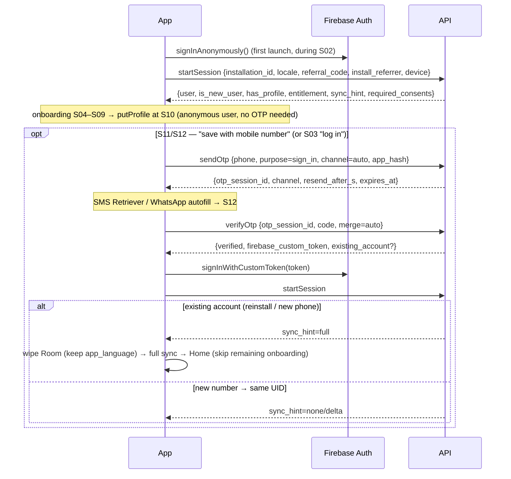

# Data layer

Contract: `docs/api/openapi.yaml` (v1) + `docs/api/README.md`. Every repository call below maps to an `operationId` (§8).

## 1. Shape

```mermaid
flowchart LR
  subgraph UI[":feature:* (Compose + ViewModel)"]
    VM[ViewModel]
  end
  subgraph DATA[":core:data"]
    R[Repositories<br/>(interfaces + impl)]
    SE[SyncEngine]
    AQ[ActionQueue / Outbox]
    DS[(DataStore<br/>app prefs)]
    W[Workers:<br/>SyncWorker, ActionFlushWorker,<br/>OutboxWorker, NoticePrefetchWorker,<br/>DeviceUpsertWorker, SelfTestWorker,<br/>ReminderMirrorWorker, CleanupWorker]
  end
  subgraph DB[":core:database (Room)"]
    T[(matches, match_detail, notices,<br/>applications, lifecycle_events, inbox,<br/>profile, profile_draft, ref_items,<br/>entitlement, notif_prefs, pending_actions,<br/>outbox, local_reminders, notif_ledger,<br/>sync_state, clashes)]
  end
  subgraph NET[":core:network"]
    API[SmApi (Retrofit)]
    IC[Interceptors: auth, App Check,<br/>headers, problem+json]
  end
  FB[(Firebase Auth / App Check /<br/>Installations / FCM)]
  VM -->|observe Flow| R
  VM -->|commands| R
  R -->|read Flow| T
  R -->|write optimistic| T
  R --> AQ --> W
  SE --> API
  W --> API
  API --> IC --> FB
  SE -->|upsert in tx| T
```

Rules:

1. **Room is the single source of truth** for everything a screen shows offline: matches, match detail, notices, applications + timeline, inbox, profile, reference taxonomy, entitlement, notification prefs. UI only ever observes Room `Flow`s.
2. **Network writes into Room; it never returns data straight to UI**, except for genuinely online-only, non-cached calls (eligibility preview S10, exports, WhatsApp opt-in, family, referral, products, self-test) which return `Result<T>` to the VM.
3. **User actions are optimistic + queued** (Applied / Not interested / Snooze / Seen / Undo) and survive process death, reboot and days offline.
4. Repositories expose **domain models** from `:core:model`, never DTOs or entities.
5. Dispatchers are injected (`@IoDispatcher`) — no `Dispatchers.IO` literals, so tests can use `StandardTestDispatcher`.

## 2. Network module (`:core:network`)

- **Retrofit 3 + OkHttp 5 + kotlinx.serialization** (`Json { ignoreUnknownKeys = true; coerceInputValues = true; explicitNulls = false }`). Retrofit over Ktor: smaller dependency surface on Android, OkHttp is already pulled by Firebase/Play, mature interceptors/`Authenticator`, and the API is plain REST.
- DTOs hand-written (≈40 classes) in `com.sarkarimatch.core.network.dto`, mirroring OpenAPI schemas 1:1. A CI job diffs DTO field names against `openapi.yaml` (testing-ci.md) — cheaper than wiring a generator into the build.
- Unknown enum values: every enum DTO has an `@SerialName`'d fallback via a custom serializer (`MatchStatus.unknown → seen`, push `type` unknown → `sync`), per API README.

```kotlin
interface SmApi {
    @GET("v1/config") suspend fun getAppConfig(@Header("If-None-Match") etag: String?): Response<AppConfigDto>
    @POST("v1/session") suspend fun startSession(@Header("Idempotency-Key") key: String, @Body body: SessionRequestDto): SessionResponseDto
    @GET("v1/reference") suspend fun getReferenceBundle(@Header("If-None-Match") etag: String?): Response<ReferenceBundleDto>
    @GET("v1/me/profile") suspend fun getProfile(): Response<ProfileDto>
    @PUT("v1/me/profile") suspend fun putProfile(@Header("Idempotency-Key") key: String, @Header("If-Match") etag: String?, @Body p: ProfileInputDto): Response<ProfileSaveResultDto>
    @POST("v1/eligibility/check") suspend fun checkEligibilityPreview(@Header("Idempotency-Key") key: String, @Body p: ProfileInputDto): EligibilityPreviewDto
    @GET("v1/me/sync") suspend fun sync(@Query("since") since: String?, @Query("page_token") page: String?, @Query("limit") limit: Int = 100): SyncResponseDto
    @GET("v1/me/matches") suspend fun listMatches(@Query("status") status: String, @Query("cursor") cursor: String?, @Query("limit") limit: Int = 20): PageDto<MatchSummaryDto>
    @GET("v1/me/matches/{id}") suspend fun getMatch(@Path("id") id: String, @Header("If-None-Match") etag: String?): Response<MatchDetailDto>
    @POST("v1/me/actions:batch") suspend fun actOnMatchesBatch(@Header("Idempotency-Key") key: String, @Body body: ActionBatchDto): ActionBatchResultDto
    @POST("v1/me/matches/{id}/reports") suspend fun reportMatch(@Path("id") id: String, @Header("Idempotency-Key") key: String, @Body b: MatchReportInputDto): MatchReportDto
    @GET("v1/notices/{id}") suspend fun getNotice(@Path("id") id: String, @Header("If-None-Match") etag: String?): Response<NoticeDto>
    @GET("v1/me/posts/{id}/eligibility") suspend fun getMyEligibilityForPost(@Path("id") postId: String): EvaluationDto
    @GET("v1/me/applications/{id}") suspend fun getApplication(@Path("id") id: String): ApplicationDetailDto
    @PATCH("v1/me/applications/{id}") suspend fun updateApplication(@Path("id") id: String, @Header("Idempotency-Key") key: String, @Body b: ApplicationUpdateDto): ApplicationDetailDto
    // … one function per operationId in §8
}
```

Interceptor chain (order matters):

| # | Interceptor | Does |
| --- | --- | --- |
| 1 | `HeadersInterceptor` | `X-App-Version`, `X-Installation-Id` (Firebase Installations, cached), `Accept-Language` (current app locale) |
| 2 | `AppCheckInterceptor` | `X-Firebase-AppCheck` from `FirebaseAppCheck.getAppCheckToken(false)` (SDK caches; Play Integrity provider in release, debug provider in debug) |
| 3 | `AuthInterceptor` | `Authorization: Bearer` from `FirebaseUser.getIdToken(false)` (SDK caches ~1 h) for `/v1/me/**`, `/v1/session`, `/v1/eligibility/check` |
| — | `TokenAuthenticator` (OkHttp `Authenticator`) | on `401 token_expired`: `getIdToken(true)` **once**, retry; second 401 → `SessionEvents.signedOut` |
| 4 | `UpgradeRequiredInterceptor` | `426` → `AppEvents.forceUpdate` (→ S41) |
| 5 | `OutageInterceptor` | counts consecutive 5xx; 3 in a row → `OutageDetector` asks `getHealth` → `down` = S42 (no cache) / O03 banner; `alerts_delayed` = O03 variant |
| 6 | `HttpLoggingInterceptor` | debug builds only, `BASIC` |

Timeouts tuned for 2G/3G: connect 15 s, read 30 s, call 45 s; OkHttp `Cache` 5 MB only for `config`/`reference`/`notices` responses (also persisted in Room). `Problem` bodies parse into `ApiException(code, status, message: LocalizedText?, retryable, errors[])`; callers branch on `code`.

```kotlin
sealed interface ApiResult<out T> {
    data class Ok<T>(val value: T) : ApiResult<T>
    data object NotModified : ApiResult<Nothing>
    data class Problem(val code: String, val status: Int, val message: LocalizedText?, val retryable: Boolean,
                       val fieldErrors: List<FieldError> = emptyList()) : ApiResult<Nothing>
    data class NetworkError(val cause: IOException) : ApiResult<Nothing>  // offline, timeout
}
```

## 3. Room (`:core:database`)

One database `sm.db`, `exportSchema = true` (schemas committed under `core/database/schemas/`), `AutoMigration`s where possible, hand-written `Migration`s otherwise, **no destructive fallback** (it would delete the pending action queue). Rich nested content that is only ever displayed (why-rules, what-you-need, notice body, timeline links) is stored as JSON text columns via a `TypeConverter` — the app never queries inside it, and it avoids ~15 extra tables.

```kotlin
@Entity(tableName = "matches", indices = [Index("effective_status"), Index("last_date"), Index("notice_id")])
data class MatchEntity(
    @PrimaryKey val id: String,
    @ColumnInfo(name = "post_id") val postId: String,
    @ColumnInfo(name = "notice_id") val noticeId: String,
    @ColumnInfo(name = "notice_etag") val noticeEtag: String?,
    val verdict: String,                          // eligible | check_yourself
    @ColumnInfo(name = "server_status") val serverStatus: String,
    @ColumnInfo(name = "local_status") val localStatus: String?,   // set by optimistic actions, cleared when server confirms
    @ColumnInfo(name = "effective_status") val effectiveStatus: String, // = localStatus ?: serverStatus (kept in sync by DAO)
    @ColumnInfo(name = "title_hi") val titleHi: String,
    @ColumnInfo(name = "title_en") val titleEn: String,
    @ColumnInfo(name = "org_hi") val orgHi: String,
    @ColumnInfo(name = "org_en") val orgEn: String,
    @ColumnInfo(name = "exam_type") val examType: String?,
    @ColumnInfo(name = "vacancies_total") val vacanciesTotal: Int?,
    @ColumnInfo(name = "vacancies_for_category") val vacanciesForCategory: Int?,
    @ColumnInfo(name = "last_date") val lastDate: LocalDate,      // IST calendar date, never via UTC
    @ColumnInfo(name = "last_date_time") val lastDateTime: String?,
    @ColumnInfo(name = "fee_paise") val feePaise: Long?,          // null = n/a, 0 = explicitly free
    val priority: String,
    val badges: List<String>,
    @ColumnInfo(name = "snoozed_until") val snoozedUntil: Instant?,
    @ColumnInfo(name = "next_reminder_at") val nextReminderAt: Instant?,
    @ColumnInfo(name = "headline_hi") val headlineHi: String?,
    @ColumnInfo(name = "headline_en") val headlineEn: String?,
    @ColumnInfo(name = "matched_at") val matchedAt: Instant,
    @ColumnInfo(name = "updated_at") val updatedAt: Instant,
    @ColumnInfo(name = "application_id") val applicationId: String?,
)

@Entity(tableName = "match_detail")
data class MatchDetailEntity(
    @PrimaryKey @ColumnInfo(name = "match_id") val matchId: String,
    val etag: String?,
    @ColumnInfo(name = "why_json") val whyJson: String,               // List<RuleExplanation>
    @ColumnInfo(name = "what_you_need_json") val whatYouNeedJson: String,
    @ColumnInfo(name = "reminder_plan_json") val reminderPlanJson: String?,
    @ColumnInfo(name = "corrigenda_json") val corrigendaJson: String?,
    @ColumnInfo(name = "rule_version") val ruleVersion: Int?,
    @ColumnInfo(name = "fetched_at") val fetchedAt: Instant,
)

@Entity(tableName = "notices")
data class NoticeEntity(@PrimaryKey val id: String, val etag: String, val version: Int,
                        @ColumnInfo(name = "body_json") val bodyJson: String, @ColumnInfo(name = "fetched_at") val fetchedAt: Instant)

@Entity(tableName = "applications", indices = [Index("match_id")])
data class ApplicationEntity(
    @PrimaryKey val id: String, @ColumnInfo(name = "match_id") val matchId: String,
    @ColumnInfo(name = "notice_id") val noticeId: String, @ColumnInfo(name = "post_id") val postId: String,
    @ColumnInfo(name = "title_hi") val titleHi: String, @ColumnInfo(name = "title_en") val titleEn: String,
    @ColumnInfo(name = "applied_at") val appliedAt: Instant, val tracking: String,
    @ColumnInfo(name = "current_stage") val currentStage: String?,
    @ColumnInfo(name = "next_event_json") val nextEventJson: String?,
    @ColumnInfo(name = "alerts_locked") val alertsLocked: Boolean,
    @ColumnInfo(name = "timeline_json") val timelineJson: String?,   // from getApplication, null until fetched
    @ColumnInfo(name = "updated_at") val updatedAt: Instant,
)

@Entity(tableName = "pending_actions", indices = [Index("match_id")])
data class PendingActionEntity(
    @PrimaryKey @ColumnInfo(name = "action_id") val actionId: String,   // UUID, server dedup key
    @ColumnInfo(name = "match_id") val matchId: String,
    val type: String,                                                    // seen|applied|not_interested|snooze|undo
    @ColumnInfo(name = "occurred_at") val occurredAt: Instant,
    val source: String,                                                  // notification_action|match_detail|feed|whatsapp
    @ColumnInfo(name = "snooze_option") val snoozeOption: String?,
    @ColumnInfo(name = "reason") val notInterestedReason: String?,
    @ColumnInfo(name = "batch_key") val batchKey: String?,               // Idempotency-Key of the batch it was sent in
    val attempts: Int = 0,
)

/** Generic idempotent write queue for everything that is not a match action. */
@Entity(tableName = "outbox")
data class OutboxEntity(
    @PrimaryKey val id: String,                         // also the Idempotency-Key
    val op: String,                                     // putNotificationPrefs | postDeliveryReceipts | recordConsent | updateApplication | reportMatch | upsertDevice
    @ColumnInfo(name = "payload_json") val payloadJson: String,
    @ColumnInfo(name = "coalesce_key") val coalesceKey: String?,   // e.g. "prefs" → only the latest is kept
    @ColumnInfo(name = "created_at") val createdAt: Instant,
    val attempts: Int = 0,
)

@Entity(tableName = "profile")       // single row id=1; also profile_draft (single row) for onboarding/edit
data class ProfileEntity(@PrimaryKey val id: Int = 1, val etag: String?, val version: Int,
                         @ColumnInfo(name = "json") val json: String, val completeness: Float,
                         @ColumnInfo(name = "missing_optional") val missingOptional: List<String>)

@Entity(tableName = "ref_items", primaryKeys = ["kind", "code"], indices = [Index("kind", "sort")])
data class RefItemEntity(val kind: String /* qualification|category|state|exam_type|pwd_type|extra_attribute|organization */,
                         val code: String, val parent: String?, val level: Int?, val selectable: Boolean,
                         @ColumnInfo(name = "name_hi") val nameHi: String, @ColumnInfo(name = "name_en") val nameEn: String,
                         val aliases: String?, val sort: Int)

// Also: InboxEntity, EntitlementEntity (single row), NotificationPrefsEntity (single row), ClashEntity,
// LocalReminderEntity, NotificationLedgerEntity(msg_id, shown_at, source, match_id, kind, ist_date),
// SyncStateEntity(scope PK, token, last_success_at, last_error), SelfTestEntity(test_id, status, received_at).
```

```kotlin
@Dao
interface MatchDao {
    /** Home feed: open matches (new/seen/reminded/snoozed), last date today or later (IST), ordered for sections. */
    @Query("""
        SELECT * FROM matches
        WHERE effective_status IN ('new','seen','reminded','snoozed') AND last_date >= :todayIst
        ORDER BY last_date ASC, matched_at DESC
    """)
    fun observeOpen(todayIst: LocalDate): Flow<List<MatchEntity>>

    @Query("SELECT COUNT(*) FROM matches WHERE effective_status IN ('new','reminded') AND last_date >= :todayIst")
    fun observeNeedsReplyCount(todayIst: LocalDate): Flow<Int>                  // tab badge

    @Query("SELECT * FROM matches WHERE id = :id")
    fun observe(id: String): Flow<MatchEntity?>

    @Upsert suspend fun upsertAll(rows: List<MatchEntity>)
    @Query("DELETE FROM matches WHERE id IN (:ids)") suspend fun delete(ids: List<String>)

    /** Optimistic local action; effective_status recomputed in the same statement. */
    @Query("UPDATE matches SET local_status = :status, effective_status = :status, snoozed_until = :snoozedUntil WHERE id = :id")
    suspend fun setLocalStatus(id: String, status: String, snoozedUntil: Instant?)

    @Query("UPDATE matches SET local_status = NULL, effective_status = server_status WHERE id = :id")
    suspend fun clearLocalStatus(id: String)
}

@Dao
interface PendingActionDao {
    @Insert suspend fun insert(a: PendingActionEntity)
    @Query("SELECT * FROM pending_actions ORDER BY occurred_at ASC LIMIT 50") suspend fun nextBatch(): List<PendingActionEntity>
    @Query("SELECT * FROM pending_actions WHERE match_id = :matchId ORDER BY occurred_at DESC LIMIT 1") suspend fun latestFor(matchId: String): PendingActionEntity?
    @Query("DELETE FROM pending_actions WHERE action_id IN (:ids)") suspend fun delete(ids: List<String>)
    @Query("UPDATE pending_actions SET batch_key = :key WHERE action_id IN (:ids)") suspend fun assignBatch(ids: List<String>, key: String)
}
```

Volumes: launch coverage is 20–40 notices/month, so an active user has tens of open matches and a few hundred rows total. **No Paging library**: lists are plain `Flow<List<…>>` into `LazyColumn` with `key = id`; inbox is capped at 90 days / 300 rows by `CleanupWorker`. (S25 archive uses `listMatches` online pages with a "और देखें" button, since not-interested/expired rows may be tombstoned out of sync.)

## 4. DataStore (`:core:data`)

One Preferences DataStore `app_prefs` (not encrypted — nothing secret):

| Key | Type | Use |
| --- | --- | --- |
| `app_language` | `hi`/`en` | mirrors `AppCompatDelegate` locale for workers/notifications (which run without an Activity) |
| `theme` | system/light/dark | S26 theme row |
| `onboarding_step` | string | S01 resume |
| `pending_deep_link` + `_at` | string, long | replay after onboarding |
| `pending_paywall_hint` | json | B02/B08 after a push-action Applied |
| `paywall_moment_last_shown` | instant | B02 max once / 7 days |
| `device_fingerprint_hash` | string | decide whether to call `upsertDevice` |
| `last_push_received_at`, `last_self_test_id` | | S29 |
| `notif_primer_denials` | int | S13 → D01 logic |
| `config_etag`, `reference_version` | string | revalidation |
| `exact_alarm_backup` | bool | S28/S14 |

Sensitive tokens are **not** stored by us: Firebase Auth persists its own refresh token in app-private storage. We therefore do not need `EncryptedSharedPreferences` (and `androidx.security:security-crypto`'s `EncryptedSharedPreferences` is deprecated anyway).

## 5. Offline action queue

```kotlin
interface MatchActionRepository {
    /** Optimistic: updates Room, cancels local reminders, enqueues flush. Returns immediately (< 50 ms). */
    suspend fun record(matchId: String, action: UserAction, source: ActionSource): RecordedAction
    suspend fun undo(recorded: RecordedAction)
    /** Called by ActionFlushWorker. */
    suspend fun flush(): FlushOutcome
}

sealed interface UserAction {
    data object Seen : UserAction
    data class Applied(val feePaid: Boolean? = null) : UserAction        // → MatchActionInput.fee_paid (B01 checkbox)
    data class NotInterested(val reason: NotInterestedReason?) : UserAction
    data class Snooze(val option: SnoozeOption) : UserAction             // Tomorrow | TwoDaysBeforeLastDate | TodayEvening
}
```

Flow (also used by notification action buttons, notifications.md §4):

1. `record()` in one Room transaction: insert `PendingActionEntity(actionId = UUID, occurredAt = now)`, `setLocalStatus`, cancel `local_reminders` for the match (Applied / Not interested) or move them (Snooze).
2. `enqueueUniqueWork("flush-actions", ExistingWorkPolicy.APPEND_OR_REPLACE, ActionFlushWorker)` — expedited, `NetworkType.CONNECTED`, exponential backoff 30 s.
3. Worker: `nextBatch()` (≤ 50, ordered by `occurred_at`) → assign/persist a batch `Idempotency-Key` → `actOnMatchesBatch`.
4. Per result: `ok` → delete pending row; upsert `result.match` (sets `server_status`) and `clearLocalStatus` **only if no newer pending action exists for that match**; upsert `result.application`; write `result.entitlement`; stash `result.paywall` in DataStore. `ok=false` & non-retryable → delete row, `clearLocalStatus` (UI reverts, snackbar "बदलाव नहीं हो पाया" next time the screen is open). Retryable → keep.
5. **Seen** actions are coalesced: at most one per match per day, and dropped if a stronger action for the same match is pending.

Conflict resolution is server-defined: actions apply in `occurred_at` order, stale ones return `applied=false` + authoritative match, which we accept. Example: user taps *रुचि नहीं* offline on phone A on Monday, *भर दिया* on phone B on Tuesday → server keeps Applied; phone A's flush returns `applied=false` and the authoritative `applied` match overwrites A's local row.

Undo (B03 snackbar, 6 s): if the action is still pending → delete it and `clearLocalStatus`; else `record(Undo)` → server reverts.

**Other writes** (prefs, consent, receipts, device, application progress, reports) go through the generic `outbox` (`OutboxWorker`, same constraints), with `coalesce_key` so e.g. five quick quiet-hour edits send one `putNotificationPrefs`. `putProfile` is **not** queued: it is synchronous with a visible saving state (S10/S27) because the user needs the re-match result; offline → "इंटरनेट आने पर सेव होगा" and the draft stays in `profile_draft` with a one-shot `ProfileSaveWorker`.

## 6. Sync strategy

```kotlin
class SyncEngine @Inject constructor(
    private val api: SmApi, private val db: SmDatabase, private val syncState: SyncStateDao,
    private val actions: MatchActionRepository, private val reminders: ReminderMirror,
) {
    suspend fun sync(reason: SyncReason): SyncOutcome {
        actions.flush()                                   // 1. push local intent first
        var since = syncState.token("me")                 // null → full snapshot
        var page: String? = null
        try {
            do {
                val r = api.sync(since = since, page = page)
                db.withTransaction { applyPage(r) }       // 2. each page committed atomically (memory-light)
                page = r.pageToken
                if (!r.hasMore) syncState.save("me", r.nextSyncToken, r.serverTime)   // 3. token only after last page
            } while (r.hasMore)
        } catch (e: ApiException) {
            if (e.code == "sync_token_expired") {         // 410
                db.withTransaction { clearTables(e.details.reset) ; syncState.clear("me") }
                return sync(reason)                       // full resync (guarded against loops)
            } else throw e
        }
        reminders.rebuild()                               // 4. local reminder mirror from next_reminder_at
        enqueueNoticePrefetch()                           // 5. stale notices/details for open matches
        return SyncOutcome.Ok
    }

    private suspend fun applyPage(r: SyncResponseDto) {
        r.changes.matches?.let { rows -> matchDao.upsertServerRows(rows.map { it.toEntity() }) } // keeps local_status if a pending action exists
        r.changes.applications?.let { applicationDao.upsertAll(it.map(::toEntity)) }
        r.changes.inbox?.let { inboxDao.upsertAll(it.map(::toEntity)) }
        r.changes.entitlement?.let { entitlementDao.put(it.toEntity()) }
        r.changes.notificationPrefs?.let { prefsDao.put(it.toEntity()) }
        r.changes.profileVersion?.let { if (it > profileDao.version()) enqueueProfileRefresh() }
        r.removed.matches?.let { matchDao.delete(it) }
        r.removed.applications?.let { applicationDao.delete(it) }
        r.removed.inbox?.let { inboxDao.delete(it) }
        r.changes.notices?.forEach { noticeDao.markStale(it.id, it.etag) }
    }
}
```

Triggers (debounced through one unique work name `sync`, `ExistingWorkPolicy.KEEP` so bursts collapse):

| Trigger | How |
| --- | --- |
| App start / resume | `ProcessLifecycleOwner` ON_START, debounced 5 min |
| Pull-to-refresh (S20, S22) | expedited one-time work; UI shows `refreshing` until the work finishes |
| FCM `sync=1` or `type=sync` | enqueue from `PushHandler` |
| After `putProfile`, purchase verification, account link | direct call |
| Periodic | `PeriodicWorkRequest` 12 h, `NetworkType.CONNECTED`, `requiresBatteryNotLow` — also re-arms reminders (heartbeat for OEM-killed apps) |

Network-light details for slow networks: gzip (OkHttp default), `limit=100` per page, notice bodies fetched **only** for open matches and only when `notice_etag` changed, `If-None-Match` on `getMatch`, `getNotice`, `getAppConfig`, `getReferenceBundle`. Match details are prefetched for at most 20 newest open matches per sync, so tapping a push opens S21 fully offline.

Cache invalidation:

| Data | Invalidated by |
| --- | --- |
| Notice body | `notice_etag` on match ≠ cached `etag`, or `changes.notices[]` |
| Match detail | `getMatch` ETag; matches `updated_at` newer than `fetched_at` |
| Reference taxonomy | `AppConfig.reference_version` ≠ cached version (checked at start), else daily `If-None-Match` |
| Config | ETag, at most every 6 h + every cold start |
| Expired matches | `CleanupWorker` daily: delete matches with `last_date < today − 30 d` and status not applied; delete orphan notices/details |
| Everything | logout, delete account, `sync_hint=full` from `startSession`, 410 reset |

## 7. Auth & session

Backend choice (API README §3): **Firebase Auth, anonymous first**; phone is optional and verified with the backend's **own OTP** (WhatsApp-auth template first, DLT SMS fallback), which returns a Firebase **custom token**. Google linking is an extra free recovery option.



- **No token storage of our own.** The Firebase SDK keeps and refreshes the ID token; `AuthInterceptor` asks for it per request (memory-cached by the SDK). The OTP session id lives only in the `OtpViewModel`'s `SavedStateHandle`.
- S12 autofill: SMS Retriever API (`SmsRetriever.getClient(ctx).startSmsRetriever()`, no SMS permission) with our 11-char `app_hash` sent in `sendOtp`; for WhatsApp-delivered codes the user pastes or uses the one-tap autofill if the provider supports it. `OtpField` uses `ContentType.SmsOtpCode` autofill.
- Other OTP purposes reuse S11/S12 with `purpose = whatsapp_link | family_accept | delete_account` (no custom token returned, `verified=true` only).
- **Primary device (B15):** only the primary device gets alert pushes; the newest signed-in device becomes primary. `Device.primary` arrives in `upsertDevice`'s response; if `false`, `MainViewModel` shows B15 and "इसी फ़ोन पर पाएँ" calls `makeDevicePrimary`. A non-primary device keeps syncing but **disables its local reminder mirror** to avoid double reminders.
- **Logout (D02):** `outbox.flushNow()` (best effort, 5 s) → `deleteDevice` → `FirebaseMessaging.deleteToken()` → `FirebaseAuth.signOut()` → wipe Room + DataStore (keep language) → cancel all workers and alarms → `signInAnonymously()` → Onboarding graph. If unsent pending actions remain offline, D02 warns "कुछ बदलाव अभी सेव नहीं हुए".
- **Delete account (D03):** step 2 confirms by OTP (`purpose=delete_account`) when a phone is verified, else typed "हटाएँ" → `deleteAccount` (202, 7-day grace, `cancelDeletion` available from S38) → same local wipe. If `Entitlement.source` is a Play product, show `manage_url` first (Play subscriptions are not cancelled by the API).
- **Multi-device:** the same UID on several phones is supported; actions are server-ordered by `occurred_at`.
- Profile conflict: `putProfile` with `If-Match`; `412 profile_conflict` → `getProfile`, show "दूसरे फ़ोन से प्रोफ़ाइल बदली गई" with the merged draft; user re-confirms.

Privacy at rest: the profile (DOB, category, state) lives in app-private Room storage, protected by Android file-based encryption. We do **not** add SQLCipher (≈ 3–4 MB per ABI and slower on 2 GB phones) — PRD asks for minimal data, no documents/Aadhaar, deletable; we meet that with data minimisation + deletion. `android:allowBackup` uses `data_extraction_rules.xml` that **excludes** Room and Firebase files (restoring another device's anonymous token/DB causes ghost sessions); recovery goes through the linked account.

## 8. Endpoint mapping (repository method → operationId)

| Repository (`:core:data`) | Method | operationId | Cache / queue | Screens |
| --- | --- | --- | --- | --- |
| `ConfigRepository` | `refresh()` / `observe()` | `getAppConfig` | Room+ETag | S01, S41, S42, S39, S15 (oem_guides), flags everywhere |
| `SessionRepository` | `ensureSession()` | `startSession` | — | S01, after link/login |
| `AuthRepository` | `sendOtp(phone, purpose)` | `sendOtp` | — | S11 (+ S33 other number, S35, D03) |
| `AuthRepository` | `verifyOtp(session, code)` → `signInWithCustomToken` | `verifyOtp` (+ Firebase SDK, `startSession`) | — | S12 |
| `AuthRepository` | `linkGoogle()`, `signOut()` | Firebase SDK (+ `startSession`) | — | S38 recovery, D02 |
| `HealthRepository` | `check()` | `getHealth` | memory 30 s | S01, S42, O03 |
| `ReferenceRepository` | `refreshIfStale()`, `observeStates()`, `observeQualificationTree()` … | `getReferenceBundle` | Room+ETag | S04–S09, S27 |
| `ProfileRepository` | `observe()`, `refresh()` | `getProfile` | Room | S26, S27 |
| `ProfileRepository` | `save(draft)` | `putProfile` | sync call; offline → `ProfileSaveWorker` | S10, S27, S36 |
| `ProfileRepository` | `preview(draft)` | `checkEligibilityPreview` | none | S10 (fallback when save fails), S46 |
| `SyncEngine` | `sync()` | `sync` | Room | all |
| `MatchRepository` | `observeFeed()`, `observeMatch(id)`, `observeNeedsReplyCount()` | (Room, filled by `sync`) | Room | S20, S21, S44, badge |
| `MatchRepository` | `refreshDetail(id)` | `getMatch` | Room+ETag | S21 |
| `MatchRepository` | `loadArchive(tab, cursor)` | `listMatches` (status=`not_interested` / `expired` / `withdrawn`) | memory | S25 |
| `MatchActionRepository` | `record()`, `undo()`, `flush()` | `actOnMatchesBatch` (single-action `actOnMatch` used only by `undo()` when online for instant feedback) | `pending_actions` | S20, S21, B01–B04, B06, notification actions |
| `MatchRepository` | `report(id, reason, note)` | `reportMatch` | outbox | B05 |
| `NoticeRepository` | `observe(noticeId)`, `refresh(noticeId)` | `getNotice` | Room+ETag | S21, B07, S23 links |
| `NoticeRepository` | `evaluate(postId)` | `getMyEligibilityForPost` | memory | S21 fallback for post-id links |
| `ApplicationRepository` | `observeAll()` | (Room via `sync`); `listApplications` for first page if sync not yet done | Room | S22 |
| `ApplicationRepository` | `refreshTimeline(id)`, `observeTimeline(id)` | `getApplication` | Room | S23 |
| `ApplicationRepository` | `reportProgress()`, `stopTracking()` | `updateApplication` | outbox | S23 |
| `ClashRepository` | `refresh()`, `observe(id)` | `listClashes` | Room | S22 banner, S37 |
| `NotificationRepository` | `observePrefs()`, `updatePrefs()` | `getNotificationPrefs`, `putNotificationPrefs` | Room + outbox(coalesced) | S28, B13, `DeliveryGate` |
| `NotificationRepository` | `observeInbox()`, `loadMore()` | `listInbox` (+ `sync.changes.inbox`) | Room | S24, S44 |
| `ReceiptQueue` | `add()`, `flush()` | `postDeliveryReceipts` | outbox (expedited) | push pipeline |
| `DeviceRepository` | `upsertIfChanged()` | `upsertDevice` | outbox(coalesced) | S01, S13, S15, token refresh |
| `DeviceRepository` | `unregister()` | `deleteDevice` | direct | D02 |
| `DeviceRepository` | `makePrimary()` | `makeDevicePrimary` | direct | B15 |
| `DeviceRepository` | `startSelfTest()`, `observeSelfTest(id)` | `startSelfTest`, `getSelfTest` | Room `self_tests` | S16, S29 |
| `EntitlementRepository` | `observe()`, `refresh()` | `getEntitlement` (+ `sync`, `startSession`, action results) | Room | everywhere (Pro gating) |
| `EntitlementRepository` | `products()` | `listProducts` | memory 1 h | S30, B02 |
| `EntitlementRepository` | `startTrial()` | `startTrial` | direct | B02 (only if auto-trial didn't happen) |
| `EntitlementRepository` | `verifyPlayPurchase()` | `verifyPlayPurchase` | outbox-like retry (`PurchaseVerifyWorker`) | S30 → S31, app start |
| `EntitlementRepository` | `createUpiLink(productId)` | `createUpiPaymentLink` | direct | B11 |
| `ReferralRepository` | `get()`, `redeem(code)` | `getReferral`, `redeemReferral` | memory | S45, onboarding (install referrer) |
| `WhatsAppRepository` | `status()`, `startOptIn(useVerifiedPhone)`, `optOut()`, `sendTest()` | `getWhatsApp`, `startWhatsAppOptIn`, `optOutWhatsApp`, `sendWhatsAppTest` | memory | S33, D05, S29 |
| `FamilyRepository` | `list()`, `invite()`, `remove()` | `listFamily`, `inviteFamily`, `removeFamily` | memory | S34, B12, D06 |
| `FamilyRepository` | `invite(token)`, `accept(token, channels)`, `decline(token)` | `getFamilyInvite`, `acceptFamilyInvite`, `declineFamilyInvite` | memory | S35 |
| `AccountRepository` | `me()` | `getMe` | memory | S38 |
| `AccountRepository` | `delete()`, `cancelDeletion()` | `deleteAccount`, `cancelDeletion` | direct | D03, S38 |
| `AccountRepository` | `requestExport()`, `pollExport(id)` | `requestExport`, `getExport` | direct | S38, D04 |
| `ConsentRepository` | `list()`, `record()` | `listConsents`, `recordConsent` | outbox | S11 checkbox, S33, S38, analytics opt-in, `required_consents` after `startSession` |
| `AdsGate` | `shouldShow(placement)` | `getAppConfig` (`ads`) + `getEntitlement`/`sync` (`ads_enabled`) | Room | S20, S44 (O10) |
| — | — | `listNotices` | **not used in v1 app** (no browse screen in the inventory) | — |

Unused operation: `listNotices` (browse all notices). Every repository call above maps to an operation; remaining mismatches are listed in README *Contract gaps*.
