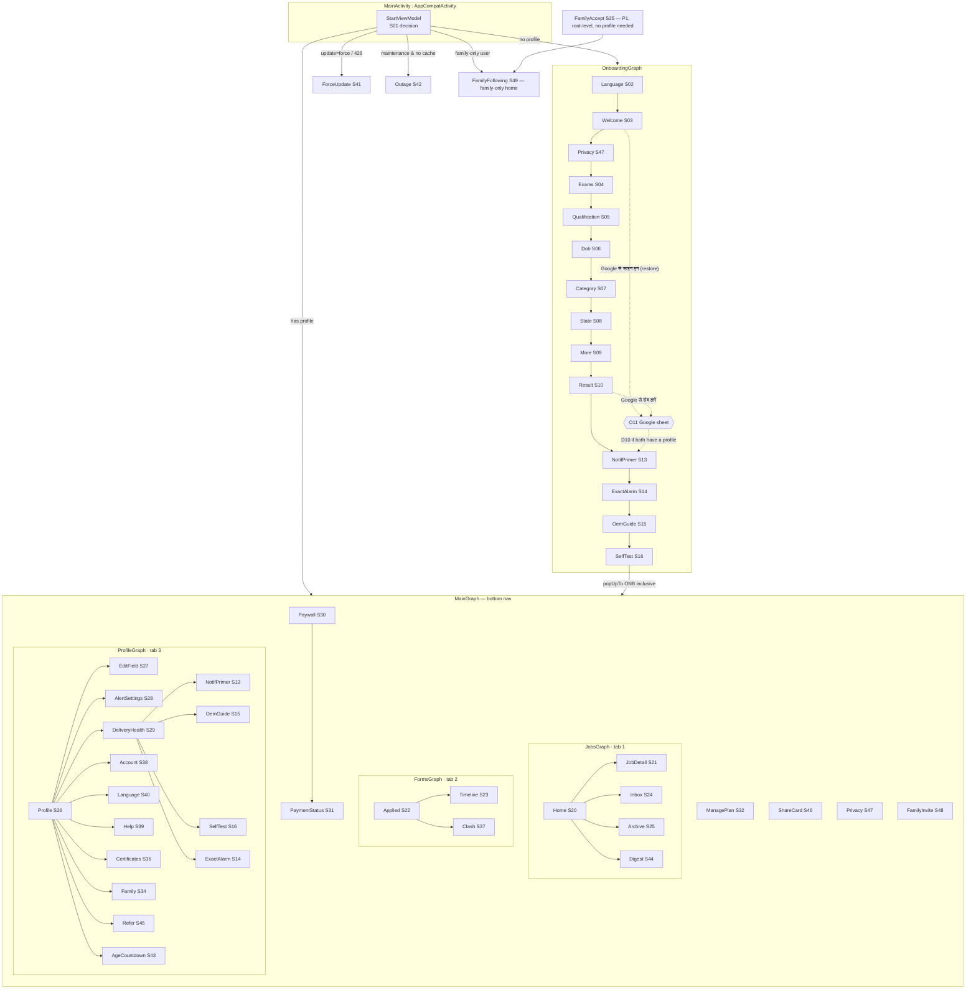

# Navigation

Library: **Navigation Compose 2.10.2** with type-safe `@Serializable` routes (kotlinx.serialization), nested graphs, multiple back stacks for the 3 bottom tabs, built-in deep links.

> Why not Navigation 3 (stable 1.2.x)? It is a good fit for adaptive/multi-pane apps where you own the back stack as a list. We need the opposite: phone-only, **deep links with synthesised back stacks**, nested graphs and per-tab back stacks, which Nav 2 gives us for free. Routes are plain `@Serializable` classes, so a later move to Nav 3 only rewrites `:app`'s `SmNavHost`.

Source of screen IDs: `docs/design/01-screen-inventory.md` (IDs are never renumbered; we use them in code comments, analytics `screen_id` and test tags).

## 1. Principles

1. **Features don't know about each other.** Each `:feature:*` module exposes its route classes and a `NavGraphBuilder.xxxGraph(...)` extension that takes **navigation callbacks** (`onOpenJob: (matchId) -> Unit`, `onOpenPaywall: (PaywallSource) -> Unit`). Only `:app` wires callbacks to `navController.navigate(...)`. No feature depends on another feature.
2. **ViewModels never hold a `NavController`.** A VM emits a one-off `Effect.Navigate…` (Channel → `receiveAsFlow()`, collected with `Dispatchers.Main.immediate` in a `LaunchedEffect`, per the Compose guideline "event-based navigation"); the screen calls the callback.
3. **Route args are IDs only** (never objects). The destination VM reads them with `savedStateHandle.toRoute<JobDetail>()` and loads from Room, so process death restores for free.
4. **Bottom sheets (Bxx) and dialogs (Dxx) are not destinations** (per inventory), except where noted. Their visibility is VM state (`sheet: SheetState?` in the UiState, persisted in `SavedStateHandle` so a sheet survives rotation/process death).
5. **No Splash route.** S01 is `installSplashScreen()` + `StartViewModel` choosing the start graph before the first frame (`setKeepOnScreenCondition { start == null }`, bounded by a 1.5 s timeout that falls back to cached state).

## 2. Graph structure



- The three tab graphs use the standard multiple-back-stack pattern: `navigate(tabRoute) { popUpTo(graph.findStartDestination().id) { saveState = true }; launchSingleTop = true; restoreState = true }`.
- Bottom bar visibility: shown only when the current destination is `Home`, `Applied` or `Profile` (inventory). Computed from `currentBackStackEntry.destination.hasRoute<…>()`.
- Pro screens (S30–S32), S46, S47 (settings variant) and S48 sit directly in `MainGraph` (not in a tab) so they can be pushed from any tab; a deep link to them synthesises `Home` underneath (MainGraph's start = JobsGraph).
- S13/S15/S16 are **shared** between onboarding and S29. They live in `:feature:alerts` and are registered twice (once in each graph) with a `mode: SetupMode = ONBOARDING | SETTINGS` argument, which changes only the CTA ("आगे बढ़ें" vs "हो गया" + pop).
- S27 reuses the S04–S09 step bodies, so **S27 (and B10) live in `:feature:onboarding`**, which owns the whole profile form (create and edit). `:feature:profile` only emits `onEditField(ProfileField)`; `:app` wires it to `EditProfile(field)`. No feature-to-feature dependency.

## 3. Route table (every inventory screen)

`VM` = `@HiltViewModel` in the same feature module. All UiStates are `@Immutable` (state-management.md). Screens that read user data have the standard `Loading / Content / Empty / Error / Offline` handling; the "States" column lists the screen-specific variants beyond that.

| ID | Route class (args) | URL / deep link | Module | ViewModel | UiState (screen-specific states) | P |
| --- | --- | --- | --- | --- | --- | --- |
| S01 | — (Activity + `StartViewModel`) | — | :app | `StartViewModel` | `StartState { Deciding, Onboarding(resumeStep), Main(pendingDeepLink), ForceUpdate, Outage }` | P0 |
| S02 | `Onb.Language` | — | :feature:onboarding | `LanguageViewModel` | `LanguageUiState(selected: AppLanguage)` | P0 |
| S03 | `Onb.Welcome` | — | onboarding | (stateless) | — | P0 |
| S04 | `Onb.Exams` | — | onboarding | `OnboardingViewModel` (scoped to `OnboardingGraph` back-stack entry, shared by S04–S10) | `OnboardingUiState(step, draft: ProfileDraft, refData: RefState, canContinue, fieldErrors)` | P0 |
| S05 | `Onb.Qualification` | — | onboarding | ↑ shared | ↑ + `qualificationTree` from Room reference cache | P0 |
| S06 | `Onb.Dob` | — | onboarding | ↑ shared | ↑ + `ageToday: AgeLabel?`, `dobError` | P0 |
| S07 | `Onb.Category` | — | onboarding | ↑ shared | ↑ | P0 |
| S08 | `Onb.State` | — | onboarding | ↑ shared | ↑ + `stateQuery`, filtered list | P0 |
| S09 | `Onb.More` | — | onboarding | ↑ shared | ↑ + `showMaritalStatus` (derived from selected exam types) | P0 |
| S10 | `Onb.Result` | — | onboarding | `OnboardingResultViewModel` | `Matching` (local evaluation; skeleton only while the first catalog snapshot downloads) / `Result(count, checkYourself, top3, completeness)` / `CatalogUnavailable(retry)` / `Minor(ageYears)` (no sign-in button) | P0 |
| ~~S11~~, ~~S12~~ | retired 2026-11-19 (no phone/OTP) | — | — | — | Google sign-in = O11 (system sheet) from `AuthRepository.signInWithGoogle(origin)`; conflict = D10 | — |
| S47 | `Privacy(mode: SetupMode)` | `sarkarimatch://privacy` | onboarding (shared, registered in onboarding and profile graphs) | `PrivacyNoticeViewModel` | `PrivacyUiState(version, items, crashReportsOptIn, usageCountersOptIn, isMinor)`; "समझ गया" stores `privacy_notice_ack{version, at}` | P0 |
| S13 | `Setup.NotifPrimer(mode)` | `sarkarimatch://setup/notifications` | :feature:alerts | `NotifPermissionViewModel` | `Granted / CanAsk / PermanentlyDenied(→D01) / ChannelBlocked(ids)` | P0 |
| S14 | `Setup.ExactAlarm(mode)` | — | alerts | `ExactAlarmViewModel` | `CanSchedule(bool)`; on-device backup reminders (R1 + R-last), default on | P0 |
| S15 | `Setup.OemGuide(mode, brand: String? = null)` | — | alerts | `OemGuideViewModel` | `OemGuideUiState(brand, brandConfident, steps: List<OemStep>, batteryOk, doneChecks)` | P0 |
| S16 | `Setup.SelfTest(mode)` | `sarkarimatch://test` | alerts | `SelfTestViewModel` | `Idle / Running(step, elapsedSec) / Passed(latency) / Failed(advice: List<Advice>, backupRemindersOn) / RateLimited` (`startPushTest`) | P0 |
| S20 | `Home` | `sarkarimatch://home` | :feature:jobs | `HomeViewModel` | `HomeUiState(feed: List<FeedItem> incl. O10 ad slot for free tier, banners, refreshing, syncedAt, sheet)` · Empty variants: `NoMatchesYet`, `AllCaughtUp`, `ProfileIncomplete` | P0 |
| S21 | `JobDetail(matchId: String, src: String? = null)` · `SharedPost(postId: String)` | `https://sarkarimatch.in/j/{matchId}`, `sarkarimatch://job/{matchId}`, alias `sarkarimatch://match/{matchId}` · `https://sarkarimatch.in/p/{postId}` | jobs | `JobDetailViewModel` | `Content(JobDetailUi, sheet)` (why-lines evaluated locally) / `ReadOnlyVerdict(local evaluation, not in matches)` / `NeedsUpdate(evaluator)` / `NotFound` / `Loading` only for a `/p/` post missing from the local catalog (`getNotice`) | P0 |
| S22 | `Applied` | `sarkarimatch://forms` | :feature:applications | `AppliedViewModel` | `AppliedUiState(filter: Active/Done, rows, isPro, clashBanner?, guestSaveCard → B16 sync)` | P0 |
| S23 | `Timeline(applicationId: String)` | `https://sarkarimatch.in/a/{applicationId}` | applications | `TimelineViewModel` | `Content(steps, locked: Boolean, nextAction) / NotFound` | P0 |
| S24 | `Inbox` | `sarkarimatch://inbox` | jobs | `InboxViewModel` | `Content(groups by date) / Empty` | P1 |
| S25 | `Archive(tab: ArchiveTab = NotInterested)` | — | jobs | `ArchiveViewModel` | `ArchiveUiState(tab, rows, undoing)` | P1 |
| S26 | `Profile` | `sarkarimatch://profile` | :feature:profile | `ProfileViewModel` | `ProfileUiState(summaryRows, completeness, plan: PlanBadge, account: AccountHeader(Guest / Google(name, email)), followingRow?)` | P0 |
| S27 | `EditProfile(field: ProfileField)` | — | onboarding (form owner) | `EditProfileViewModel` | `Editing(draft, dirty) / Saving (local, < 50 ms) / Saved(rematch → B10)` + D07 on back if dirty | P0 |
| S28 | `AlertSettings` | — | alerts | `AlertSettingsViewModel` | `AlertSettingsUiState(quietHours, reminderTime, digest, backupReminders (default on → S14), channelsBlocked)` + B13 | P0 |
| S29 | `DeliveryHealth` | `sarkarimatch://delivery` | alerts | `DeliveryHealthViewModel` | `DeliveryHealthUiState(checks: List<HealthCheck(kind, status: Ok/Warn/Fail/Unknown)>, lastTest)` | P0 |
| S30 | `Paywall(source: PaywallSource, plan: String? = null)` | `https://sarkarimatch.in/pro?plan=&src=` | :feature:pro | `PaywallViewModel` | see state-management.md §5 | P0 |
| S31 | `PaymentStatus(purchaseRef: String)` | — | pro | `PaymentStatusViewModel` | `Verifying / Success(expiry, guestLinkCta) / Pending (Play PENDING only) / Failed(reason) / Cancelled` | P0 |
| S32 | `ManagePlan` | `sarkarimatch://plan` | pro | `ManagePlanViewModel` | `ManagePlanUiState(entitlement, canUpgrade, restoring)` + D08 (restore by Google/Play account) | P0 |
| ~~S33~~ | retired 2026-11-19 (no WhatsApp) | — | — | — | — | — |
| S34 | `Family` | — | profile (`family` pkg) | `FamilyViewModel` | `Locked / Content(links: relation + nickname, state, max) / Empty` + B12 → S48, D06 | P1 |
| S35 | `FamilyAccept(token: String, key: String)` | `https://sarkarimatch.in/f/{token}#k={key}` (or install referrer) | profile | `FamilyAcceptViewModel` | `Loading / Invite / Accepting / Accepted(→ S13 family variant → S49) / Declined / Expired` | P1 |
| S36 | `Certificates` | `sarkarimatch://certificates` | profile | `CertificatesViewModel` | `Locked / Content(rows with ValidityBadge)` | P1 |
| S37 | `Clash(clashId: String)` | `sarkarimatch://clash/{clashId}` | applications | `ClashViewModel` | `Content(a, b, guidance) / Locked / NotFound` | P1 |
| S38 | `Account` | — | profile | `AccountViewModel` | `AccountUiState(account: Guest / Google(email), isPrimaryAlertDevice, backup: Off / On(updatedAt), deletion: DeletionStatus, localExport)` + D02, D03, D04, D11 | P0 |
| S39 | `Help` | — | profile | `HelpViewModel` | static FAQ + `support` from config | P0 |
| S40 | `LanguageSettings` | — | profile | `LanguageViewModel` (same class as S02) | `LanguageUiState` | P0 |
| S41 | `ForceUpdate` | — | :app | `ForceUpdateViewModel` | `Immediate(inAppUpdateAvailable) / StoreOnly` | P0 |
| S42 | `Outage` | — | :app | `OutageViewModel` | `Outage(message, until, hasCache, alertsDelayed)` from `getHealth` | P0 |
| S43 | `AgeCountdown` | — | profile | `AgeCountdownViewModel` | deferred to P2 (needs attempt rules in the catalog; computed locally) | P2 |
| S44 | `Digest(date: String)` | `sarkarimatch://digest/{date}` | jobs | `DigestViewModel` | `Content(items: List<FeedItem> incl. O10 ad slot) / Empty` | P1 |
| S45 | `Refer` | — | profile | `ReferViewModel` | `Content(code, shareUrl, earned) / RedeemError` | P1 |
| S46 | `ShareCard` | — | profile | `ShareCardViewModel` | `Rendering / Ready(bitmapUri)` | P1 |
| S48 | `FamilyInvite(inviteId: String)` | — | profile (`family`) | `FamilyInviteViewModel` | `Creating / Ready(url with #k, qr) / Linked / Expired` (`inviteFamily`) | P1 |
| S49 | `FamilyFollowing` | `sarkarimatch://family/following` | profile (`family`) | `FamilyFollowingViewModel` | `Content(aspirants: label + relation, next critical date, paused?) / Empty` + D12 (`listFollowing`, `stopFollowing`) | P1 |

### Sheets and dialogs (hosted state)

| ID | Host screen(s) → VM | State field | Calls |
| --- | --- | --- | --- |
| B01 Confirm Applied | S20 `HomeViewModel`, S21 `JobDetailViewModel` | `sheet = Sheet.ConfirmApplied(matchId, feePaid)` | `MatchActionRepository.record(applied)` |
| B02 Paywall moment | S20/S21 (and on app open after push-action Applied) via `PaywallMomentController` in `:feature:pro` | `sheet = Sheet.PaywallMoment(variant)` | decided locally: `trial_offer` while `Entitlement.trial_available` (guests: true) and not minor, else `plans`; first Applied always, then max once / 7 days |
| B03 Not interested | S20, S21 | `Sheet.NotInterested(matchId, reasons: Set)` | `record(not_interested, reasons)` + snackbar undo; `not_eligible` also opens B05 |
| B04 Snooze | S20, S21 | `Sheet.Snooze(options)` | `record(snooze, option)` |
| B05 Report wrong match | S21 | `Sheet.Report(reason, note, sendDetails: Boolean)` | `reportMatch` (anonymous; attributes only if ticked, never in minor mode) |
| B06 Check yourself | S20, S21 | `Sheet.CheckYourself(rule)` | open PDF / `record(confirm_eligible, rule)` / `record(not_interested, [not_eligible])` / S27 via `fix_field` |
| B07 Corrigendum | S20, S21 | `Sheet.Corrigendum(id)` | local (notice cache) |
| B08 Trial started | after B02 | `Sheet.TrialStarted(endsAt, isGuest)` | guest: `GoogleSignInButton` → O11 |
| B09 Trial ending | S20 (app open day 12–14) | `Sheet.TrialEnding(daysLeft, nextStage)` | → S30 |
| B10 Re-match result | S27 `EditProfileViewModel` | `sheet = Rematch(added, removed)` | local `MatchEngine` diff |
| ~~B11~~ | retired (UPI) | | |
| B12 Add family | S34 | `sheet = AddFamily(relation, nickname?)` | `inviteFamily` → S48 |
| B13 Digest time | S28 | `sheet = DigestTime` | local prefs |
| B14 Age crossed | S20 | `Sheet.AgeCrossed` | P1: local N-43 from the reconcile worker; open exams from the local catalog |
| B15 New device | app-level `MainViewModel` | `notPrimary: Boolean` (after N-47) | `makeDevicePrimary` |
| B16 Sign-in offer | S22 (`sync`), S30 (`pro`, guests, once before the Play sheet), S34 (`family`), S26/S38 (`settings`) | `Sheet.SignInOffer(variant)` | O11 → `startSession`; hidden in minor mode |
| B17 Ads notice | O10 "क्यों?", S47 | `Sheet.AdsNotice` | static + `config.ads` |
| D01–D09 (D05 retired) | host VM sets `dialog: DialogState?` | | D03 → local wipe (+ `deleteAccount` when signed in); D04 → local JSON export; D08 → restore result |
| D10 Profile conflict | after O11 when `has_backup` and a local profile exist | `dialog = ProfileConflict(saved, local)` | keep saved → `getBackup`; keep this phone's → `putBackup` |
| D11 Switch account | S38 | `dialog = SwitchAccount` | backup → sign out → O11 (account chooser) |
| D12 Stop family alerts | S49 | `dialog = StopFollowing(linkId)` | `stopFollowing` |
| O11 Google sign-in | system (Credential Manager) | — | `AuthRepository.signInWithGoogle()` |

O10 native ad slot: a `FeedItem.Ad` on S20/S44 only (ads.md), never a destination.

Global overlays: O01 offline / O03 outage / O02 delivery banners come from one `BannerProvider` in `:core:data` (combines `ConnectivityObserver`, `OutageDetector`, `DeliveryHealthRepository`, permission state) and are rendered by `StatusBannerSlot` on S20/S21/S22/S23.

## 4. Route declarations (skeleton)

```kotlin
// :feature:jobs — public API
@Serializable data object JobsGraph
@Serializable data object Home
@Serializable data class JobDetail(val matchId: String, val src: String? = null)
@Serializable data object Inbox
@Serializable data class Archive(val tab: ArchiveTab = ArchiveTab.NotInterested)
@Serializable data class Digest(val date: String)

fun NavGraphBuilder.jobsGraph(
    onOpenJob: (matchId: String) -> Unit,
    onOpenPaywall: (PaywallSource) -> Unit,
    onOpenDeliveryHealth: () -> Unit,
    onEditProfileField: (ProfileField) -> Unit,
    onBack: () -> Unit,
) = navigation<JobsGraph>(startDestination = Home) {
    composable<Home>(deepLinks = listOf(navDeepLink<Home>(basePath = "sarkarimatch://home"))) {
        HomeRoute(onOpenJob = onOpenJob, onOpenPaywall = onOpenPaywall, onOpenDeliveryHealth = onOpenDeliveryHealth)
    }
    composable<JobDetail>(
        deepLinks = listOf(
            navDeepLink<JobDetail>(basePath = "https://sarkarimatch.in/j"),
            navDeepLink<JobDetail>(basePath = "sarkarimatch://job"),
            navDeepLink<JobDetail>(basePath = "sarkarimatch://match"),
        ),
    ) { JobDetailRoute(onBack = onBack, onOpenPaywall = onOpenPaywall, onEditProfileField = onEditProfileField) }
    composable<Inbox> { InboxRoute(onOpenJob = onOpenJob, onBack = onBack) }
    composable<Archive> { ArchiveRoute(onOpenJob = onOpenJob, onBack = onBack) }
    composable<Digest>(deepLinks = listOf(navDeepLink<Digest>(basePath = "sarkarimatch://digest"))) {
        DigestRoute(onOpenJob = onOpenJob, onBack = onBack)
    }
}
```

```kotlin
// :app — SmNavHost.kt
@Composable
fun SmNavHost(start: StartDestination, nav: NavHostController = rememberNavController()) {
    NavHost(nav, startDestination = start.route, enterTransition = { smForward() }, popExitTransition = { smBack() }) {
        onboardingGraph(
            onFinished = { nav.navigate(MainGraph) { popUpTo(OnboardingGraph) { inclusive = true } } },
            onRestoreWithGoogle = { /* AuthRepository.signInWithGoogle(Origin.Welcome) → O11; restore → MainGraph */ },
        )
        navigation<MainGraph>(startDestination = JobsGraph) {
            jobsGraph(
                onOpenJob = { nav.navigate(JobDetail(it)) },
                onOpenPaywall = { nav.navigate(Paywall(it)) },
                onOpenDeliveryHealth = { nav.navigate(DeliveryHealth) },
                onEditProfileField = { nav.navigate(EditProfile(it)) },
                onBack = nav::popBackStack,
            )
            formsGraph(/* … */)
            profileGraph(/* … */)
            proDestinations(/* S30–S32 */)
        }
        composable<ForceUpdate> { ForceUpdateRoute() }
        composable<Outage> { OutageRoute(onRetry = { /* StartViewModel.retry() */ }) }
    }
}
```

Transitions follow tokens `motion.usage`: forward = fade 300 ms + `slideInHorizontally { it / 12 }` emphasizedDecelerate; back = reverse 200 ms emphasizedAccelerate; tab switch = crossfade 150 ms; all 0 ms when animator scale is 0. Predictive back on (`android:enableOnBackInvokedCallback="true"`).

## 5. Deep links

Intent filters in `:app` `AndroidManifest.xml`:

```xml
<activity android:name=".MainActivity" android:launchMode="singleTop" android:exported="true">
  <intent-filter android:autoVerify="true">
    <action android:name="android.intent.action.VIEW"/>
    <category android:name="android.intent.category.DEFAULT"/>
    <category android:name="android.intent.category.BROWSABLE"/>
    <data android:scheme="https" android:host="sarkarimatch.in"
          android:pathPrefix="/j/"/>  <!-- also /p/ /a/ /pro /f/ as separate <data> path entries -->
  </intent-filter>
  <intent-filter>
    <action android:name="android.intent.action.VIEW"/>
    <category android:name="android.intent.category.DEFAULT"/>
    <category android:name="android.intent.category.BROWSABLE"/>
    <data android:scheme="sarkarimatch"/>
  </intent-filter>
</activity>
```

| Link | Route | Synthesised back stack | Source |
| --- | --- | --- | --- |
| `https://sarkarimatch.in/j/{matchId}?src=push\|share` | `JobDetail` | Home → JobDetail | share to self |
| `sarkarimatch://job/{matchId}?src=push&msg=&nid=` | `JobDetail` | Home → JobDetail | push content intent (`PushData.link`) |
| `https://sarkarimatch.in/p/{postId}?src=share` | `SharedPost` → evaluate locally; if a local match exists (`m_` + post suffix), replace with `JobDetail(matchId)`; post not in the local catalog → `getNotice` | Home → JobDetail | job share (S21 share), anything sent to another person |
| `https://sarkarimatch.in/a/{applicationId}` | `Timeline` | Applied → Timeline | lifecycle push |
| `https://sarkarimatch.in/pro?plan=&src=` | `Paywall` | Home → Paywall | trial-ending push |
| `https://sarkarimatch.in/f/{token}#k={key}` (QR on S48 is the same URL; app not installed → install referrer) | `FamilyAccept` | root (works before onboarding; family-only users never onboard) | family invite |
| `sarkarimatch://family/following` | `FamilyFollowing` | root for family-only users, else Profile → S49 | family pushes N-50…N-53 |
| `sarkarimatch://privacy` | `Privacy(SETTINGS)` | Profile → Account → S47 | notice version changed |
| `sarkarimatch://digest/{date}` | `Digest` | Home → Digest | digest push |
| `sarkarimatch://delivery` | `DeliveryHealth` | Profile → DeliveryHealth | weekly self-test failure |
| `sarkarimatch://test` | `Setup.SelfTest(SETTINGS)` | Profile → DeliveryHealth → SelfTest (manual `TaskStackBuilder`) | |
| `sarkarimatch://clash/{clashId}` | `Clash` | Applied → Clash | clash push |
| `sarkarimatch://certificates`, `sarkarimatch://plan` | S36 / S32 | Profile → … | push (`sarkarimatch://whatsapp` retired) |

Rules:

- **Push notifications build their `PendingIntent` with `NavDeepLinkBuilder`-equivalent `TaskStackBuilder`** on the deep-link URI with `FLAG_IMMUTABLE` and a unique request code per `collapse` tag; `MainActivity` is `singleTop`, so `onNewIntent` → `navController.handleDeepLink(intent)`.
- Before onboarding is complete, `StartViewModel` stores the URI (`SavedStateHandle` + DataStore `pending_deep_link`, TTL 24 h), runs onboarding, then replays it after `onFinished`.
- `JobDetail` with an unknown/expired id → `NotFound` state with "नौकरियाँ देखें" (→ Home). `match_id` is derived (`m_` + post suffix), so `/j/` and `/p/` resolve to the same local row when the viewer matches.
- Every deep link carries `src`; with the usage-counter opt-in, `deeplink_open_{src}` is counted (no identifiers). No open receipts are sent.
- `https://sarkarimatch.in/.well-known/assetlinks.json` must list the release + Play App Signing SHA-256 (backend/web task).

## 6. Back-stack rules

| Situation | Behaviour |
| --- | --- |
| Finish onboarding (S16 → S20) | `popUpTo(OnboardingGraph) { inclusive = true }` — Back from Home exits the app |
| Back on S20/S22/S26 | S22/S26 → go to S20 (tab 1) first; Back on S20 exits (standard M3 bottom-nav behaviour) |
| Tab re-select | Pops that tab to its root and scrolls the list to top |
| Paywall → Play → S31 success | `popUpTo<Paywall> { inclusive = true }` so Back from S31 returns to where the paywall was opened |
| S27 save | pop to S26 then show B10 on S26 (result via `savedStateHandle["rematch"]` on previous entry) |
| Delete everything (D03) / restore a different profile (D10 "keep saved") | `navigate(OnboardingGraph or MainGraph) { popUpTo(0) }` after the local wipe / restore; sign-out alone keeps the guest's local data and stays in MainGraph |
| `426 upgrade_required` from any call | `AppEvents.forceUpdate` → `navigate(ForceUpdate) { popUpTo(0) }` |
| Force update screen | Back exits the app |

## 7. Process-death restoration

| What | How |
| --- | --- |
| Back stack, current tab | `rememberNavController()` saves to the Activity's saved state |
| Route args | `SavedStateHandle.toRoute<T>()` in every VM |
| Onboarding draft (S04–S09) | `OnboardingViewModel` writes every change to Room `profile_draft` (single row) — survives process death **and** app kill; S01 resumes at `draft.lastStep` |
| Open sheet, form fields | `SavedStateHandle` keys (`sheet`, `note`) with `@Serializable` sheet state |
| Scroll position | `rememberLazyListState()` (saveable) |
| In-flight purchase | Play redelivers via `queryPurchasesAsync` on next start → `verifyPlayPurchase` (billing.md) |
| In-flight Google sign-in | Credential Manager result is delivered to the `AuthRepository` coroutine; on process death the user simply taps again (no server state was created) |

Test: every screen has a `StateRestorationTester` test, and CI runs one instrumented "don't keep activities" smoke flow (testing-ci.md).
